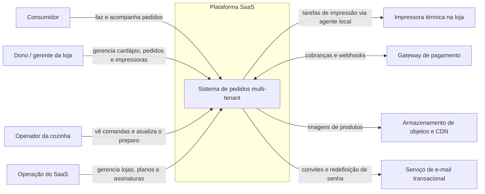
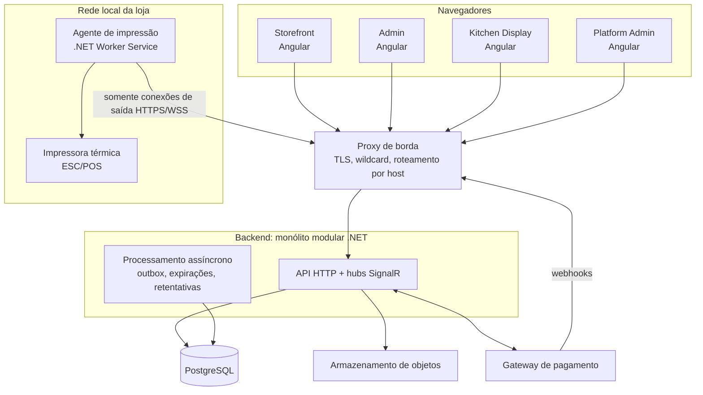

# Visão geral da arquitetura

> Micro SaaS multi-tenant de pedidos para hamburguerias e fast-food.
> Status do documento: **proposta para revisão** · Última revisão: 2026-10-11

Este é o ponto de entrada da documentação de arquitetura. Ele descreve o contexto, o estado atual do repositório, os componentes do sistema e o resumo das decisões. Os detalhes ficam nos documentos específicos listados na [seção 13](#13-mapa-dos-documentos).

## 0. Mudança de escopo (2026-10-13)

O sistema passou a atender **um único cliente: uma loja** ([ADR-0016](../adr/0016-uma-unica-loja.md)). Este documento foi escrito para vários estabelecimentos; leia-o com estas correções:

| Tema | Como era | Como ficou |
|---|---|---|
| Lojas | Várias, isoladas por `TenantId` | Uma, em um registro único |
| Endereço da loja do consumidor | Um subdomínio por loja, que identificava a loja | Um endereço só |
| Interfaces | Storefront, Admin, Kitchen Display e Platform Admin | Storefront, Admin e Kitchen Display |
| Papéis | Vínculo usuário–loja com papel | Papel no próprio usuário (proprietário, gerente, cozinha) |
| Isolamento | Quatro camadas, com RLS | Não se aplica |
| Planos e assinaturas | Previstos | Fora do escopo |
| Outro cliente no futuro | Nova loja no mesmo sistema | Nova instalação, separada |

Continuam valendo: monólito modular, PostgreSQL, sessões separadas por interface, fluxo de pedidos e impressão, segurança da web, infraestrutura e CI/CD.

## 1. Como ler estes documentos

Toda afirmação pertence a uma de três categorias, e a distinção é mantida em todos os arquivos:

| Marca | Significado |
|---|---|
| **Fato** | Observado diretamente no repositório em 2026-10-11. |
| **Decisão proposta** | Recomendação desta arquitetura. Cada uma tem um ADR em `docs/adr/`; só vira definitiva quando o ADR for aceito. Já aceitos: ADR-0002 (PostgreSQL) e ADR-0005 (monorepo, com npm). |
| **Pendente (DP-nn)** | Questão ainda sem resposta. O registro completo, com a recomendação e o critério para decidir, está em [implementation-roadmap.md](implementation-roadmap.md#6-decisões-pendentes). |

Nenhum destes documentos contém código de produção. Nomes de classes, tabelas, rotas e projetos são **nomes propostos**, usados para dar precisão ao texto.

Convenção de idioma: identificadores técnicos em inglês (como no código existente), texto e rótulos de interface em português.

## 2. Contexto do produto

O produto é um SaaS comercial usado por vários estabelecimentos. Cada estabelecimento (tenant) tem loja virtual, cardápio, configurações, usuários, pedidos e operação de cozinha próprios e isolados.

São quatro interfaces independentes, uma API e um agente local:

| Componente | Quem usa | Para quê |
|---|---|---|
| **Storefront** | Consumidor final | Ver cardápio, montar o pedido, fechar e acompanhar. |
| **Admin** | Dono e gerente da loja | Cardápio, preços, disponibilidade, ofertas, pedidos, configurações e impressoras. |
| **Kitchen Display** | Operadores da cozinha | Fila de comandas, observações e estado do preparo. |
| **Platform Admin** | Operação do SaaS | Estabelecimentos, usuários da plataforma, planos, assinaturas e configurações globais. |
| **API** | Todas as interfaces e o agente | Regras de negócio, persistência, permissões, pedidos, pagamentos e tarefas de impressão. |
| **Agente de impressão** | Computador na rede local da loja | Recebe tarefas de impressão e imprime na térmica. |

Restrição central: o consumidor nunca acessa comandas internas nem recursos administrativos, e nenhum tenant acessa dados de outro.

## 3. Estado atual do repositório (fatos)

Inspeção feita em `C:\Users\Ryan\Documents\brasa-burger` em 2026-10-11.

**Repositório**

- Repositório Git com um único commit na branch `main` ("Projeto inicial: sistema de pedidos Brasa Burger (Angular 21)"), com remoto `origin` em `github.com/Ryan-pedro/brasa-burger`.
- O único diretório versionado é `front-end/`. Não existem backend, banco de dados, Docker, pipelines de CI, pasta `docs/`, nem `README`/`.gitignore` na raiz.
- Não há decisões arquiteturais registradas. As únicas intenções declaradas estão em `front-end/README.md`, seção "Integração com a API".

**Aplicação Angular existente** (`front-end/`)

- Um único projeto Angular chamado `brasa-burger`, na raiz do workspace (`angular.json` com `newProjectRoot: projects`, ainda sem nenhum projeto em `projects/`).
- Angular 21.2, TypeScript 5.9 em modo `strict`, componentes standalone, signals, `ChangeDetectionStrategy.OnPush`, sem `zone.js` nas dependências, rotas com lazy loading, SCSS.
- Testes com Vitest + jsdom pelo builder `@angular/build:unit-test`. Existe um único arquivo de teste: `core/utils/pricing.spec.ts`.
- npm 10 como gerenciador, com `legacy-peer-deps=true` no `.npmrc`. Prettier configurado. **Não há ESLint.**
- Sem bibliotecas de UI: todos os componentes são próprios. Tokens de design em variáveis CSS em `src/styles.scss`, nomeados pela cor (`--red`, `--yellow`), não pela função.
- Organização em `core/` (models, data, services, utils, guards), `shared/` (componentes reutilizáveis) e `pages/` (uma pasta por tela).
- `provideHttpClient()` **não** está registrado: a aplicação não faz nenhuma chamada HTTP.

**Comportamento do protótipo**

- Todos os dados são mockados em `core/data/menu.data.ts`: categorias, produtos, adicionais, bebidas de combo e os dados do restaurante (`RESTAURANT`).
- A marca "Brasa Burger" está fixa no código: título, meta tags, logo, cores e textos.
- As regras de preço e promoção rodam no navegador (`core/utils/pricing.ts`): preço unitário, R$ 5 de desconto acima de R$ 30, "Terça do Hambúrguer" e taxa de entrega fixa. A promoção de terça usa o relógio do navegador.
- Valores monetários são `number` de ponto flutuante (ex.: `24.9`).
- O carrinho é persistido em `localStorage` na chave `brasa.cart`.
- O pedido é criado no navegador, com número gerado localmente a partir de 1048, e o status avança por um botão de simulação.
- Tipos de pedido: `local` (mesa), `balcao` e `delivery`. Formas de pagamento: `card`, `pix` e `cash`, apenas como seleção, sem integração.
- A comanda da cozinha é um componente em `shared/kitchen-ticket/` e a rota `/cozinha/comanda` é **pública, dentro da aplicação do consumidor**. A impressão usa `window.print()` com CSS de 80 mm.
- O formulário de checkout nasce preenchido com dados de exemplo.
- Não existe autenticação, autorização nem noção de tenant.

## 4. Análise: do protótipo ao produto

O protótipo é um bom ponto de partida para o **Storefront**: a stack é atual, o fluxo do consumidor está completo e as regras de preço já estão isoladas em funções puras. O que falta para um SaaS é quase tudo que não é tela.

| Lacuna observada | Consequência | Onde é tratada |
|---|---|---|
| Preço, desconto e total calculados no navegador | Qualquer cliente pode adulterar o valor do pedido. | O servidor recalcula tudo; o cliente só exibe. [order-and-printing-flow.md](order-and-printing-flow.md) |
| Comanda acessível por rota pública no app do consumidor | Viola a restrição de que o consumidor não vê comandas. | A comanda vai para o Kitchen Display e para o agente. [frontend-architecture.md](frontend-architecture.md) |
| Marca e cardápio fixos no código | Impossível atender mais de uma loja. | Resolução de tenant por host e tema por loja. [database-and-tenancy.md](database-and-tenancy.md) |
| Dinheiro em ponto flutuante | Erros de arredondamento em totais e descontos. | `decimal` no backend, centavos inteiros nos contratos. [ADR-0012](../adr/0012-snapshot-de-pedido-e-dinheiro.md) |
| Promoção baseada no relógio do navegador | Cliente em outro fuso ou com relógio errado recebe (ou perde) desconto. | Regras avaliadas no servidor, no fuso da loja. |
| Número de pedido gerado no cliente | Colisões e ausência de registro. | Sequência por tenant gerada no servidor. |
| Impressão por `window.print()` | Exige alguém clicando; não é automática. | Agente local com fila durável. [ADR-0009](../adr/0009-agente-de-impressao-local.md) |
| Uma aplicação só para consumidor e cozinha | Mistura de permissões e de código. | Quatro aplicações separadas. [ADR-0005](../adr/0005-estrutura-do-monorepo.md) |
| Sem ESLint, um único teste, sem CI | Regressões passam sem aviso. | [infrastructure-and-cicd.md](infrastructure-and-cicd.md) |

O que é **preservado** do protótipo: Angular 21 com standalone, signals e OnPush; SCSS com tokens em variáveis CSS; Vitest; a convenção `core/shared/features`; o fluxo e as telas do consumidor; os cinco status exibidos ao cliente; a ideia de regras de preço puras e testáveis, que migra para o backend.

O nome **"Brasa Burger"** hoje é ao mesmo tempo o nome do repositório e a marca de uma loja fictícia. Um SaaS para várias lojas não deveria carregar a marca de uma delas. Esta documentação trata "Brasa Burger" como a **loja de demonstração (primeiro tenant)** e usa `Brasa` como codinome provisório de namespaces. O nome do produto e o domínio raiz são a pendência **DP-01**.

## 5. Objetivos e não-objetivos

**Objetivos arquiteturais, em ordem de prioridade**

1. **Isolamento entre tenants.** Um defeito em uma consulta não pode expor dados de outra loja. É o risco mais caro do produto.
2. **Confiabilidade do pedido até a cozinha.** Pedido confirmado precisa chegar à cozinha, mesmo com falha de impressora, de rede ou de processo.
3. **Simplicidade operacional.** Uma pessoa precisa conseguir desenvolver, publicar e operar o sistema. Isso descarta microsserviços, Kubernetes e brokers de mensagem no MVP.
4. **Evolução incremental.** Cada fase entrega algo utilizável e testável, sem reescrever a anterior.
5. **Custo baixo no início.** Infraestrutura mínima, sem licenças pagas.

**Não-objetivos do MVP**

- Aplicativo nativo para celular.
- Emissão de documento fiscal (NFC-e/SAT). A comanda não é documento fiscal; ver **DP-08**.
- Gestão de estoque, de entregadores e roteirização.
- Integração com marketplaces de delivery.
- Domínio próprio por loja (fica para evolução; o modelo de dados já prevê).
- Motor genérico de promoções.

## 6. Diagrama de contexto

## 7. Componentes e implantação lógica

| Componente | Tecnologia proposta | Implantação | Detalhes |
|---|---|---|---|
| Storefront, Admin, Kitchen Display, Platform Admin | Angular 21, um workspace com quatro aplicações | Arquivos estáticos, build e deploy independentes | [frontend-architecture.md](frontend-architecture.md) |
| API | ASP.NET Core em .NET 10 (LTS), monólito modular | Um contêiner | [backend-architecture.md](backend-architecture.md) |
| Processamento assíncrono | Hosted services .NET | No MVP, no mesmo processo da API; separável depois | [ADR-0007](../adr/0007-consistencia-outbox-e-fila-em-tabelas.md) |
| Banco de dados | PostgreSQL | Gerenciado, se o orçamento permitir | [database-and-tenancy.md](database-and-tenancy.md) |
| Agente de impressão | .NET Worker Service com SQLite local | Serviço Windows no computador da loja | [order-and-printing-flow.md](order-and-printing-flow.md) |
| Proxy de borda | Caddy ou equivalente | Um contêiner | [infrastructure-and-cicd.md](infrastructure-and-cicd.md) |

## 8. Hosts e superfícies da API

**Decisão proposta** ([ADR-0004](../adr/0004-resolucao-de-tenant-por-host.md)): cada interface tem o seu host, e a API é publicada **na mesma origem** de cada interface, por roteamento no proxy de borda. Não há uma API pública única chamada entre origens.

| Host | Interface | Prefixos roteados para a API |
|---|---|---|
| `{slug}.dominio.com.br` | Storefront da loja `slug` | `/api/v1/store/*` |
| `painel.dominio.com.br` | Admin | `/api/v1/admin/*`, `/hubs/ops` |
| `cozinha.dominio.com.br` | Kitchen Display | `/api/v1/kitchen/*`, `/hubs/kitchen` |
| `plataforma.dominio.com.br` | Platform Admin | `/api/v1/platform/*` |
| `agentes.dominio.com.br` | Agentes de impressão | `/api/v1/agent/*`, `/hubs/agent` |
| `api.dominio.com.br` | Integrações externas | `/api/v1/webhooks/*` |

Efeitos desta escolha:

- O tenant do Storefront vem do cabeçalho `Host`, repassado por um proxy confiável. Nenhum identificador de loja é enviado pelo navegador.
- Sem requisições entre origens, não há CORS a configurar nas interfaces de usuário.
- Cookies de sessão são `__Host-`, presos a um host. Uma loja não consegue interferir na sessão do painel.
- Rotas administrativas nem chegam aos hosts das lojas. É uma camada a mais; a autorização de verdade continua sendo feita na API.

Os slugs `painel`, `cozinha`, `plataforma`, `agentes`, `api`, `www`, `cdn` e similares são reservados e não podem ser usados por lojas.

## 9. Resumo das decisões propostas

| # | Decisão | Motivo principal |
|---|---|---|
| [0001](../adr/0001-monolito-modular.md) | Monólito modular, sem microsserviços | Uma equipe pequena, um banco, transações simples. |
| [0002](../adr/0002-postgresql.md) | PostgreSQL | Sem custo de licença, hospedagem barata, RLS para isolamento. |
| [0003](../adr/0003-multi-tenancy-banco-compartilhado.md) | Banco compartilhado com `TenantId`, filtros globais, chaves compostas e RLS | Custo e operação de um banco só, com defesa em profundidade. |
| [0004](../adr/0004-resolucao-de-tenant-por-host.md) | Tenant resolvido pelo host; API na mesma origem | O navegador nunca informa o tenant; sem CORS; cookies por host. |
| [0005](../adr/0005-estrutura-do-monorepo.md) | Monorepo com workspace Angular multi-projeto e solução .NET única | Uma versão de cada framework, builds independentes por caminho. |
| [0006](../adr/0006-organizacao-da-aplicacao.md) | Fatias verticais, CQRS lógico, sem MediatR, sem repositório genérico | Menos indireção; EF Core já é unidade de trabalho. |
| [0007](../adr/0007-consistencia-outbox-e-fila-em-tabelas.md) | Transação única entre módulos; Outbox só para efeitos externos; filas em tabelas | Consistência forte onde importa, sem broker. |
| [0008](../adr/0008-tempo-real-com-signalr.md) | SignalR com grupos por tenant; push é aviso, consulta é a verdade | Reconexão segura e sem perda de eventos. |
| [0009](../adr/0009-agente-de-impressao-local.md) | Agente local em .NET, conexões só de saída, fila em SQLite | Funciona atrás de NAT e sobrevive a quedas. |
| [0010](../adr/0010-autenticacao-e-sessoes.md) | ASP.NET Core Identity com cookies para pessoas; credencial de dispositivo para agentes | Sem tokens no JavaScript; sem provedor externo no MVP. |
| [0011](../adr/0011-maquinas-de-estado-separadas.md) | Estados separados para pedido, pagamento, comanda/preparo e impressão | Falha de impressão não pode travar um pedido. |
| [0012](../adr/0012-snapshot-de-pedido-e-dinheiro.md) | Pedido guarda cópia imutável de nomes e preços; dinheiro em `decimal` | Histórico correto mesmo quando o cardápio muda. |
| [0013](../adr/0013-contratos-openapi-por-superficie.md) | Um documento OpenAPI por superfície, versionado no repositório | Front e back não divergem em silêncio. |
| [0014](../adr/0014-hospedagem-do-mvp.md) | Uma máquina com Docker Compose e proxy de borda | Custo e operação mínimos. Provedor é DP-04. |
| [0015](../adr/0015-estado-no-frontend-com-signals.md) | Estado no frontend com signals e serviços, sem NgRx | Já é o padrão do protótipo e basta para a complexidade atual. |

## 10. Stack consolidada

| Camada | Proposta | Observação |
|---|---|---|
| Frontend | Angular 21, TypeScript estrito, signals, SCSS, Vitest | Preserva o que já existe. |
| Gerenciador de pacotes | npm, um único `package.json` no workspace | Decidido em 2026-10-11; ver ADR-0005. |
| Backend | .NET 10 (LTS), ASP.NET Core, EF Core 10 | Versões a confirmar no início da implementação. |
| Banco | PostgreSQL 17 ou superior, com Npgsql | Versão exata depende do provedor (DP-04). |
| Tempo real | SignalR | Sem backplane no MVP. |
| Agente | .NET 10 Worker Service, SQLite | Serviço Windows; Linux possível. |
| Contêineres | Docker e Docker Compose | Sem Kubernetes. |
| CI/CD | GitHub Actions com filtros por caminho | Um pipeline por artefato implantável. |
| Observabilidade | Logs estruturados e OpenTelemetry | Destino dos dados é DP-12. |

## 11. MVP e evolução

| Tema | MVP | Evolução |
|---|---|---|
| Lojas | Subdomínio por loja | Domínio próprio com verificação. |
| Consumidor | Pedido como convidado, acompanhamento por link | Conta com código por telefone (DP-05). |
| Pagamento | Na retirada ou entrega | Pix online com gateway (DP-03). |
| Promoções | Preço "de/por" e desconto por valor mínimo | Regras por dia, categoria e combinação. |
| Cozinha | Uma fila por loja | Estações (chapa, bebidas, expedição). |
| Impressão | Um agente e uma impressora por loja | Várias impressoras com roteamento por categoria; atualização automática do agente. |
| Tempo real | Uma instância, sem backplane | Redis como backplane ao escalar horizontalmente. |
| Processamento assíncrono | No processo da API | Processo separado. |
| Isolamento | Banco compartilhado com RLS | Banco dedicado para tenants grandes. |
| Assinaturas | Plano e situação definidos manualmente no Platform Admin | Cobrança recorrente automatizada (DP-07). |
| Infraestrutura | Uma máquina com Compose | Várias instâncias, banco com réplica. |

## 12. Decisões pendentes (resumo)

| ID | Questão | Bloqueia |
|---|---|---|
| DP-01 | Nome do produto e domínio raiz | Publicação; nomes de namespaces |
| DP-02 | Modelo de impressora térmica e forma de conexão | Fase de impressão |
| DP-03 | Pagamento online no MVP e escolha do gateway | Fase de pagamento online |
| DP-04 | Provedor de hospedagem e região | Homologação e produção |
| DP-05 | Identificação do consumidor | Evolução do Storefront |
| DP-06 | Aceite do pedido automático ou manual | Fluxo de confirmação |
| DP-07 | Cobrança do SaaS manual ou automatizada | Módulo de assinaturas |
| DP-08 | Documento fiscal | Escopo comercial |
| DP-09 | Papéis LGPD e prazos de retenção | Entrada em produção |
| DP-10 | Gerador de cliente a partir do OpenAPI | Fase de fundações |
| DP-11 | Escopo do delivery e pedido em mesa | Fase de pedidos |
| DP-12 | Destino de logs, métricas e alertas | Entrada em produção |

Detalhes, recomendação e critério de decisão de cada uma: [implementation-roadmap.md](implementation-roadmap.md#6-decisões-pendentes).

## 13. Mapa dos documentos

| Documento | Conteúdo |
|---|---|
| [frontend-architecture.md](frontend-architecture.md) | As quatro aplicações Angular, bibliotecas compartilhadas, estado, rotas, tema por loja. |
| [backend-architecture.md](backend-architecture.md) | Camadas, módulos, dependências, validação, erros, idempotência, testes. |
| [database-and-tenancy.md](database-and-tenancy.md) | Escolha do banco, modelo conceitual, isolamento multi-tenant. |
| [order-and-printing-flow.md](order-and-printing-flow.md) | Fluxo do pedido, estados, eventos, fila e agente de impressão. |
| [security.md](security.md) | Identidade, autorização, ameaças e mitigação. |
| [infrastructure-and-cicd.md](infrastructure-and-cicd.md) | Ambientes, hospedagem, pipelines, monitoramento, backup, monorepo e fluxo no GitHub. |
| [implementation-roadmap.md](implementation-roadmap.md) | Fases, critérios de aceite, riscos e decisões pendentes. |
| [../adr/](../adr/README.md) | Registros individuais das decisões. |

## 14. Glossário

| Termo | Significado neste projeto |
|---|---|
| **Tenant / estabelecimento / loja** | Um cliente do SaaS. Unidade de isolamento de dados. |
| **Superfície** | Conjunto de rotas da API destinado a um tipo de cliente (store, admin, kitchen, platform, agent). |
| **Pedido (Order)** | Registro comercial do que o consumidor pediu, com preços e totais. |
| **Comanda (KitchenTicket)** | Documento interno da cozinha derivado de um pedido. Nunca exposto ao consumidor. |
| **Preparo** | Andamento da produção de uma comanda. |
| **Tarefa de impressão (PrintJob)** | Pedido de impressão de uma comanda em uma impressora. |
| **Agente** | Programa instalado na loja que imprime as tarefas. |
| **KDS** | Kitchen Display System, o painel da cozinha. |
| **Outbox** | Tabela onde eventos são gravados na mesma transação dos dados, para entrega posterior garantida. |
| **RLS** | Row-Level Security do PostgreSQL. |
| **Snapshot** | Cópia dos dados do cardápio gravada no pedido no momento da compra. |
