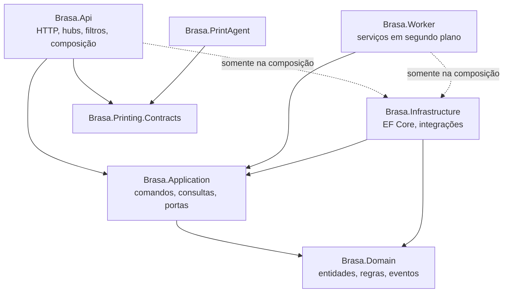

# Arquitetura do backend

> Status: **proposta para revisão** · Última revisão: 2026-10-11
> Decisões relacionadas: [ADR-0001](../adr/0001-monolito-modular.md), [ADR-0006](../adr/0006-organizacao-da-aplicacao.md), [ADR-0007](../adr/0007-consistencia-outbox-e-fila-em-tabelas.md), [ADR-0013](../adr/0013-contratos-openapi-por-superficie.md)

> **Mudança de escopo em 2026-10-13.** O sistema passou a atender **uma única loja** ([ADR-0016](../adr/0016-uma-unica-loja.md)). Os trechos deste documento sobre vários estabelecimentos (`TenantId`, loja resolvida pelo endereço, isolamento entre lojas, Platform Admin, planos e assinaturas) não se aplicam mais e serão revisados. O restante continua valendo.

> **Estrutura de pastas desde 2026-10-13.** A solução saiu de `back-end/` e fica na raiz do repositório `brasa-burger` ([ADR-0017](../adr/0017-front-end-em-repositorio-proprio.md)). Onde este documento diz `back-end/`, leia a raiz do repositório.

**Fato:** não existe backend no repositório. Tudo neste documento é proposta. Não há código aqui; nomes de projetos, pastas e tipos servem para dar precisão.

## 1. Princípios

1. **Um processo, um banco, módulos com fronteiras verificadas.** A complexidade fica dentro do código, onde é barata, e não na rede.
2. **O servidor é a única fonte de verdade** para preço, disponibilidade, permissão e tenant. Nada que venha do cliente é confiado.
3. **Padrões só com motivo.** Cada padrão adotado ou rejeitado tem justificativa na seção 6.
4. **Testável por construção.** Regras de negócio sem dependência de infraestrutura; integração testada contra PostgreSQL real.

## 2. Monólito modular ou microsserviços

**Decisão proposta** ([ADR-0001](../adr/0001-monolito-modular.md)): monólito modular.

| Critério | Monólito modular | Microsserviços |
|---|---|---|
| Equipe | Adequado a uma pessoa ou equipe pequena | Pressupõe equipes independentes por serviço |
| Consistência | Transação local entre módulos | Sagas, compensações, consistência eventual em tudo |
| Operação | Um deploy, um banco, um log | Vários deploys, descoberta, rastreamento distribuído |
| Custo de infraestrutura | Uma máquina pequena | Várias instâncias e, em geral, um broker |
| Isolamento de falhas | Menor | Maior |
| Escala independente | Não | Sim |

Nenhum motivo concreto para microsserviços existe hoje: não há equipes separadas, cargas com perfis de escala diferentes, nem requisito de isolamento de falhas entre partes do backend.

**O que já é separado por natureza**, e não por escolha de estilo: o agente de impressão, que roda na loja. Ele é um programa à parte, mas não é um microsserviço do backend.

**Gatilhos para reavaliar:** um módulo exigir escala muito diferente dos demais; uma segunda equipe assumir um módulo; o processamento de webhooks ou de impressão degradar a latência da API de pedidos. Mesmo nesses casos, o primeiro passo é separar o **processo** de trabalho assíncrono, não criar um serviço com banco próprio.

## 3. Solução e projetos

```
back-end/
├─ Brasa.sln
├─ Directory.Build.props          # nullable, avisos como erro, analisadores
├─ Directory.Packages.props       # versões de pacotes centralizadas
├─ src/
│  ├─ Brasa.Domain/               # entidades, objetos de valor, eventos, regras
│  ├─ Brasa.Application/          # casos de uso: comandos, consultas, portas
│  ├─ Brasa.Infrastructure/       # EF Core, identidade, gateway, armazenamento, outbox
│  ├─ Brasa.Api/                  # endpoints HTTP, hubs SignalR, composição
│  ├─ Brasa.Worker/               # serviços de processamento assíncrono
│  ├─ Brasa.Printing.Contracts/   # protocolo entre API e agente, versionado
│  └─ Brasa.PrintAgent/           # agente local de impressão
└─ tests/
   ├─ Brasa.UnitTests/
   ├─ Brasa.IntegrationTests/
   ├─ Brasa.ArchitectureTests/
   └─ Brasa.PrintAgent.Tests/
```

`Brasa` é um codinome provisório (pendência **DP-01**).

**Por que quatro projetos de camada e não um projeto por módulo:** oito módulos vezes quatro camadas seriam mais de trinta projetos, com custo de build e de navegação desproporcional ao tamanho do sistema. Os módulos são **pastas e namespaces dentro de cada camada**, e as fronteiras são garantidas por testes de arquitetura. Se um módulo crescer a ponto de justificar, ele pode virar um conjunto de projetos próprio sem mudar namespaces.

## 4. Camadas e dependências



| Camada | Contém | Pode depender de | Não pode |
|---|---|---|---|
| **Domain** | Agregados, entidades, objetos de valor, eventos de domínio, políticas puras (preço, transições de estado) | Nada do projeto; só a biblioteca base | Referenciar EF Core, ASP.NET, relógio do sistema, qualquer E/S |
| **Application** | Um manipulador por caso de uso, validadores, DTOs, interfaces de portas (gateway de pagamento, armazenamento, relógio, notificador) | Domain; abstrações do EF Core | Referenciar ASP.NET, `HttpContext`, SignalR, provedores concretos |
| **Infrastructure** | `DbContext`, mapeamentos, migrations, implementação das portas, outbox, identidade | Application, Domain | Conter regra de negócio |
| **Api** | Endpoints, hubs, autenticação, filtros, limitação de taxa, OpenAPI | Application; Infrastructure só no registro de dependências | Acessar o `DbContext` ou conter regra de negócio |
| **Worker** | Serviços em segundo plano | Application; Infrastructure só no registro | Idem |

**Concessão declarada:** a camada Application usa o EF Core diretamente (por uma interface `IAppDbContext`), em vez de esconder todo acesso a dados atrás de repositórios. O motivo está na seção 6.3.

Estas regras são verificadas automaticamente (seção 16).

## 5. Módulos de negócio

| Módulo | Responsável por | Reage a | Publica |
|---|---|---|---|
| **Tenancy** | Estabelecimentos, domínios, perfil e configurações da loja, tema | — | `TenantSuspended`, `StoreSettingsChanged` |
| **Identity** | Usuários, vínculos com lojas, papéis, convites, sessões, credenciais de dispositivo | — | `MembershipChanged` |
| **Catalog** | Categorias, produtos, grupos de opções, combos, ofertas, versão do cardápio | — | `MenuChanged` |
| **Ordering** | Cotação do carrinho, criação do pedido, numeração, ciclo de vida do pedido, acompanhamento | `PaymentConfirmed`, `PaymentFailed`, `PreparationChanged` | `OrderPlaced`, `OrderConfirmed`, `OrderCancelled` |
| **Payments** | Cobranças, integração com gateway, webhooks | `OrderPlaced` | `PaymentConfirmed`, `PaymentFailed`, `PaymentExpired` |
| **Kitchen** | Comandas e estado de preparo | `OrderConfirmed`, `OrderCancelled` | `TicketIssued`, `PreparationChanged` |
| **Printing** | Agentes, impressoras, tarefas de impressão, tentativas | `TicketIssued` | `PrintJobFailed`, `AgentWentOffline` |
| **Billing** | Planos, assinaturas, limites por plano | — | `SubscriptionChanged` |
| **Shared** | Auditoria, outbox, idempotência, contexto de tenant, relógio, tipos de erro | — | — |

### Regras entre módulos

1. Um módulo **só altera as próprias entidades**.
2. Um módulo lê dados de outro apenas por uma **interface pública de consulta** exposta pelo dono (por exemplo, Ordering pede a Catalog os produtos e opções para precificar), nunca navegando pelas entidades do outro.
3. Reações entre módulos acontecem por **eventos de domínio**, não por chamada direta.
4. Entidades de módulos diferentes se referenciam **por identificador**, sem propriedades de navegação cruzando a fronteira.
5. Todos os módulos compartilham um único `DbContext` e um único banco, com um schema do PostgreSQL por módulo.

O fluxo que percorre Ordering → Payments → Kitchen → Printing está em [order-and-printing-flow.md](order-and-printing-flow.md).

## 6. Padrões avaliados

**Decisão proposta** ([ADR-0006](../adr/0006-organizacao-da-aplicacao.md)). Resumo:

| Padrão | Decisão | Motivo |
|---|---|---|
| Fatias verticais por caso de uso | **Adotar** | Cada funcionalidade em uma pasta; mudanças ficam localizadas. |
| CQRS | **Adotar só a separação lógica** | Comandos e consultas têm formas diferentes; não há ganho em dois bancos. |
| MediatR | **Não adotar** | Indireção sem ganho proporcional; licença comercial desde 2025. |
| Repositório genérico | **Não adotar** | O `DbContext` já é repositório e unidade de trabalho. |
| Repositório específico | **Onde houver motivo** | Carregamento não trivial de um agregado, usado em vários casos de uso. |
| Eventos de domínio | **Adotar**, em processo | Desacopla módulos sem perder a transação. |
| Outbox | **Adotar**, para efeitos externos | Garante entrega depois do commit. |
| Event sourcing | **Não adotar** | Complexidade sem requisito que a justifique. |
| Mapeador automático | **Não adotar** | Mapeamento explícito é mais simples de ler e depurar. |
| Resultado em vez de exceção para regras | **Adotar** | Falha de regra de negócio é fluxo esperado, não exceção. |

### 6.1 Organização de comandos e consultas

- Cada caso de uso é uma pasta em `Application/<Módulo>/<CasoDeUso>/` com a requisição, o manipulador, o validador e o resultado.
- **Comandos** alteram estado, carregam agregados com rastreamento, aplicam regras do domínio e gravam em uma transação. Retornam o mínimo (identificador, versão).
- **Consultas** não alteram estado, não rastreiam entidades e projetam direto para o DTO de resposta, sem passar por entidades de domínio.
- Mesmo banco e mesmas tabelas para os dois lados. Não há modelo de leitura separado.
- O endpoint recebe o manipulador por injeção de dependência e o chama diretamente.

### 6.2 MediatR

Avaliado e não recomendado.

- O que ele entregaria aqui (despacho de requisições e um pipeline para validação e log) é coberto por injeção direta dos manipuladores e por filtros de endpoint.
- Desde 2025 o MediatR é distribuído sob licença comercial para empresas acima de um certo faturamento. Os termos devem ser conferidos se a decisão for revista.
- Sem ele, "ir para a definição" leva do endpoint ao manipulador em um passo.

Reavaliar se os comportamentos transversais passarem a exigir um pipeline que os filtros não atendam.

> **Regra geral de dependências:** conferir a licença de toda biblioteca no momento da adoção. Em 2025, MediatR, AutoMapper, MassTransit e FluentAssertions passaram a ter licença comercial. Nenhuma delas é necessária nesta arquitetura.

### 6.3 Repositórios

- Não há `IRepository<T>` genérico.
- A camada Application usa `IAppDbContext`, que expõe os conjuntos de entidades e `SaveChanges`.
- Custo: Application referencia as abstrações do EF Core. Benefício: consultas expressas diretamente, sem uma camada que só repassa chamadas.
- Um repositório específico é criado quando o carregamento de um agregado tem regra própria e se repete. O candidato evidente é o pedido com seus itens e opções.
- Trocar de ORM não é um cenário considerado. Trocar de banco continua possível, dentro do que o EF Core abstrai.

### 6.4 Eventos de domínio e Outbox

Dois mecanismos, com papéis distintos ([ADR-0007](../adr/0007-consistencia-outbox-e-fila-em-tabelas.md)):

| Mecanismo | Quando roda | Para quê |
|---|---|---|
| **Evento de domínio em processo** | Dentro da transação, antes do commit | Outro módulo alterar os próprios dados de forma atômica (ex.: confirmar pedido e criar comanda). |
| **Outbox** | Depois do commit, por um serviço em segundo plano | Efeitos fora do banco: avisos SignalR, chamada ao gateway, e-mail. |

Uma falha em um manipulador de evento em processo desfaz a transação inteira. Uma falha na entrega de uma mensagem do outbox é repetida até funcionar ou ser marcada para análise.

## 7. Validação

Quatro níveis, cada um com um papel:

| Nível | Onde | O que verifica | Resposta |
|---|---|---|---|
| 1. Forma | Filtro de endpoint, um validador por requisição | Campos obrigatórios, tipos, tamanhos, formatos, combinações (ex.: delivery exige endereço) | 400 com erros por campo |
| 2. Regra com estado | Manipulador | O que depende de dados: produto existe e está disponível, loja aberta, pedido mínimo | 409 ou 422 com `code` |
| 3. Invariante | Agregado do domínio | O que nunca pode ser falso: total não negativo, transição de estado válida | Erro de domínio convertido em 409/422 |
| 4. Banco | Restrições | Unicidade, chaves estrangeiras compostas, verificações | 409; indica defeito se chegar aqui |

- As requisições são tipos explícitos. Nenhuma entidade é preenchida diretamente a partir do corpo da requisição, o que elimina atribuição em massa.
- Texto livre do consumidor (observações, nome) tem tamanho máximo e caracteres de controle removidos, porque acaba em uma impressora.
- Candidata para o nível 1: uma biblioteca de validação declarativa, como FluentValidation.

## 8. Tratamento de erros

Todas as respostas de erro seguem **Problem Details (RFC 9457)**, com extensões fixas:

| Campo | Conteúdo |
|---|---|
| `type`, `title`, `status`, `detail` | Padrão da RFC. `detail` é legível por pessoas e nunca contém dados internos. |
| `code` | Identificador estável para o cliente tratar (ex.: `cart_changed`). |
| `traceId` | Identificador de rastreamento, igual ao dos logs. |
| `errors` | Erros por campo, quando for validação. |

| Situação | Status | Exemplos de `code` |
|---|---|---|
| Requisição malformada | 400 | `validation_failed` |
| Sem sessão válida | 401 | `unauthenticated` |
| Sem permissão | 403 | `forbidden`, `store_unavailable` |
| Recurso inexistente **ou de outro tenant** | 404 | `not_found`, `store_not_found` |
| Estado atual impede a operação | 409 | `cart_changed`, `store_closed`, `invalid_transition`, `version_conflict` |
| Regra de negócio violada | 422 | `below_minimum_order`, `idempotency_key_reused` |
| Excesso de requisições | 429 | `rate_limited` |
| Erro inesperado | 500 | `internal_error` |

Regras:

- Um recurso de outro tenant responde **404**, igual a um recurso que não existe. Responder 403 confirmaria a existência.
- Erros inesperados são registrados com detalhe no log e respondidos sem detalhe.
- Falhas de regra de negócio não usam exceções; o manipulador retorna um resultado com o erro, e a camada HTTP o converte.
- O catálogo de códigos faz parte do contrato e é documentado no OpenAPI.

## 9. Transações e consistência

- **Um comando, uma transação.** O manipulador carrega, aplica regras e grava uma vez. Eventos de domínio em processo e mensagens do outbox entram na mesma transação.
- **Nível de isolamento:** o padrão do PostgreSQL (Read Committed).
- **Concorrência otimista** por versão de linha em tudo que é editado por pessoas (produtos, configurações) e em transições de estado. Conflito responde 409 `version_conflict`.
- **Transições de estado** são condicionais: só acontecem se o estado atual for o esperado. Duas requisições simultâneas não avançam o estado duas vezes.
- **Bloqueio pessimista** só em dois lugares: no contador de numeração de pedidos e na reserva de tarefas de impressão.
- **Nenhuma chamada externa dentro de uma transação de banco.** O padrão para o gateway de pagamento é: gravar a intenção, confirmar, chamar o gateway com chave de idempotência e gravar o resultado em outra transação.
- **Consistência entre módulos** é imediata dentro do banco e eventual só para efeitos externos.

## 10. Idempotência

| Operação | Mecanismo | Efeito de uma repetição |
|---|---|---|
| Criar pedido | Cabeçalho `Idempotency-Key` gerado pelo cliente; registro por tenant com hash da requisição | Devolve o mesmo pedido. Mesma chave com corpo diferente responde 422. |
| Criar cobrança no gateway | Identificador do nosso pagamento como chave de idempotência do gateway | O gateway devolve a mesma cobrança. |
| Receber webhook de pagamento | Unicidade por provedor e identificador do evento | Evento repetido é reconhecido e ignorado com resposta 200. |
| Aplicar resultado de pagamento | Transição condicional de estado | Segunda aplicação não faz nada. |
| Criar comanda | Unicidade por pedido e sequência | Reprocessamento não duplica. |
| Criar tarefa de impressão | Unicidade por comanda, impressora e motivo | Reprocessamento não duplica. Reimpressão é uma tarefa nova, pedida por alguém. |
| Confirmar impressão | Identificador da tarefa e da tentativa | Confirmação repetida é aceita sem efeito. |
| Entregar mensagem do outbox | Consumidores idempotentes; a entrega é "ao menos uma vez" | Aviso repetido é inofensivo. |

Registros de idempotência expiram (sugestão: 24 horas) e são removidos por um serviço de limpeza.

## 11. Versionamento da API

- Versão no caminho: `/api/v1/...`. Uma versão nova (`v2`) só para mudanças incompatíveis.
- **Compatível:** adicionar campo opcional, endpoint, valor em enumeração que o cliente já tolera.
- **Incompatível:** remover ou renomear campo, mudar tipo ou significado, tornar obrigatório, mudar código de erro.
- As quatro interfaces web são publicadas junto com a API e podem acompanhar mudanças rapidamente. O **agente de impressão não pode**: ele fica instalado em computadores de clientes.
- Por isso o protocolo do agente (`Brasa.Printing.Contracts`) tem versão própria. O agente informa a versão ao conectar, e o servidor mantém compatibilidade com pelo menos a versão anterior. Abaixo de um mínimo, o servidor recusa e o painel avisa que o agente precisa ser atualizado.

## 12. Paginação, filtros e ordenação

| Tipo de lista | Estratégia |
|---|---|
| Grandes e crescentes (pedidos, tarefas de impressão, auditoria) | Paginação por cursor: `limit` (máximo 100) e `cursor` opaco; resposta com `items` e `nextCursor`. |
| Pequenas e limitadas pelo plano (categorias, produtos no Admin) | Paginação por cursor também, para manter um único padrão. |
| Cardápio público | Resposta única e completa, com cache por versão e `ETag`. |

- Ordenação por parâmetro `sort` com lista fechada de campos por endpoint. Toda ordenação inclui o identificador como desempate, para que o cursor seja estável.
- Filtros são parâmetros nomeados e documentados. Não há linguagem de consulta genérica.
- Todo filtro é aplicado **dentro** do tenant corrente. Nenhum endpoint aceita `tenantId` como filtro, exceto na superfície `platform`.

## 13. Documentação OpenAPI

**Decisão proposta** ([ADR-0013](../adr/0013-contratos-openapi-por-superficie.md)):

- Um documento por superfície: `store`, `admin`, `kitchen`, `platform`, `agent`.
- Os documentos são gerados no build e **versionados** em `contracts/openapi/`. O pipeline falha se o que o código gera for diferente do que está versionado, e sinaliza mudanças incompatíveis.
- Os clientes TypeScript são gerados a partir desses arquivos.
- A interface interativa de documentação fica disponível apenas em desenvolvimento e homologação. Em produção, os documentos `admin`, `kitchen` e `platform` não são servidos.

## 14. Logs e rastreabilidade

- Logs estruturados em JSON, com instrumentação OpenTelemetry para rastros e métricas.
- Toda entrada carrega: `TraceId`, `TenantId`, `Surface`, e `UserId` ou `AgentId` quando houver. Em fluxos de pedido, também `OrderId`.
- O contexto de rastreamento segue o padrão W3C e atravessa o outbox: a mensagem guarda o rastro de origem, de modo que criação do pedido, comanda, tarefa de impressão e confirmação do agente aparecem como uma sequência única.
- O `traceId` é devolvido em toda resposta de erro.
- **Dados pessoais não vão para o log**: telefone, endereço e observações são omitidos ou mascarados.
- **Auditoria não é log.** Ações relevantes para o negócio e para a segurança são gravadas em uma tabela própria, consultável e com retenção definida ([security.md](security.md#9-auditoria)).

Métricas e alertas: [infrastructure-and-cicd.md](infrastructure-and-cicd.md#8-logs-métricas-e-alertas).

## 15. Processamento assíncrono

`Brasa.Worker` contém os serviços em segundo plano:

| Serviço | Função |
|---|---|
| Despachante do outbox | Entrega mensagens pendentes: avisos SignalR, e-mails, chamadas a integrações. |
| Expiração de pagamentos | Expira pedidos que aguardam pagamento além do prazo. |
| Recuperação de tarefas de impressão | Devolve à fila tarefas cuja reserva venceu; abandona as que esgotaram tentativas. |
| Monitor de presença de agentes | Marca agentes como offline quando param de enviar sinal de vida e gera o aviso. |
| Limpeza e retenção | Remove registros de idempotência e mensagens antigas; anonimiza dados pessoais vencidos. |

**Onde eles rodam.** No MVP, esses serviços são registrados **no mesmo processo da API**, por configuração. O motivo é técnico: o despachante precisa enviar avisos pelos hubs SignalR, e sem um backplane só o processo que mantém as conexões consegue fazer isso. Quando houver um backplane (ver [ADR-0008](../adr/0008-tempo-real-com-signalr.md)), o mesmo projeto passa a rodar como processo separado, sem mudança de código.

Regras:

- Todos os serviços reservam trabalho com bloqueio de linha que ignora linhas já reservadas, de modo que mais de uma instância pode rodar sem processar o mesmo item duas vezes.
- Esses serviços varrem dados de todos os tenants, por natureza. Cada item processado abre um escopo com o **tenant daquele item** definido explicitamente; não existe tenant "ambiente" herdado.
- Toda tarefa tem limite de tentativas, espera crescente e um estado final de falha que gera alerta.

## 16. Estratégia de testes

| Tipo | Escopo | Ferramentas e regras |
|---|---|---|
| **Unitário** | Domínio e políticas puras: preço, descontos, transições de estado, invariantes | Sem banco e sem relógio real. Devem ser a maioria e rodar em segundos. |
| **Integração** | Endpoint até o banco | Aplicação em memória contra **PostgreSQL real em contêiner**. Banco em memória e SQLite não servem: RLS, bloqueios e restrições precisam do banco verdadeiro. Gateway e relógio substituídos por falsos. |
| **Isolamento** | Tenant A nunca enxerga nem altera dados do tenant B | Suíte dedicada e obrigatória, descrita em [database-and-tenancy.md](database-and-tenancy.md#9-testes-automatizados-de-isolamento). |
| **Arquitetura** | Regras de dependência | Lista abaixo. |
| **Contrato** | OpenAPI gerado igual ao versionado | Falha do pipeline em divergência. |
| **Agente** | Protocolo, fila local, renderização | Servidor falso, impressora virtual, comparação com saídas de referência. |

Regras verificadas pelos testes de arquitetura:

1. Domain não referencia nenhum outro projeto nem pacotes de infraestrutura.
2. Application não referencia ASP.NET, SignalR nem Infrastructure.
3. Api e Worker não usam o `DbContext` diretamente.
4. Um módulo não referencia tipos internos de outro módulo.
5. Toda entidade com dados de loja implementa o marcador de pertencimento a tenant.
6. Todo endpoint declara explicitamente a sua política de autorização ou que é anônimo. Nenhum endpoint fica sem declaração.
7. Nenhuma requisição de endpoint tem um campo `TenantId` fora da superfície `platform`.

Casos que precisam de teste de integração desde o início, por serem os mais caros de errar: criação de pedido com repetição, adulteração de preço pelo cliente, webhook repetido e fora de ordem, transições de estado concorrentes, reserva e expiração de tarefas de impressão.
