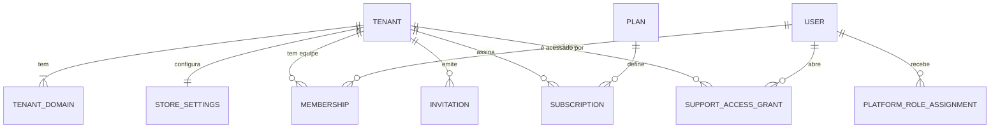
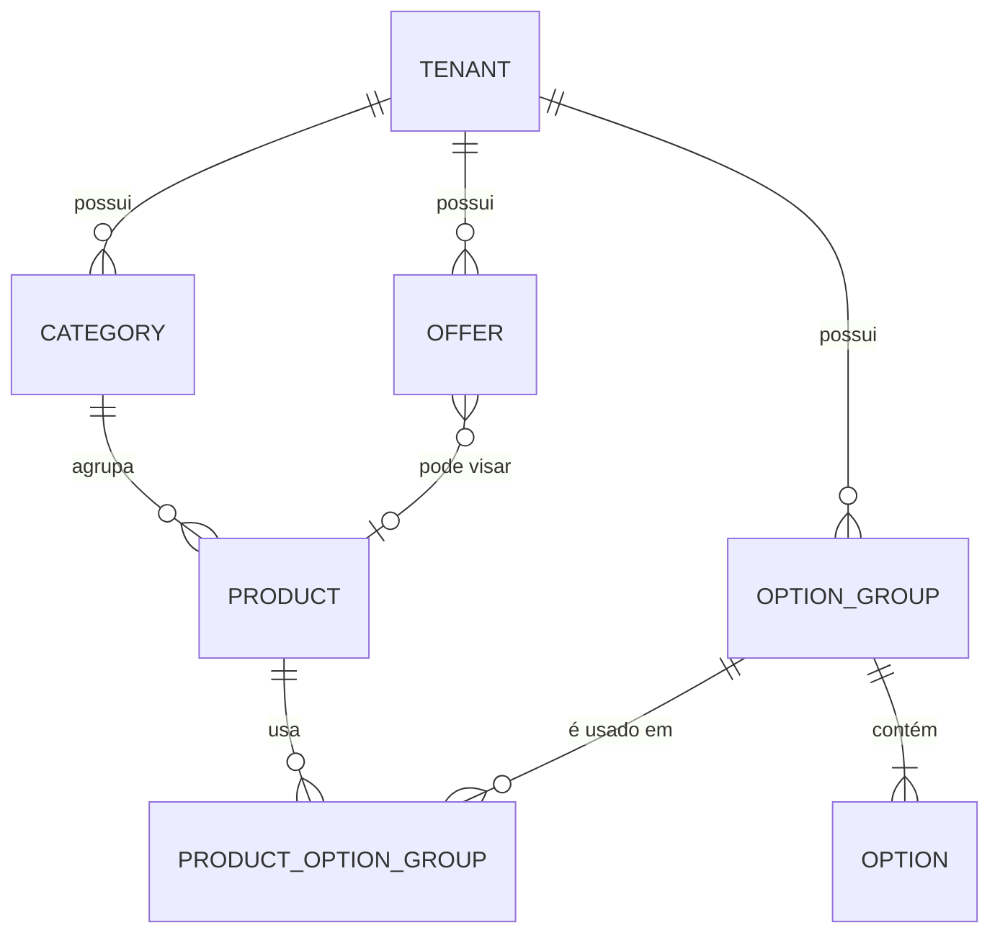
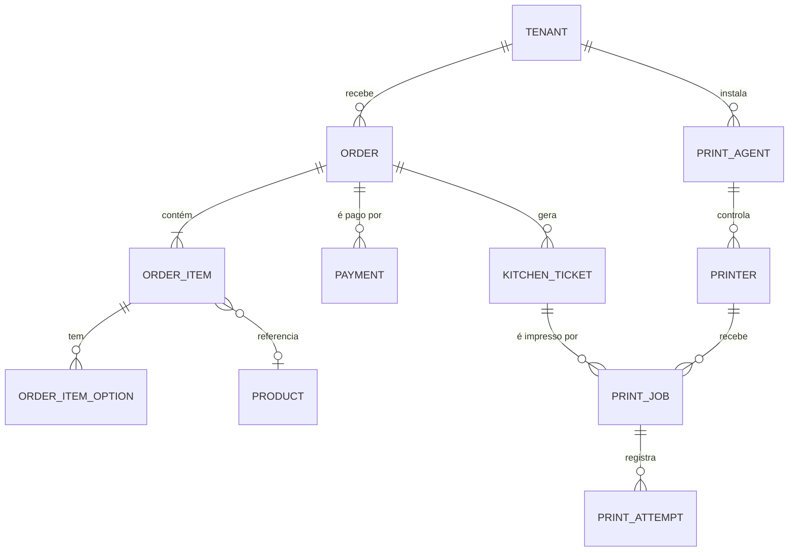
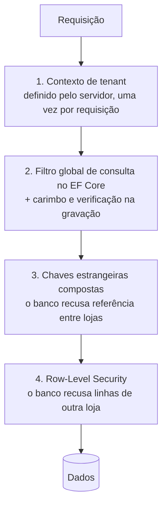

# Banco de dados e multi-tenancy

> Status: **proposta para revisão** · Última revisão: 2026-10-11
> Decisões relacionadas: [ADR-0002](../adr/0002-postgresql.md), [ADR-0003](../adr/0003-multi-tenancy-banco-compartilhado.md), [ADR-0004](../adr/0004-resolucao-de-tenant-por-host.md), [ADR-0012](../adr/0012-snapshot-de-pedido-e-dinheiro.md)

> **Mudança de escopo em 2026-10-13.** O sistema passou a atender **uma única loja** ([ADR-0016](../adr/0016-uma-unica-loja.md)). Os trechos deste documento sobre vários estabelecimentos (`TenantId`, loja resolvida pelo endereço, isolamento entre lojas, Platform Admin, planos e assinaturas) não se aplicam mais e serão revisados. O restante continua valendo.

**Fato:** o repositório não tem banco de dados, migrations nem modelo persistido. Os únicos modelos existentes são as interfaces TypeScript do protótipo (`menu.model.ts`, `order.model.ts`). Este documento não contém SQL nem código.

## 1. O projeto precisa de banco de dados?

Sim. Os requisitos que tornam isso inevitável:

- Vários estabelecimentos com cardápios, usuários e pedidos próprios, alterados em tempo de execução.
- Pedidos são registros comerciais: precisam de durabilidade, numeração sem repetição e histórico.
- Consistência transacional entre pedido, pagamento, comanda e tarefa de impressão.
- Isolamento entre tenants imposto por restrições, não só por código.
- Filas duráveis para outbox e impressão ([ADR-0007](../adr/0007-consistencia-outbox-e-fila-em-tabelas.md)).

Um banco relacional é a escolha natural: os dados são fortemente relacionados e as garantias exigidas são as de transações ACID. Não há requisito que peça um banco de documentos ou um armazenamento chave-valor como base principal.

## 2. PostgreSQL ou SQL Server

| Critério | PostgreSQL | SQL Server |
|---|---|---|
| **Custo operacional** | Sem licença em qualquer tamanho. | Edição Express é gratuita, com limites de tamanho de banco, memória e CPU (10 GB por banco até a versão 2022; a versão 2025 ampliou o limite, a confirmar). Acima disso, licença por núcleo ou serviço gerenciado pago. |
| **Hospedagem gerenciada** | Oferecido por praticamente todos os provedores, inclusive opções de baixo custo e com região no Brasil. | Bem atendido no Azure (Azure SQL, com camada serverless) e disponível em outros grandes provedores com licença embutida, em geral mais caro. |
| **.NET e EF Core** | Provedor Npgsql, maduro e atualizado junto com o EF Core. | Provedor mantido pela Microsoft; é o caminho mais documentado. |
| **Migrations** | EF Core migrations. | EF Core migrations. Equivalente. |
| **Isolamento multi-tenant** | Row-Level Security por políticas; schemas. | Row-Level Security por políticas de segurança; schemas. Equivalente em capacidade. |
| **Backup e recuperação** | Recuperação pontual nos serviços gerenciados; autogerenciado exige ferramenta externa. | Ferramentas nativas maduras; recuperação pontual nos serviços gerenciados. A edição Express não tem agendador embutido. |
| **Crescimento do volume** | Particionamento declarativo nativo; suficiente por muitos anos neste domínio. | Particionamento disponível; igualmente suficiente. |
| **Desenvolvimento local** | Imagem de contêiner leve, em qualquer sistema e arquitetura. | Excelente no Windows (Developer Edition, LocalDB). Contêiner mais pesado. |
| **Recursos úteis aqui** | `jsonb`, bloqueio que ignora linhas reservadas, UUID v7 nativo nas versões recentes. | JSON, dica de leitura que ignora linhas bloqueadas. Equivalentes funcionais. |
| **Familiaridade** | Exige atenção a diferenças: comparação de texto sensível a maiúsculas por padrão, tratamento de data e hora com fuso, convenção de nomes. | Vantagem real se quem desenvolve já trabalha com SQL Server. |

**Dimensão do problema.** Cem lojas com duzentos pedidos por dia geram cerca de sete milhões de pedidos e algumas dezenas de milhões de itens por ano. Os dois bancos lidam com isso sem dificuldade. Volume não decide a escolha.

**Decisão proposta** ([ADR-0002](../adr/0002-postgresql.md)): **PostgreSQL**.

- O fator decisivo é custo e portabilidade: sem licença, com o mesmo banco em qualquer provedor e em qualquer tamanho. Para um micro SaaS, o custo fixo mensal importa mais do que qualquer diferença técnica entre os dois.
- Tecnicamente, os dois atendem. Nenhum requisito favorece o SQL Server.
- O principal argumento contrário é familiaridade com SQL Server. Ele é real, mas é atenuado pelo EF Core, que cobre a maior parte do acesso a dados.

**Critério para rever:** se a hospedagem escolhida (DP-04) for Azure e o custo total com Azure SQL ficar menor ou igual, ou se a curva de aprendizado atrasar a entrega de forma mensurável. Trocar de banco é barato antes de haver dados de produção e caro depois; a revisão deve acontecer, no máximo, até o fim da fase de fundações.

## 3. Convenções do modelo

| Tema | Convenção proposta |
|---|---|
| **Identificadores** | UUID versão 7 (ordenável por tempo), gerado pela aplicação. Não revela volume e não colide entre tenants. |
| **Pertencimento** | Toda tabela com dados de loja tem a coluna `TenantId`, obrigatória e imutável. |
| **Chaves compostas** | Tabelas de loja têm unicidade em (`TenantId`, `Id`). Chaves estrangeiras entre tabelas de loja são compostas e incluem `TenantId` (seção 8.5). |
| **Dinheiro** | `decimal` no domínio, numérico com duas casas no banco, moeda BRL. Nunca ponto flutuante. Nos contratos da API, centavos inteiros. |
| **Data e hora** | Sempre UTC com fuso no banco. Cada loja tem um fuso configurado; regras como "terça-feira" e "horário de funcionamento" são avaliadas no fuso da loja. |
| **Exclusão** | Produtos, categorias e opções são **arquivados**, não apagados. Pedidos nunca são apagados; dados pessoais são anonimizados após o prazo de retenção. |
| **Concorrência** | Versão de linha em entidades editáveis e nas que têm máquina de estados. |
| **Schemas** | Um schema por módulo (`tenancy`, `identity`, `catalog`, `ordering`, `payments`, `kitchen`, `printing`, `billing`, `shared`). |
| **Nomes** | Entidades em inglês, como no código existente. |
| **Dados semiestruturados** | `jsonb` para snapshots e configurações que não são consultadas por campo (endereço do pedido, layout da comanda, parâmetros de oferta). |

## 4. Modelo conceitual

### 4.1 Plataforma, identidade e loja

| Entidade | Escopo | Responsabilidade |
|---|---|---|
| `Tenant` | Global | O estabelecimento. Slug, nome, situação (ativo, suspenso, encerrado), fuso horário. |
| `TenantDomain` | Loja | Hosts que resolvem para a loja. Tipo (subdomínio ou domínio próprio), verificação, qual é o principal. |
| `StoreSettings` | Loja (1:1) | Perfil público, tema, horários, tipos de pedido aceitos, formas de pagamento, pedido mínimo, taxa de entrega, aceite automático. |
| `User` | Global | Identidade de uma pessoa: e-mail, credenciais, segundo fator. Uma pessoa pode pertencer a várias lojas. |
| `Membership` | Loja | Vínculo de um usuário com uma loja e o papel nela (proprietário, gerente, cozinha). |
| `PlatformRoleAssignment` | Global | Papel de um usuário na operação do SaaS. Independente de `Membership`. |
| `Invitation` | Loja | Convite pendente para entrar na equipe, com token de uso único e validade. |
| `Plan` | Global | Plano comercial e seus limites (produtos, pedidos por mês, impressoras). |
| `Subscription` | Loja | Plano vigente, situação e período. O histórico é mantido. |
| `SupportAccessGrant` | Global, referencia uma loja | Acesso de suporte: quem, a qual loja, motivo, prazo, somente leitura ou não. |

### 4.2 Catálogo

| Entidade | Responsabilidade |
|---|---|
| `Category` | Agrupamento do cardápio, com ordem e imagem. Pode ter categoria pai, para acomodar as subcategorias de bebidas do protótipo. |
| `Product` | Item vendável: nome, descrição, preço base, imagem, tipo (simples ou combo), ativo, disponível agora, destaque. |
| `OptionGroup` | Conjunto de escolhas reutilizável entre produtos. Tem tipo (**adicional**, **escolha** ou **remoção**) e limites mínimo e máximo de seleção. |
| `Option` | Uma escolha do grupo: nome, diferença de preço, disponível. |
| `ProductOptionGroup` | Associa grupos a produtos, com ordem de exibição. |
| `Offer` | Oferta com tipo, parâmetros e vigência. |

**Um único mecanismo cobre adicionais, tamanhos, bebida do combo e ingredientes removíveis:**

| Necessidade | Como é modelada |
|---|---|
| Adicionais pagos (bacon, queijo) | Grupo do tipo adicional, mínimo 0, máximo N, opções com preço. |
| Tamanho (P, M, G) | Grupo do tipo escolha, mínimo 1, máximo 1, opções com diferença de preço. |
| Bebida do combo | Grupo do tipo escolha, mínimo 1, máximo 1. É o `choice` do protótipo. |
| "Sem cebola" | Grupo do tipo remoção, opções sem preço. São os `ingredients` não fixos do protótipo. |

Combos são produtos do tipo combo que usam grupos de escolha. Uma tabela de componentes de combo só é necessária se for preciso baixar estoque por componente, o que está fora do MVP.

**Ofertas no MVP** têm dois tipos fechados: preço promocional de um produto com vigência ("de/por"), e desconto fixo em pedidos acima de um valor. Quando mais de uma se aplica, vale o maior desconto, como no protótipo. Regras combinatórias como a "Terça do Hambúrguer" (50% no item mais barato ao levar dois) ficam para uma fase posterior; o protótipo as tem apenas como demonstração.

### 4.3 Pedidos, pagamentos, cozinha e impressão

| Entidade | Responsabilidade |
|---|---|
| `Order` | Registro comercial: número, token de acompanhamento, tipo (local, balcão, delivery), dados do cliente, endereço, subtotal, descontos, taxas, total, estado. |
| `OrderItem` | Linha do pedido com **cópia** do nome e do preço do produto, quantidade, observação e total da linha. |
| `OrderItemOption` | Opção escolhida, com **cópia** do nome do grupo, do nome da opção, do tipo e do preço. |
| `Payment` | Cobrança de um pedido: forma, se é online, provedor, referência externa, valor, estado. |
| `KitchenTicket` | Comanda da cozinha: sequência no pedido, conteúdo imutável para a cozinha, situação do documento e situação do preparo. |
| `PrintAgent` | Programa instalado na loja: nome, credencial (somente o hash), versão, último sinal de vida, situação. |
| `Printer` | Impressora lógica controlada por um agente: nome, perfil (largura, protocolo), ativa. |
| `PrintJob` | Tarefa de imprimir uma comanda em uma impressora: motivo (automática, reimpressão, teste), estado, tentativas, reserva, validade. |
| `PrintAttempt` | Histórico de cada tentativa: agente, início, fim, resultado, erro. |

### 4.4 Tabelas de suporte

| Entidade | Escopo | Responsabilidade |
|---|---|---|
| `TenantCounter` | Loja | Próximo número de pedido da loja. |
| `IdempotencyRecord` | Loja | Chave, hash da requisição, resultado e validade. |
| `OutboxMessage` | Global, com `TenantId` | Eventos pendentes de entrega, com tentativas e rastro de origem. |
| `PaymentWebhookEvent` | Global | Caixa de entrada de notificações do gateway: provedor, identificador do evento, conteúdo bruto, situação de processamento. |
| `AuditLog` | Global, com `TenantId` quando houver | Registro apenas de inclusão de ações relevantes. |

`PaymentWebhookEvent` é global porque a notificação chega **sem contexto de loja**. O tenant é descoberto pela referência do pagamento, depois de a assinatura ser validada.

## 5. Cardinalidades e invariantes

**Cardinalidades principais**

| Relação | Cardinalidade |
|---|---|
| Tenant — TenantDomain | 1 para 1 ou mais; exatamente um principal |
| Tenant — StoreSettings | 1 para 1 |
| User — Tenant (por Membership) | N para N; no máximo um vínculo por par |
| Tenant — Subscription | 1 para N no tempo; no máximo uma vigente |
| Category — Product | 1 para N |
| Product — OptionGroup | N para N |
| OptionGroup — Option | 1 para 1 ou mais |
| Order — OrderItem | 1 para 1 ou mais |
| OrderItem — OrderItemOption | 1 para 0 ou mais |
| Order — Payment | 1 para N; no máximo um bem-sucedido |
| Order — KitchenTicket | 1 para N; uma no MVP |
| KitchenTicket — PrintJob | 1 para N |
| PrintAgent — Printer | 1 para N |
| PrintJob — PrintAttempt | 1 para N |

**Invariantes de negócio**

1. Toda loja ativa tem pelo menos um proprietário ativo.
2. O `TenantId` de uma linha nunca muda.
3. Uma linha de loja só referencia linhas da mesma loja.
4. Em um grupo de opções, mínimo ≤ máximo; grupo do tipo escolha obrigatória tem pelo menos uma opção disponível, ou o produto fica indisponível.
5. Um pedido tem pelo menos um item.
6. Total do pedido = subtotal − descontos + taxas, e nunca é negativo.
7. Itens e valores de um pedido não mudam depois de criado. No MVP, corrigir um pedido é cancelar e refazer.
8. O número do pedido é único na loja e nunca é reutilizado. Lacunas na sequência são aceitáveis.
9. O estado de um pedido só muda por transições válidas ([order-and-printing-flow.md](order-and-printing-flow.md#3-as-quatro-máquinas-de-estado)).
10. O valor de um pagamento é igual ao total do pedido; um pedido tem no máximo um pagamento bem-sucedido.
11. Uma comanda só existe para um pedido confirmado.
12. Uma tarefa de impressão referencia comanda e impressora da mesma loja.
13. O registro de auditoria só aceita inclusões.

## 6. O que é global e o que é da loja

| Global (sem `TenantId` obrigatório) | Da loja (com `TenantId`) |
|---|---|
| `Tenant`, `Plan`, `User`, `PlatformRoleAssignment` | `TenantDomain`, `StoreSettings`, `Membership`, `Invitation`, `Subscription` |
| `PaymentWebhookEvent` | `Category`, `Product`, `OptionGroup`, `Option`, `ProductOptionGroup`, `Offer` |
| `OutboxMessage`, `AuditLog`, `SupportAccessGrant` (carregam `TenantId` como dado) | `Order`, `OrderItem`, `OrderItemOption`, `Payment` |
| | `KitchenTicket`, `PrintAgent`, `Printer`, `PrintJob`, `PrintAttempt` |
| | `TenantCounter`, `IdempotencyRecord` |

`User` é global de propósito: a mesma pessoa pode ser dona de duas lojas ou trabalhar em mais de uma, com uma única credencial.

**Restrições de unicidade**

| Restrição | Escopo |
|---|---|
| Slug do tenant | Global |
| Host em `TenantDomain` | Global |
| E-mail do usuário (normalizado) | Global |
| Código do plano | Global |
| (Provedor, identificador do evento) em webhooks | Global |
| (Provedor, referência externa) em pagamentos | Global |
| Token de acompanhamento do pedido | Global |
| (Usuário, loja) em `Membership` | Por par |
| Slug da categoria; slug do produto | Por loja |
| Número do pedido | Por loja |
| Nome do agente; nome da impressora | Por loja |
| (Escopo, chave) de idempotência | Por loja |
| (Pedido, sequência) em comandas | Por loja |

## 7. Preservação do histórico dos pedidos

**Decisão proposta** ([ADR-0012](../adr/0012-snapshot-de-pedido-e-dinheiro.md)): o pedido guarda uma **cópia** de tudo o que o descreve no momento da compra.

| Dado | Onde é copiado |
|---|---|
| Nome do produto, preço base unitário | `OrderItem` |
| Nome do grupo, nome da opção, tipo, preço da opção | `OrderItemOption` |
| Rótulo e valor de cada desconto aplicado | `Order` |
| Taxa de entrega | `Order` |
| Nome, telefone e endereço do cliente | `Order` |
| Conteúdo da comanda como a cozinha a viu | `KitchenTicket` |

- `OrderItem` mantém uma referência ao produto original apenas para relatórios ("mais vendidos"). Nenhuma tela de pedido lê nome ou preço pelo produto.
- Como produtos são arquivados e não apagados, essa referência continua válida.
- Alterar preço, nome, opções ou ofertas no cardápio **não muda nenhum pedido existente**.
- O total do pedido é um valor gravado, não uma soma recalculada na leitura. Mudanças futuras na regra de cálculo não reescrevem o passado.

O protótipo faz o contrário: o pedido guarda só identificadores e busca nome e preço no cardápio a cada exibição. Isso funciona com dados fixos e deixa de funcionar na primeira alteração de preço.

## 8. Estratégia multi-tenant

### 8.1 Alternativas

| Critério | Banco compartilhado com `TenantId` | Schema por loja | Banco por loja |
|---|---|---|---|
| Custo por loja | Mínimo | Baixo | Alto |
| Criar uma loja nova | Inserir linhas | Criar schema e aplicar migrations | Provisionar banco |
| Migrations | Uma vez | Uma vez por schema | Uma vez por banco |
| Isolamento | Lógico; depende de filtros e políticas | Médio | Forte |
| Backup e restauração de uma loja | Exige exportação seletiva | Possível por schema | Simples |
| Vizinho barulhento | Possível | Possível | Isolado |
| Relatórios da plataforma | Simples | Trabalhosos | Trabalhosos |
| Adequado a centenas de lojas pequenas | Sim | Com dificuldade | Não |

**Decisão proposta** ([ADR-0003](../adr/0003-multi-tenancy-banco-compartilhado.md)): **banco compartilhado, isolamento lógico por `TenantId`**, com quatro camadas independentes de proteção:

Cada camada protege contra uma falha da anterior. Um filtro esquecido em uma consulta escrita à mão é barrado pela camada 4; uma política mal configurada é coberta pela camada 2.

### 8.2 Identificação do tenant na loja pública

- O Storefront é servido em `{slug}.dominio.com.br`, e a API é alcançada **na mesma origem** ([ADR-0004](../adr/0004-resolucao-de-tenant-por-host.md)).
- O proxy de borda repassa o host original. A API só aceita esse cabeçalho vindo do proxy confiável.
- A API procura o host em `TenantDomain`. A busca tem cache curto, invalidado quando domínios mudam.
- Host desconhecido responde 404; loja suspensa responde 403, sem expor mais nada.
- Nenhum parâmetro, cabeçalho ou corpo vindo do navegador informa a loja.

Na loja pública isso não é uma decisão de autorização: qualquer pessoa pode ver qualquer cardápio. O que importa é que o pedido seja criado na loja do host e que pedidos existentes só sejam consultados com o token de acompanhamento, que é verificado **junto com o tenant do host**.

### 8.3 Validação do tenant em operações autenticadas

Em toda requisição das superfícies `admin` e `kitchen`:

1. A sessão é autenticada e identifica o usuário.
2. A sessão carrega a **loja ativa**, definida pelo servidor no login ou em uma troca de loja validada.
3. O servidor confirma que o vínculo do usuário com essa loja continua ativo e que a loja não está suspensa. Essa verificação tem cache de curta duração, invalidado quando vínculos mudam.
4. As permissões são derivadas do papel nesse vínculo.
5. O contexto de tenant é definido.
6. A política do endpoint verifica a permissão exigida.
7. Qualquer recurso solicitado por identificador é carregado através dos filtros. Se pertencer a outra loja, não é encontrado e a resposta é 404.

O frontend nunca é a fonte do `TenantId`. Trocar de loja é uma operação do servidor que valida o vínculo e reemite a sessão.

### 8.4 Disponibilização do contexto

- Existe um serviço de contexto de tenant com tempo de vida de uma requisição (ou de um item de trabalho em segundo plano).
- Ele é preenchido **uma única vez**, por um componente de entrada, e depois é imutável.
- Ele registra a origem do contexto: host, sessão, credencial de agente, mensagem em processamento ou acesso de suporte.
- Código que exige tenant e não o encontra falha imediatamente. Não existe tenant padrão.

| Entrada | Origem do tenant |
|---|---|
| Superfície `store` | Host da requisição |
| Superfícies `admin` e `kitchen` | Loja ativa da sessão, revalidada |
| Superfície `agent` | Credencial do agente |
| Webhooks | Referência do pagamento, após validar a assinatura |
| Serviços em segundo plano | `TenantId` do item processado |
| Superfície `platform` | Nenhum, ou a loja de um acesso de suporte vigente |

### 8.5 Isolamento de consultas e alterações

**Na aplicação**

- Toda entidade de loja implementa um marcador comum. Um filtro global de consulta é aplicado a todas elas automaticamente.
- Na gravação, um interceptador preenche o `TenantId` de entidades novas a partir do contexto e **recusa** qualquer entidade nova ou alterada cujo `TenantId` seja diferente.
- Desativar o filtro global é proibido fora do módulo de plataforma, e isso é verificado por teste de arquitetura.
- SQL escrito à mão é evitado; quando necessário, passa por um ponto único que exige o tenant.
- Chaves de cache, nomes de grupos SignalR e caminhos de arquivos sempre incluem o tenant.

**No banco**

- Row-Level Security habilitada em todas as tabelas de loja, com política que compara o `TenantId` da linha com o tenant da transação corrente.
- A aplicação conecta com um papel de banco **sem** privilégio de ignorar políticas e que não é dono das tabelas. As migrations usam outro papel.
- O tenant da transação é definido no início de cada unidade de trabalho, com escopo de transação, para que não vaze por conexões reutilizadas do pool.
- Sem tenant definido, a política não devolve nenhuma linha.

**Ressalva de implementação:** RLS com pool de conexões exige disciplina (toda unidade de trabalho em transação, variável com escopo de transação). É a parte tecnicamente mais delicada desta arquitetura. Se ela atrasar o MVP, as camadas 1 a 3 podem ir primeiro, **desde que a camada 4 esteja ativa antes de haver uma segunda loja real em produção**.

### 8.6 Relacionamentos entre entidades de tenants diferentes

- Não existem. Nenhuma entidade de loja referencia entidade de outra loja.
- Isso é imposto pelo banco: chaves estrangeiras entre tabelas de loja são compostas por (`TenantId`, identificador). Um produto da loja A não pode ser associado a uma categoria da loja B, mesmo que o código tente.
- Dados comuns a todas as lojas (planos) são globais e somente leitura para as lojas.
- Não há catálogo compartilhado entre lojas. Se uma rede com várias unidades precisar disso, será uma funcionalidade explícita de cópia, não uma referência cruzada.

### 8.7 SignalR

- Toda conexão aos hubs `kitchen` e `ops` é autenticada.
- O servidor coloca a conexão no grupo da loja **a partir da identidade autenticada**, no momento da conexão. O cliente não informa nome de grupo nem identificador de loja.
- Os hubs não têm métodos que recebam `TenantId` ou nome de grupo.
- Os hubs transmitem apenas do servidor para o cliente. Comandos vão por HTTP.
- As mensagens levam o mínimo: tipo, identificador e versão. O conteúdo é obtido por HTTP, passando por toda a autorização normal. Mesmo que um aviso chegasse ao lugar errado, não haveria dados nele.
- Quando um vínculo é revogado ou uma loja é suspensa, as conexões correspondentes são encerradas.

### 8.8 Vínculo do agente de impressão com a loja

1. No Admin, um usuário com permissão gera um **código de pareamento** de uso único e curta validade. O código já nasce associado à loja da sessão.
2. O agente envia o código e recebe um identificador e um segredo próprios. O servidor guarda apenas o hash do segredo.
3. Com identificador e segredo, o agente obtém tokens de curta duração que carregam `tenant_id` e `agent_id`.
4. Toda requisição e toda conexão do agente derivam o tenant **desse token**. O agente nunca envia a loja como parâmetro.
5. Um agente só consegue reservar e confirmar tarefas de impressoras que pertencem a ele.
6. Revogar o agente no Admin invalida o segredo e encerra a conexão.

Detalhes em [security.md](security.md#5-dispositivos-agente-de-impressão).

### 8.9 Acesso de administradores da plataforma

- A superfície `platform` opera sobre dados globais: lojas, planos, assinaturas, usuários da plataforma. Para isso não precisa atravessar o isolamento.
- Consultas que agregam dados de várias lojas (por exemplo, pedidos por loja no mês) existem **somente no módulo de plataforma**, usam um papel de banco próprio com acesso de leitura explícito e são poucas e revisadas.
- Para ver ou alterar dados **de uma loja**, o operador abre um **acesso de suporte**: informa a loja e o motivo, recebe um acesso com prazo, somente leitura por padrão. A partir daí as requisições rodam com o contexto daquela loja, pelos mesmos filtros de qualquer usuário. Não é um desvio do isolamento; é um contexto legítimo e registrado.
- Abertura, uso e encerramento são auditados, com o operador real identificado em cada ação.

### 8.10 Migração futura para isolamento mais forte

O modelo foi desenhado para permitir mover uma loja para um banco dedicado sem redesenho:

- Toda linha de loja tem `TenantId`, e não há referências entre lojas: os dados de uma loja formam um conjunto fechado, exportável.
- Identificadores são UUID, sem sequências globais que colidam ao mover dados.
- A numeração de pedidos é por loja.
- A resolução de conexão pode passar a consultar, por loja, em qual banco ela está. O ponto único de definição do contexto de tenant é onde isso se encaixa.

Caminho previsto: banco compartilhado para todas → banco dedicado para lojas que exigirem (volume, contrato ou requisito legal) → eventualmente, grupos de lojas por banco. Critérios para iniciar: uma loja degradar as demais, exigência contratual de isolamento físico, ou necessidade de restauração individual frequente.

## 9. Testes automatizados de isolamento

Suíte obrigatória, executada em todo pull request contra PostgreSQL real.

| Teste | O que prova |
|---|---|
| **Varredura de endpoints** | Com duas lojas semeadas, um usuário da loja A chama **cada** endpoint das superfícies `admin` e `kitchen` usando identificadores da loja B. Esperado: 404 e nenhum dado alterado. Os endpoints são enumerados a partir do OpenAPI, de modo que um endpoint novo sem caso de teste faz a suíte falhar. |
| **Listagens** | Nenhuma listagem devolve itens da outra loja, com qualquer filtro ou ordenação. |
| **Metadados do modelo** | Toda entidade de loja tem filtro global, `TenantId` obrigatório e chaves compostas. Verificado por reflexão. |
| **Políticas do banco** | Toda tabela de loja tem RLS habilitada e política presente. Verificado no catálogo do banco. |
| **Banco direto** | Conectado com o papel da aplicação e o tenant A, ler linhas de B devolve zero; inserir com `TenantId` de B é recusado; sem tenant definido, nada é devolvido. |
| **Gravação** | Tentar gravar uma entidade com `TenantId` diferente do contexto falha. Tentar alterar o `TenantId` falha. |
| **Referência cruzada** | Associar um registro de A a um registro de B é recusado pelo banco. |
| **Loja pública** | Token de acompanhamento de um pedido da loja A consultado no host da loja B responde 404. |
| **Tempo real** | Conectado como A, um evento da loja B não é recebido. |
| **Agente** | Um agente de A não reserva nem confirma tarefas de B. |
| **Cache** | O cardápio em cache do host A nunca é servido ao host B. |
| **Segundo plano** | Uma mensagem do outbox da loja B é processada com o contexto de B. |
| **Acesso de suporte** | Sem acesso vigente, um operador da plataforma não lê dados de loja; com acesso, lê apenas a loja concedida e a ação aparece na auditoria. |

## 10. Modelo mínimo viável e evolução

| Fase | Entidades |
|---|---|
| **MVP** | `Tenant`, `TenantDomain`, `StoreSettings`, `User`, `Membership`, `Invitation`, `PlatformRoleAssignment`, `Category`, `Product`, `OptionGroup`, `Option`, `ProductOptionGroup`, `Offer` (dois tipos), `Order`, `OrderItem`, `OrderItemOption`, `Payment` (formas presenciais), `KitchenTicket`, `PrintAgent`, `Printer`, `PrintJob`, `PrintAttempt`, `TenantCounter`, `IdempotencyRecord`, `OutboxMessage`, `AuditLog`, `Plan`, `Subscription` (situação manual) |
| **Pagamento online** | `PaymentWebhookEvent`; campos de provedor em `Payment` |
| **Operação da plataforma** | `SupportAccessGrant` |
| **Depois** | Cliente cadastrado por loja; áreas e taxas de entrega; mesas; estações de cozinha e preparo por estação; regras de oferta combinatórias; componentes de combo; cupons; faturas da assinatura |

**Deliberadamente fora do modelo inicial**, para não criar tabela sem necessidade:

- **Carrinho no servidor.** O carrinho vive no navegador; o servidor só o valida e precifica.
- **Cliente.** Os dados do consumidor são copiados no pedido. Uma entidade própria só faz sentido com contas (DP-05).
- **Histórico de estados do pedido** como tabela própria. A trilha fica na auditoria no MVP.
- **Versões publicadas do cardápio.** As alterações valem imediatamente; um contador de versão serve ao cache.
- **Permissões em tabela.** Os papéis são poucos e fixos; o mapa de papel para permissões fica no código.
