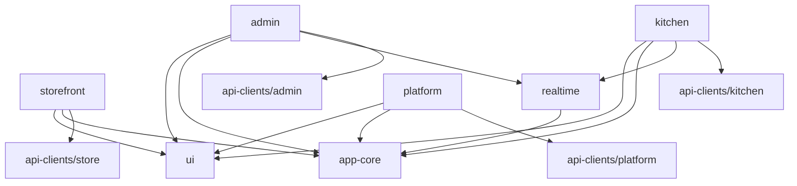
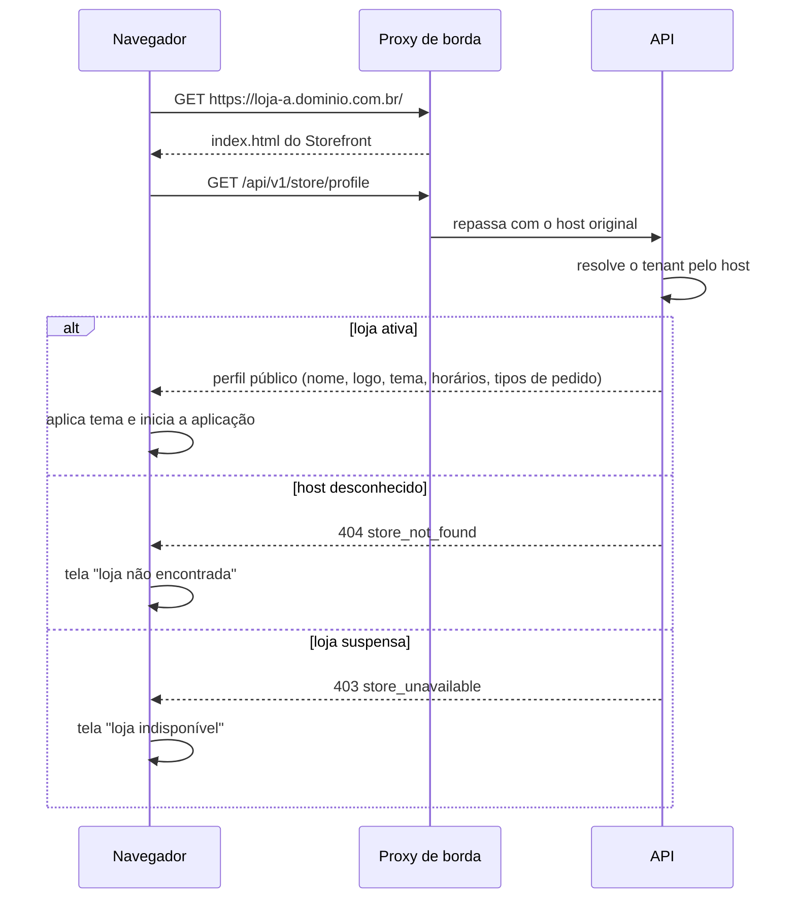
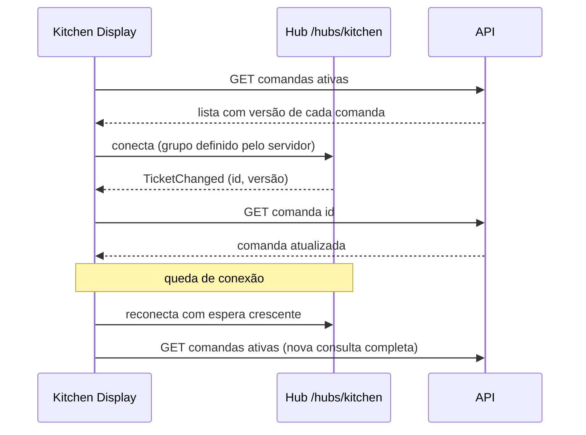

# Arquitetura do frontend

> Status: **proposta para revisão** · Última revisão: 2026-10-11
> Decisões relacionadas: [ADR-0004](../adr/0004-resolucao-de-tenant-por-host.md), [ADR-0005](../adr/0005-estrutura-do-monorepo.md), [ADR-0008](../adr/0008-tempo-real-com-signalr.md), [ADR-0013](../adr/0013-contratos-openapi-por-superficie.md), [ADR-0015](../adr/0015-estado-no-frontend-com-signals.md)

> **Mudança de escopo em 2026-10-13.** O sistema passou a atender **uma única loja** ([ADR-0016](../adr/0016-uma-unica-loja.md)). Os trechos deste documento sobre vários estabelecimentos (`TenantId`, loja resolvida pelo endereço, isolamento entre lojas, Platform Admin, planos e assinaturas) não se aplicam mais e serão revisados. O restante continua valendo.

> **Repositórios separados desde 2026-10-13.** O front-end fica no repositório [brasa-burger-front-end](https://github.com/Ryan-pedro/brasa-burger-front-end), com o workspace Angular na raiz ([ADR-0017](../adr/0017-front-end-em-repositorio-proprio.md)). Onde este documento diz `front-end/`, leia a raiz daquele repositório.

Este documento define as quatro aplicações Angular, o que elas compartilham e o que fica isolado. Não contém código: estruturas de diretório e nomes são propostas.

## 1. Ponto de partida (fatos)

- Existe uma aplicação Angular 21.2 em `front-end/`, com standalone components, signals, OnPush, lazy loading, SCSS e Vitest.
- Ela implementa o fluxo do consumidor com dados mockados e também contém uma tela de comanda da cozinha (`/cozinha/comanda`), pública.
- A organização atual é `core/`, `shared/` e `pages/`. Os serviços de estado (`CartService`, `CheckoutService`, `OrderService`) são singletons em `core/services/`.
- O `angular.json` já declara `newProjectRoot: projects`, mas não há nenhum projeto lá.
- Não há ESLint, não há `HttpClient` registrado e as fontes são carregadas do Google Fonts por CDN.

A aplicação existente se torna o **Storefront**. O que é da cozinha sai dela.

## 2. Estrutura do workspace

**Decisão proposta:** um único workspace Angular em `front-end/`, com quatro aplicações e quatro bibliotecas em `projects/`, um único `package.json` e npm como gerenciador. Detalhes e alternativas no [ADR-0005](../adr/0005-estrutura-do-monorepo.md).

```
front-end/
├─ angular.json              # 4 aplicações + 4 bibliotecas
├─ package.json              # único; uma versão de Angular para tudo
├─ package-lock.json
├─ tsconfig.json             # paths das bibliotecas apontando para o código-fonte
└─ projects/
   ├─ storefront/            # aplicação: loja do consumidor (migração do src/ atual)
   ├─ admin/                 # aplicação: painel da loja
   ├─ kitchen/               # aplicação: painel da cozinha
   ├─ platform/              # aplicação: operação do SaaS
   ├─ ui/                    # biblioteca: componentes de apresentação e tokens
   ├─ app-core/              # biblioteca: infraestrutura transversal (HTTP, erros, config)
   ├─ realtime/              # biblioteca: cliente SignalR com reconexão
   └─ api-clients/           # biblioteca: clientes gerados do OpenAPI, um ponto de entrada por superfície
```

As bibliotecas são consumidas **pelo código-fonte**, por mapeamento de caminhos no `tsconfig`. Elas não são publicadas nem compiladas separadamente; cada aplicação compila o que importa.

### Regras de dependência



1. Aplicações importam bibliotecas. Bibliotecas nunca importam aplicações. Aplicações nunca importam outras aplicações.
2. `ui` não depende de nenhuma outra biblioteca do projeto e não conhece regras de negócio.
3. Cada aplicação só pode importar o cliente da **sua** superfície. O Storefront não pode importar `api-clients/admin`: os contratos administrativos nem entram no bundle do consumidor.
4. As regras são verificadas por lint (restrição de importações por projeto). Isso exige **adicionar ESLint**, que hoje não existe no repositório.

## 3. O que é compartilhado e o que fica isolado

| Item | Onde fica | Motivo |
|---|---|---|
| Tokens de design, tipografia, botões, campos, chips | `ui` | Mesma linguagem visual nas quatro interfaces. |
| `icon`, `qty-stepper`, `toast`, diálogo/folha base, esqueletos de carregamento | `ui` | Apresentação pura, sem domínio. |
| Formatação de moeda (`brl`), datas e telefone | `ui` | Funções puras. |
| Interceptores HTTP, tipo de erro da API, carregador de configuração, telemetria | `app-core` | Infraestrutura idêntica em todas as aplicações. |
| Mecânica de login e sessão das interfaces internas | `app-core` (subpasta `staff-session`) | A mecânica é a mesma; as **permissões** não são compartilhadas. |
| Cliente SignalR com reconexão e nova consulta | `realtime` | Usado por Admin e Kitchen. |
| Clientes da API | `api-clients/<superfície>` | Gerados, um por superfície. |
| `product-card`, `product-sheet`, `cart-line`, `order-summary` | Só no Storefront | Só o consumidor usa. |
| `kitchen-ticket` (hoje em `shared/` do protótipo) | Só no Kitchen | Comanda é recurso interno. |
| Estado de carrinho, checkout, quadro de comandas, formulários de cadastro | Na aplicação dona | Estado de funcionalidade nunca é compartilhado. |
| Guards e mapas de permissão | Na aplicação dona | Cada interface tem o seu modelo de acesso. |

**Critério para promover algo a biblioteca:** ser usado por pelo menos duas aplicações, estar estável e não precisar de parâmetros do tipo "se for admin, faça X". Enquanto isso não for verdade, o código fica duplicado na aplicação. Duplicar um componente pequeno custa menos do que acoplar duas interfaces.

**Como evitar acoplamento excessivo:** bibliotecas sem estado de negócio; nenhuma biblioteca "utils" genérica; clientes de API separados por superfície; lint de fronteiras; pipelines que reconstroem todas as aplicações quando uma biblioteca muda, para que a quebra apareça no PR.

## 4. Convenções comuns às quatro aplicações

### 4.1 Estrutura interna

```
projects/<app>/src/app/
├─ app.config.ts            # providers
├─ app.routes.ts            # rotas de primeiro nível, todas lazy
├─ app.ts                   # shell
├─ core/                    # singletons da aplicação
├─ layout/                  # cabeçalho, navegação, molduras
├─ features/                # uma pasta por funcionalidade
│  └─ <feature>/
│     ├─ <feature>.routes.ts
│     ├─ pages/             # componentes roteados
│     ├─ components/        # componentes usados só nesta funcionalidade
│     └─ data/              # store da funcionalidade e acesso à API
└─ shared/                  # apresentação reutilizada por 2+ funcionalidades desta aplicação
```

| Área | Responsabilidade | Não pode |
|---|---|---|
| `core/` | Contexto da loja ou da sessão, guards, interceptores específicos, inicialização. | Conter componentes visuais ou estado de uma funcionalidade. |
| `features/` | Telas, componentes e estado de uma funcionalidade. | Importar de outra funcionalidade. O que duas precisam sobe para `shared/` ou `core/`. |
| `shared/` | Componentes de apresentação da aplicação. | Injetar serviços de dados ou conhecer rotas. |
| `layout/` | Moldura da aplicação. | Conter regra de negócio. |

O protótipo usa `pages/` no lugar de `features/` e concentra o estado em `core/services/`. A mudança proposta é agrupar cada tela com o seu estado, para que o estado de uma funcionalidade não seja global por padrão. A migração é incremental e não precisa acontecer de uma vez.

### 4.2 Comunicação com a API

- Todas as chamadas usam caminhos relativos (`/api/v1/<superfície>/...`), porque a API está na mesma origem ([ADR-0004](../adr/0004-resolucao-de-tenant-por-host.md)). Não há URL de API por ambiente.
- Componentes não chamam `HttpClient`. A cadeia é: componente → store da funcionalidade → cliente gerado.
- Os clientes e tipos são gerados dos documentos OpenAPI versionados em `contracts/openapi/` ([ADR-0013](../adr/0013-contratos-openapi-por-superficie.md)). A ferramenta de geração é a pendência **DP-10**.
- Interceptores em `app-core`: identificador de correlação, cabeçalho anti-CSRF nas interfaces com sessão, conversão de erros.
- Valores monetários trafegam em **centavos inteiros**. A formatação acontece só na exibição.

### 4.3 Gerenciamento de estado

**Decisão proposta** ([ADR-0015](../adr/0015-estado-no-frontend-com-signals.md)): signals e serviços, sem biblioteca de estado global.

| Tipo de estado | Onde vive |
|---|---|
| Estado do servidor (listas, detalhes) | Store da funcionalidade, com situação explícita de carregamento. |
| Estado de interface local (aba aberta, filtro) | Signals no componente. |
| Estado de sessão da aplicação (loja, usuário, permissões) | Serviço em `core/`. |
| Estado persistido no navegador (carrinho, pedidos recentes) | Store com sincronização em `localStorage`. |
| Estado em tempo real | Store alimentado por consulta e avisado por SignalR. |

Critério para reavaliar: se duas ou mais funcionalidades precisarem coordenar atualizações otimistas sobre as mesmas entidades, ou se a depuração do estado ficar difícil, adotar uma store estruturada na aplicação afetada, não nas quatro.

### 4.4 Erros e carregamento

- A API responde erros no formato Problem Details com um `code` estável ([backend-architecture.md](backend-architecture.md#8-tratamento-de-erros)). O interceptor converte em um tipo único com `status`, `code`, `detail`, erros por campo e `traceId`.
- Toda leitura expõe quatro situações: inicial, carregando, sucesso e erro. Cada tela define o que mostra em cada uma, incluindo o estado vazio.
- Esqueletos de carregamento para conteúdo; indicador no botão para ações.

| Situação | Comportamento |
|---|---|
| 400/422 com erros por campo | Mensagens junto aos campos. |
| 401 nas interfaces internas | Vai para o login e volta à rota original depois. |
| 403 | Tela "sem permissão". Não some com o item em silêncio. |
| 404 | Tela de não encontrado da funcionalidade. |
| 409 | Tratado pela funcionalidade (ex.: carrinho desatualizado). |
| 429 | Mensagem com o tempo de espera informado pelo servidor. |
| Falha de rede ou 5xx | Mensagem com ação de tentar de novo; o que o usuário digitou é preservado. |

O `traceId` aparece nas telas de erro inesperado, para facilitar o suporte.

### 4.5 Configuração por ambiente

**Decisão proposta:** o mesmo artefato de build vai para homologação e produção. Não há `environment.ts` por ambiente com valores reais.

- Como a API é relativa, quase nada depende do ambiente.
- O que depende (nome do ambiente, destino de telemetria, sinalizadores de funcionalidade) é lido de `/config.json`, servido pelo proxy de borda de cada ambiente e carregado antes da inicialização.
- Nenhum segredo vai para o frontend. Tudo que está no navegador é público.

### 4.6 Acessibilidade e responsividade

- Meta: WCAG 2.2 nível AA nas quatro interfaces.
- Semântica nativa primeiro; ARIA só quando não há elemento nativo. O protótipo já usa papéis e estados em alguns controles, o que deve ser mantido e revisado.
- Foco visível, ordem de tabulação coerente, foco preso e devolvido em diálogos e folhas.
- Respeito a `prefers-reduced-motion`: o protótipo tem animações que precisam dessa alternativa.
- Contraste verificado também nos **temas das lojas** (seção 5.5).
- Áreas de toque de pelo menos 44 px no Storefront e no Kitchen.
- Fontes hospedadas junto com a aplicação, sem CDN de terceiros.

### 4.7 Testes

| Nível | Ferramenta | O que cobre |
|---|---|---|
| Unitário | Vitest (já em uso) | Stores, funções puras, mapeamentos. |
| Componente | Vitest com utilitários de teste do Angular | Componentes com lógica de interação: folha de produto, cartão de comanda, formulários. |
| Acessibilidade | Verificação automática nos testes de componente e ponta a ponta | Regressões de ARIA, rótulos e contraste. |
| Ponta a ponta | Playwright, contra o ambiente local com Compose e dados semeados | Um fluxo crítico por aplicação. |
| Contrato | Compilação contra os clientes gerados | Mudança incompatível na API quebra o build. |

Fluxos ponta a ponta mínimos: fazer um pedido (Storefront); criar um produto e vê-lo no cardápio (Admin + Storefront); receber uma comanda e avançar o preparo (Kitchen); criar e suspender uma loja (Platform).

### 4.8 Build e deploy independentes

- Cada aplicação tem o seu alvo de build e gera `dist/<app>/browser`.
- Cada aplicação tem o seu pipeline, disparado por mudanças em `projects/<app>/**`. Mudanças em bibliotecas ou na configuração raiz disparam todas as aplicações que dependem delas.
- O deploy publica arquivos estáticos em um diretório versionado pelo commit e troca o apontamento de forma atômica. Voltar uma versão é reapontar.
- Arquivos com hash no nome são servidos com cache imutável; `index.html` e `config.json`, sem cache.
- Orçamentos de bundle por aplicação. O protótipo já tem 500 kB de aviso e 1 MB de erro no carregamento inicial; o Storefront deve manter o limite mais apertado, por ser usado em rede móvel.

Detalhes dos pipelines: [infrastructure-and-cicd.md](infrastructure-and-cicd.md#6-cicd-no-github-actions).

## 5. Storefront

### 5.1 Responsabilidade e limites

Loja pública de **uma** hamburgueria por host. Mostra o cardápio publicado, monta o carrinho, conduz o checkout e mostra o andamento do pedido.

Não faz: login administrativo, exibição de comanda, cálculo autoritativo de preço, qualquer consulta a dados de outra loja.

### 5.2 Resolução do estabelecimento e identidade visual



- O navegador **não envia** identificador de loja. O servidor deduz o tenant pelo host.
- O perfil público é carregado antes da primeira tela e fica em um serviço `StoreContext` em `core/`.
- O perfil traz: nome, logotipo, cores, fuso horário, situação aberta/fechada, horários, tipos de pedido aceitos, formas de pagamento, pedido mínimo, taxa de entrega e a versão do cardápio.
- Título da página, favicon e cor do tema passam a ser definidos a partir do perfil.

**Limitação conhecida:** como a aplicação é renderizada no navegador, o `index.html` é igual para todas as lojas. Pré-visualizações de link (por exemplo, ao compartilhar no WhatsApp) não mostram nome e logo da loja. Evolução prevista: o proxy ou a API injeta as meta tags e o perfil inicial no HTML por host. Renderização no servidor (SSR) só se indexação em buscadores virar requisito.

### 5.3 Estrutura e rotas

```
projects/storefront/src/app/
├─ core/          # StoreContext, inicialização, guards de fluxo
├─ layout/        # site-header, bottom-nav, cart-bar, flow-header
├─ features/
│  ├─ home/
│  ├─ menu/            # cardápio, bebidas, promoções, folha de produto
│  ├─ cart/
│  ├─ checkout/        # tipo de pedido, revisão, confirmação
│  └─ order-tracking/
└─ shared/        # product-card, cart-line, order-summary
```

As rotas em português existentes são mantidas.

| Rota | Tela | Guard |
|---|---|---|
| `/` | Home | — |
| `/cardapio`, `/bebidas`, `/promocoes` | Cardápio | — |
| `/carrinho` | Carrinho | — |
| `/pedido/tipo`, `/pedido/revisao` | Checkout | Carrinho não vazio (já existe) |
| `/pedido/:trackingToken` | Confirmação e acompanhamento | — (o token é a credencial) |
| ~~`/cozinha/comanda`~~ | **Removida** | Vai para o Kitchen Display |

Os guards do Storefront são conveniência de navegação. Não protegem nada: a proteção é do servidor.

### 5.4 Estado e fluxo de dados

| Estado | Fonte | Observação |
|---|---|---|
| Cardápio | `GET /api/v1/store/menu`, com cache por versão | Substitui `menu.data.ts`. |
| Carrinho | `localStorage` | Guarda só identificadores e escolhas, nunca preços. |
| Totais | `POST /api/v1/store/cart/quote` | O servidor devolve preços, descontos e total. |
| Pedido em andamento | `GET /api/v1/store/orders/{trackingToken}` | Consulta periódica no MVP. |

- A função `computeTotals` do protótipo deixa de ser a fonte dos valores. O cálculo local pode continuar existindo apenas como estimativa imediata enquanto a cotação não chega, e a tela sempre mostra o valor do servidor quando ele chega.
- Ao enviar o pedido, a aplicação gera uma **chave de idempotência** e a reutiliza em toda nova tentativa do mesmo checkout. Detalhes em [order-and-printing-flow.md](order-and-printing-flow.md#4-criação-do-pedido-e-idempotência).
- Se o servidor responder que o carrinho mudou (produto indisponível, preço alterado), a tela de revisão mostra o que mudou e pede confirmação.
- Acompanhamento: **consulta periódica** no MVP, com intervalo crescente e pausa quando a aba está oculta. Conexão em tempo real para o consumidor é evolução ([ADR-0008](../adr/0008-tempo-real-com-signalr.md)).
- Os dados de exemplo pré-preenchidos no checkout do protótipo devem ser removidos.

### 5.5 Tema por loja

- Os tokens atuais, nomeados pela cor (`--red`, `--yellow`), passam a ser nomeados pela função (`--brand-primary`, `--brand-accent`, `--surface`, `--text`).
- A loja escolhe poucas coisas: cor primária, cor de destaque e logotipo. Tons derivados são calculados.
- O perfil público entrega os valores e a aplicação os aplica como variáveis CSS na raiz.
- A cor do texto sobre a cor primária é escolhida automaticamente para manter contraste AA. O Admin valida o contraste na hora da escolha e recusa combinações ilegíveis.
- Conteúdo da loja (nomes, descrições) é sempre tratado como texto, nunca como HTML.

### 5.6 Autenticação e responsividade

- Sem login no MVP. O consumidor é convidado; o link de acompanhamento contém um token não adivinhável (pendência **DP-05** para contas).
- Projetado primeiro para celular, como o protótipo (navegação inferior, barra de carrinho), adaptando para telas maiores a partir de 768 px.

## 6. Admin

### 6.1 Responsabilidade e limites

Painel da hamburgueria: catálogo, preços, disponibilidade, ofertas, pedidos, configurações da loja, impressoras e equipe.

Não faz: gestão de outras lojas, planos ou usuários da plataforma; operação da fila da cozinha (isso é do Kitchen Display).

### 6.2 Estrutura e rotas

```
projects/admin/src/app/
├─ core/          # sessão, loja ativa, permissões, guards
├─ layout/        # navegação lateral, seletor de loja
└─ features/
   ├─ auth/            # login, redefinição de senha, aceite de convite
   ├─ orders/          # pedidos em andamento e histórico
   ├─ catalog/         # categorias, produtos, grupos de opções, combos
   ├─ offers/
   ├─ store-settings/  # perfil, tema, horários, tipos de pedido, taxas
   ├─ printing/        # agentes, impressoras, teste, histórico de tarefas
   ├─ team/            # convites e papéis
   └─ subscription/    # plano atual (somente leitura no MVP)
```

| Rota | Permissão exigida |
|---|---|
| `/entrar`, `/convite/:token`, `/senha` | Nenhuma |
| `/pedidos` | `orders.read` |
| `/catalogo/**` | `catalog.read`; edição exige `catalog.write` |
| `/ofertas` | `offers.write` |
| `/loja/**` | `store.settings` |
| `/impressao/**` | `printing.manage` |
| `/equipe` | `team.manage` |
| `/assinatura` | `subscription.read` |

### 6.3 Sessão, loja ativa e controle de acesso

- Login por e-mail e senha, com sessão em cookie preso ao host `painel` ([ADR-0010](../adr/0010-autenticacao-e-sessoes.md)). Nenhum token fica acessível ao JavaScript.
- Após o login, `GET /api/v1/admin/session` devolve o usuário, as lojas a que ele pertence, a **loja ativa** e as permissões nela.
- Um usuário com mais de uma loja escolhe a loja ativa. A troca é uma chamada ao servidor, que valida o vínculo e reemite a sessão. O frontend nunca envia um `TenantId` escolhido livremente.
- Guards: `autenticado` e `temPermissão(x)`. Eles evitam telas quebradas; a decisão real é da API, que responde 403.
- Elementos de interface sem permissão ficam ocultos ou desabilitados com explicação.

### 6.4 Estado e tempo real

- Listas e formulários seguem o padrão da seção 4.3.
- A lista de pedidos em andamento recebe avisos pelo hub `/hubs/ops` e reconsulta o que mudou.
- Formulários longos (produto com grupos de opções) usam formulários reativos tipados, com validação espelhada da API e erros do servidor mapeados por campo.
- Edição concorrente: a API usa controle otimista por versão; em conflito, a tela avisa e oferece recarregar.

### 6.5 Responsividade

Projetado para desktop, funcional em tablet. A lista de pedidos e a troca de disponibilidade de produto precisam funcionar bem no celular, porque são as ações que o dono faz longe do computador.

## 7. Kitchen Display

### 7.1 Responsabilidade e limites

Painel operacional de uma cozinha: fila de comandas, observações, tempo decorrido e avanço do preparo.

Não faz: edição de cardápio, acesso a valores financeiros além do necessário na comanda, configurações da loja, dados de clientes além do que a comanda exige.

### 7.2 Estrutura e rotas

```
projects/kitchen/src/app/
├─ core/          # sessão, relógio sincronizado, conexão
├─ layout/        # barra de situação (conexão, impressora, hora)
└─ features/
   ├─ auth/            # login
   ├─ board/           # quadro de comandas por situação
   ├─ ticket/          # cartão e detalhe da comanda (herda o kitchen-ticket do protótipo)
   └─ history/         # comandas encerradas no turno
```

| Rota | Permissão |
|---|---|
| `/entrar` | Nenhuma |
| `/` | `kitchen.tickets.read` |
| `/historico` | `kitchen.tickets.read` |

Avançar preparo exige `kitchen.tickets.update`; reimprimir exige `kitchen.tickets.reprint`.

### 7.3 Sessão e controle de acesso

- Login com um usuário que tenha papel de cozinha na loja. A sessão é longa, pensada para um dispositivo fixo.
- O papel de cozinha **não herda** permissões administrativas, e o papel de gerente não herda as de cozinha. Quem precisa das duas coisas recebe os dois papéis, explicitamente.
- A loja vem da sessão. Não há seletor de loja na tela.

### 7.4 Estado e tempo real

Este é o estado mais sensível do frontend. A regra é: **o aviso em tempo real diz que algo mudou; a consulta HTTP diz o que mudou.**



- O quadro é um store com um mapa de comandas por identificador.
- Avisos fora de ordem ou repetidos são inofensivos: a versão decide se há algo a atualizar.
- Depois de qualquer reconexão, o quadro reconsulta tudo. Nenhum evento é considerado garantido.
- **Comandos vão por HTTP**, nunca pelo hub. O hub só transmite do servidor para o cliente. Assim validação, autorização e erros seguem um caminho único.
- Atualização otimista ao avançar o preparo, com reversão e aviso em caso de falha.

### 7.5 Comportamentos próprios de painel de cozinha

- **Indicador de conexão** sempre visível. Sem conexão, o quadro mostra o último estado conhecido com um aviso destacado; não finge estar atualizado.
- **Situação da impressora** na barra superior. Se o agente estiver offline, o painel avisa: a tela passa a ser o único canal.
- **Alerta sonoro** para comanda nova. Navegadores exigem um gesto do usuário antes de tocar som, então existe uma ação explícita de "iniciar turno".
- **Tela sempre ligada**, pela API de bloqueio de suspensão quando disponível.
- **Tempo decorrido** calculado com a hora do servidor, compensando relógio errado do dispositivo.
- Texto grande, alto contraste, alvos de toque amplos, sem gestos finos.

### 7.6 Responsividade

Projetado para tablet em paisagem ou monitor, a partir de 1024 px de largura. Celular não é alvo.

## 8. Platform Admin

### 8.1 Responsabilidade e limites

Painel da operação do SaaS: estabelecimentos, domínios, usuários da plataforma, planos, assinaturas, configurações globais, saúde dos agentes e auditoria.

Não faz: operação diária de uma loja. Quando o suporte precisa ver dados de uma loja, usa um **acesso de suporte** explícito, com motivo, prazo e registro ([security.md](security.md#6-acesso-de-suporte-da-plataforma)).

### 8.2 Estrutura e rotas

```
projects/platform/src/app/
├─ core/          # sessão, permissões de plataforma
├─ layout/
└─ features/
   ├─ auth/              # login com segundo fator
   ├─ tenants/           # criar, configurar, suspender, domínios
   ├─ plans/
   ├─ subscriptions/
   ├─ platform-users/
   ├─ support-access/    # abrir e encerrar acessos de suporte
   ├─ agents-health/     # situação dos agentes de impressão
   ├─ audit/
   └─ settings/          # configurações globais
```

### 8.3 Sessão e controle de acesso

- Host próprio (`plataforma`), cookie próprio, segundo fator obrigatório.
- Papéis de plataforma são separados dos papéis de loja. Ser dono de uma loja não dá acesso algum aqui.
- Esta aplicação não é referenciada em nenhuma das outras e não aparece em rotas ou links públicos.

### 8.4 Estado e responsividade

CRUD convencional com listas paginadas e filtros, seguindo a seção 4. Projetado para desktop.

## 9. Resumo por aplicação

| Aspecto | Storefront | Admin | Kitchen Display | Platform Admin |
|---|---|---|---|---|
| Usuário | Consumidor | Dono, gerente | Operador de cozinha | Operação do SaaS |
| Host | `{slug}.dominio` | `painel.dominio` | `cozinha.dominio` | `plataforma.dominio` |
| Superfície da API | `store` | `admin` | `kitchen` | `platform` |
| Origem do tenant | Host | Sessão (loja ativa) | Sessão | Não se aplica |
| Autenticação | Nenhuma no MVP | Cookie de sessão | Cookie de sessão longa | Cookie + segundo fator |
| Tempo real | Consulta periódica | Hub `ops` | Hub `kitchen` | Não |
| Estado persistido | Carrinho, pedidos recentes | Não | Não | Não |
| Alvo de tela | Celular primeiro | Desktop, tablet | Tablet paisagem, monitor | Desktop |
| Prioridade de teste | Checkout | Catálogo | Quadro e reconexão | Ciclo de vida da loja |

## 10. Migração do protótipo

Ordem sugerida, cada passo entregável sozinho. O plano completo está em [implementation-roadmap.md](implementation-roadmap.md).

1. Mover `front-end/src` para `front-end/projects/storefront`, sem mudar comportamento.
2. Criar `ui` e `app-core` e mover os primitivos (`icon`, `qty-stepper`, `toast`, `brl`, tokens).
3. Renomear tokens de cor para tokens semânticos.
4. Introduzir `StoreContext` e substituir a constante `RESTAURANT` e os textos fixos.
5. Trocar `MenuService` por chamadas à API, mantendo a mesma interface para as telas.
6. Trocar o cálculo local por cotação no servidor e a criação do pedido por `POST`.
7. Criar a aplicação Kitchen e mover `kitchen-ticket` para ela; remover a rota `/cozinha/comanda` do Storefront.
8. Criar Admin e Platform.
