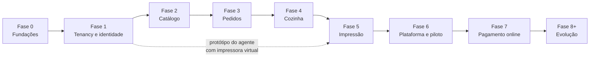

# Roteiro de implementação

> Status: **proposta para revisão** · Última revisão: 2026-10-11

> **Mudança de escopo em 2026-10-13.** O sistema passou a atender **uma única loja** ([ADR-0016](../adr/0016-uma-unica-loja.md)). Efeitos neste roteiro:
>
> - **Fase 1** deixa de ser "Tenancy e identidade" e passa a ser só **identidade**: usuários com papel, login no painel e sessão. Saem resolução por endereço, isolamento entre lojas e RLS.
> - **Fase 6** perde o Platform Admin, os planos e as assinaturas. Fica a preparação para produção e o piloto.
> - Riscos R1 (vazamento entre lojas), R2 (RLS) e R15 (acesso interno entre lojas) deixam de existir.
> - Pendência DP-07 (cobrança do SaaS) sai do escopo.
>
> O restante das fases e critérios de aceite continua valendo, lido como "a loja" em vez de "cada loja".

> **Andamento em 2026-10-14.** As fases 2, 3 e 4 estão implementadas na API, com testes. Decisões tomadas:
>
> - **DP-06:** aceite configurável pela loja, **automático por padrão**. No aceite manual, o pedido sem resposta no prazo configurado é recusado sozinho.
> - **DP-11:** entrega, retirada e mesa, como no protótipo: taxa de entrega fixa e número da mesa digitado.
> - Imagens em disco local no MVP ([ADR-0018](../adr/0018-imagens-em-disco-local.md)), sem recodificação.
> - Ofertas combinatórias (Terça do Hambúrguer) continuam fora do MVP.
>
> Pendente da fase 4 no front-end: a aplicação Kitchen Display e a remoção da rota `/cozinha/comanda` do Storefront.
>
> A **fase 5** está implementada na API (agentes, pareamento, impressoras, tarefas, tentativas, reserva, reimpressão, recuperação de reservas e presença), com testes. Faltam o programa do agente (serviço Windows com fila local e ESC/POS), as telas de impressão no Admin e no Kitchen Display, e o teste com a impressora de referência (DP-02). Os parâmetros de reserva, tentativas e validade são constantes em `PrintJobPolicy`.

Este documento ordena a implementação em fases, com critérios de aceite, riscos e o registro das decisões pendentes. Ele não contém estimativas de prazo: o tamanho de cada fase é relativo (P, M, G), porque a capacidade de quem vai implementar não é conhecida aqui.

## 1. Princípios de sequenciamento

1. **Isolamento antes de funcionalidade.** O contexto de tenant, os filtros e os testes de isolamento entram antes do primeiro dado de loja. Adicionar isolamento depois é a forma mais comum de errá-lo.
2. **Uma fatia fina de ponta a ponta primeiro.** Cada fase termina com algo que roda do navegador ao banco, passando pelo pipeline.
3. **O protótipo continua funcionando.** O Storefront existente é migrado por partes; em nenhum momento fica quebrado na `main`.
4. **Risco técnico cedo.** As partes mais incertas (isolamento no banco, tempo real, agente de impressão) são atacadas com versões mínimas antes de receberem acabamento.
5. **Platform Admin por último.** Até lá, lojas são criadas por um comando de semeadura. Uma tela para isso não reduz risco nenhum.
6. **Nada de funcionalidade antes de teste nos caminhos críticos**: criação de pedido, isolamento, transições de estado, fila de impressão.

## 2. Visão das fases

| Fase | Tamanho | Entrega em uma frase |
|---|---|---|
| 0. Fundações | M | Repositório estruturado, ambiente local e pipelines funcionando, sem funcionalidade nova. |
| 1. Tenancy e identidade | G | Duas lojas isoladas, resolvidas por host, com login no painel. |
| 2. Catálogo | M | O dono cadastra o cardápio e o consumidor o vê na loja certa. |
| 3. Pedidos | G | O consumidor faz um pedido real, com preço calculado no servidor. |
| 4. Cozinha | M | O pedido aparece no painel da cozinha em tempo real. |
| 5. Impressão | G | A comanda sai sozinha na impressora da loja. |
| 6. Plataforma e piloto | G | Uma loja real opera um turno inteiro. |
| 7. Pagamento online | M | O consumidor paga por Pix antes de o pedido ir para a cozinha. |
| 8+. Evolução | — | Lista priorizada conforme o uso. |

**Se o pagamento online for obrigatório para o primeiro cliente (DP-03), as fases 6 e 7 trocam de ordem.**

## 3. Fases

### Fase 0 — Fundações

**Objetivo:** ter a estrutura do monorepo, o ambiente local e os pipelines prontos antes de qualquer regra de negócio.

**Depende de:** aceite dos ADRs 0001, 0002, 0005, 0006 e 0013; DP-10 resolvida por um experimento curto.

**Entregas**

- Estrutura de diretórios da raiz: `docs/`, `contracts/`, `back-end/`, `infra/`, `.github/`, com `README` e `.gitignore` na raiz.
- Storefront movido para `front-end/projects/storefront`, sem mudança de comportamento.
- Bibliotecas `ui` e `app-core` criadas, com os primitivos do protótipo movidos.
- ESLint adicionado, com as regras de fronteira entre projetos.
- npm mantido como gerenciador (decidido); investigar o conflito contornado por `legacy-peer-deps`.
- Solução .NET com os projetos de camada, um endpoint de saúde e os testes de arquitetura das regras de dependência.
- Compose local com PostgreSQL, armazenamento de objetos e capturador de e-mails.
- Pipelines da API e das aplicações web, com filtros por caminho e a verificação "portão".
- Fluxo do contrato OpenAPI funcionando para um endpoint.
- Proteção da branch `main`.

**Critérios de aceite**

- [ ] Em uma máquina limpa, o ambiente sobe seguindo o `README`, sem passos não documentados.
- [ ] O Storefront se comporta exatamente como antes da migração.
- [ ] Um pull request que viola uma regra de dependência (frontend ou backend) falha no pipeline.
- [ ] Alterar um endpoint sem atualizar o documento OpenAPI falha no pipeline.
- [ ] Uma mudança só no Storefront não dispara o pipeline da API, e vice-versa.
- [ ] `painel.localhost` e `brasa.localhost` chegam à API local com o host preservado.

**Riscos:** gastar tempo demais em ferramentas. Limite: nenhuma automação além da lista acima.

---

### Fase 1 — Tenancy e identidade

**Objetivo:** provar o isolamento entre lojas antes de existir qualquer dado de negócio.

**Depende de:** fase 0; aceite dos ADRs 0003, 0004 e 0010.

**Entregas**

- Módulos Tenancy e Identity: loja, domínios, configurações, usuário, vínculo, papéis.
- Resolução de tenant por host na superfície `store`.
- Login, sessão em cookie e loja ativa na superfície `admin`.
- Contexto de tenant, filtro global, carimbo e verificação na gravação, chaves compostas.
- Row-Level Security nas tabelas de loja, com papéis de banco separados para aplicação e migrations.
- Comando de semeadura que cria **duas** lojas de demonstração, com usuários.
- Base de auditoria.
- Estrutura da suíte de isolamento, incluindo a varredura automática de endpoints.
- Storefront: `StoreContext`, tema por loja com tokens semânticos, telas de loja não encontrada e indisponível.
- Admin: aplicação criada, com login e uma tela inicial.

**Critérios de aceite**

- [ ] Dois hosts diferentes mostram nome, logo e cores diferentes no Storefront.
- [ ] Host desconhecido mostra "loja não encontrada"; loja suspensa mostra "loja indisponível".
- [ ] Um usuário entra no painel e vê apenas a sua loja; um usuário com duas lojas consegue trocar entre elas.
- [ ] A suíte de isolamento passa, incluindo os testes diretos no banco: sem tenant definido, nenhuma linha é devolvida.
- [ ] Os testes de metadados confirmam filtro global e política em todas as tabelas de loja.
- [ ] Os cookies têm os atributos definidos em [security.md](security.md#41-cookies).
- [ ] Uma requisição que altera estado sem o token antifalsificação é recusada.
- [ ] Login, falha de login e troca de loja aparecem na auditoria.

**Riscos:** RLS com pool de conexões é a parte mais delicada. Se travar, seguir com as três primeiras camadas e registrar a quarta como bloqueio da fase 6.

---

### Fase 2 — Catálogo

**Objetivo:** substituir o cardápio mockado por dados reais, gerenciados pelo dono.

**Depende de:** fase 1.

**Entregas**

- Módulo Catalog: categorias, produtos, grupos de opções, opções.
- Admin: cadastro e edição de categorias, produtos e grupos de opções; alternância rápida de disponibilidade.
- Envio de imagens com validação, recodificação e variações.
- Endpoint do cardápio público, com cache por versão.
- Storefront lendo o cardápio da API; valores em centavos; `menu.data.ts` vira dado de semeadura.
- Auditoria de alterações de preço e disponibilidade.

**Critérios de aceite**

- [ ] Um produto criado na loja A aparece no Storefront de A e não aparece no de B.
- [ ] Marcar um produto como indisponível reflete na loja em poucos segundos.
- [ ] Os quatro usos de grupos de opções funcionam: adicional, tamanho, escolha de combo e remoção.
- [ ] Um arquivo que não é imagem, ou um SVG, é recusado no envio.
- [ ] Um usuário com papel de cozinha recebe 403 em todas as rotas de catálogo.
- [ ] O Storefront não contém mais dados de cardápio no código.
- [ ] A varredura de isolamento cobre todos os endpoints novos.

**Riscos:** o formulário de produto com grupos de opções é a tela mais complexa do Admin. Começar por uma versão simples.

---

### Fase 3 — Pedidos

**Objetivo:** um pedido real, criado com segurança, com pagamento presencial.

**Depende de:** fase 2; DP-06 e DP-11 com resposta ao menos provisória; aceite dos ADRs 0011 e 0012.

**Entregas**

- Módulo Ordering: cotação, criação idempotente, numeração por loja, cópia de nomes e preços, máquina de estados.
- Pagamento presencial registrado no módulo Payments.
- Ofertas dos dois tipos do MVP.
- Regras da loja: aberta ou fechada, tipos de pedido aceitos, pedido mínimo, taxa de entrega.
- Storefront: cotação no servidor, envio com chave de idempotência, tratamento de carrinho alterado, página de acompanhamento por token com consulta periódica.
- Admin: lista de pedidos, detalhe, aceite e recusa (se manual), cancelamento.
- Limites de taxa na superfície pública.

**Critérios de aceite**

- [ ] Um pedido enviado com preços adulterados é criado com os preços do servidor, ou recusado.
- [ ] Enviar o mesmo checkout três vezes cria um único pedido, com o mesmo número.
- [ ] Vinte pedidos simultâneos na mesma loja recebem vinte números distintos.
- [ ] Alterar o preço de um produto depois da compra não altera o pedido existente.
- [ ] Mudar o preço entre a cotação e o envio devolve o aviso de carrinho alterado, sem criar pedido.
- [ ] Loja fechada recusa pedidos com mensagem clara.
- [ ] O pedido só é consultável publicamente pelo token; a consulta pelo número não existe na superfície pública.
- [ ] O token de um pedido da loja A não funciona no host da loja B.
- [ ] Os dados de exemplo pré-preenchidos do protótipo foram removidos do checkout.

**Riscos:** regras de preço divergindo entre o que o protótipo mostra e o que o servidor calcula. Os testes existentes em `pricing.spec.ts` servem de referência para os testes do backend.

---

### Fase 4 — Cozinha

**Objetivo:** o pedido confirmado aparece na cozinha, em tempo real, e o preparo atualiza o que o cliente vê.

**Depende de:** fase 3; aceite dos ADRs 0007 e 0008.

**Entregas**

- Módulo Kitchen: comanda criada na confirmação, na mesma transação; estados de documento e de preparo.
- Outbox e despachante.
- Hubs `kitchen` e `ops`, com grupos definidos pelo servidor.
- Aplicação Kitchen Display: login, quadro, avanço e desfazer, alerta sonoro, indicador de conexão, relógio sincronizado.
- Reflexo do preparo no estado do pedido.
- **Remoção da rota `/cozinha/comanda` do Storefront.**
- Admin: pedidos em andamento atualizados em tempo real.

**Critérios de aceite**

- [ ] Um pedido confirmado aparece no painel em até poucos segundos, sem recarregar.
- [ ] Com a conexão em tempo real derrubada, o pedido aparece após a reconexão ou na consulta periódica.
- [ ] Dois toques simultâneos em "iniciar preparo" avançam o estado uma única vez.
- [ ] Avançar o preparo atualiza o que o consumidor vê no acompanhamento.
- [ ] O painel da loja A não recebe nenhum aviso de eventos da loja B.
- [ ] O papel de cozinha recebe 403 nas rotas administrativas; o papel de gerente, sem papel de cozinha, recebe 403 nas rotas da cozinha.
- [ ] Nenhuma rota pública devolve uma comanda. Verificado por teste.
- [ ] Derrubar o processo entre o commit e o aviso não perde a comanda: ela aparece depois.

**Riscos:** depender de avisos em tempo real para a correção. A regra "aviso é dica, consulta é verdade" precisa ser testada desligando o hub.

---

### Fase 5 — Impressão

**Objetivo:** a comanda sai automaticamente na impressora da loja, e falhas são visíveis.

**Depende de:** fase 4; **DP-02** para o teste com equipamento real; aceite do ADR 0009.

O protótipo do agente com impressora virtual pode começar depois da fase 1, em paralelo, para antecipar o risco.

**Entregas**

- Módulo Printing: agentes, impressoras, tarefas, tentativas, reserva, novas tentativas, validade.
- Pareamento e credencial de dispositivo; superfície `agent`; hub `agent`.
- Agente: serviço, fila local, renderizador com um perfil, transporte de rede, sinal de vida, diagnóstico.
- Instalador para Windows.
- Admin: tela de impressão (parear, listar, imprimir teste, histórico).
- Kitchen Display: situação da impressora e reimpressão.
- Serviços em segundo plano: recuperação de reservas vencidas, monitor de presença.

**Critérios de aceite**

- [ ] Um pedido confirmado é impresso sem nenhuma interação.
- [ ] Com o agente desligado por cinco minutos e religado, as tarefas dentro da validade são impressas em ordem; as vencidas viram alerta e não são impressas.
- [ ] Encerrar o agente à força durante uma impressão resulta, no máximo, em uma segunda via identificada como tal.
- [ ] Perder a confirmação (rede cortada após imprimir) **não** gera impressão duplicada.
- [ ] Com a impressora desligada, a tarefa falha com motivo, é tentada de novo e o painel avisa.
- [ ] Revogar o agente no Admin interrompe a impressão em, no máximo, a duração de um token.
- [ ] O agente da loja A não consegue reservar tarefas da loja B.
- [ ] Texto com acentos e cedilha sai correto na impressora de referência.
- [ ] Uma observação com caracteres de controle não altera a formatação da comanda.
- [ ] A reimpressão sai marcada como 2ª via e aparece na auditoria.

**Riscos:** variação entre modelos de impressora; ambiente da loja (antivírus, computador desligado, rede instável). Ver riscos R3 e R4.

---

### Fase 6 — Plataforma e piloto

**Objetivo:** operar uma loja real, com o mínimo de operação do SaaS e as garantias de produção.

**Depende de:** fase 5; **DP-01**, **DP-04**, **DP-09** e **DP-12** resolvidas; aceite do ADR 0014.

**Entregas**

- Aplicação Platform Admin: lojas e domínios, planos, assinaturas com situação manual, usuários da plataforma com segundo fator, acesso de suporte, saúde dos agentes, consulta à auditoria.
- Admin: convites de equipe, papéis, visão do plano.
- Ambientes de homologação e produção; DNS curinga; certificados.
- Backup configurado e **restauração testada**.
- Logs, métricas e alertas essenciais; verificação externa de saúde.
- Lista de verificação de [security.md](security.md#14-verificações-de-segurança-antes-de-produção) completa.
- Teste de carga com o perfil esperado.
- Termos de uso, política de privacidade e procedimento para pedidos de titulares.
- Roteiro escrito de implantação de uma loja nova, incluindo a instalação do agente.

**Critérios de aceite**

- [ ] Uma loja é criada, configurada e colocada no ar pelo Platform Admin, sem acesso direto ao banco.
- [ ] Suspender uma loja torna o Storefront indisponível e o Admin somente leitura.
- [ ] Um acesso de suporte fica registrado e visível ao proprietário.
- [ ] Um backup é restaurado em homologação seguindo o procedimento escrito.
- [ ] Todos os itens da lista de verificação de segurança estão marcados.
- [ ] Os alertas essenciais disparam em um teste provocado.
- [ ] A loja piloto opera um turno completo, com pedidos reais, sem intervenção técnica.

**Riscos:** escopo. O Platform Admin deve ser o mínimo para operar; o que puder continuar por comando continua.

---

### Fase 7 — Pagamento online

**Objetivo:** receber por Pix antes de o pedido ir para a cozinha.

**Depende de:** fase 3 (tecnicamente); **DP-03** resolvida.

**Entregas**

- Integração com o gateway escolhido, atrás de uma porta do módulo Payments.
- Estado `AwaitingPayment`, prazo e expiração por serviço em segundo plano.
- Recebimento de webhooks com caixa de entrada, validação de assinatura e consulta do estado real.
- Storefront: tela de pagamento com atualização do estado.
- Admin: situação dos pagamentos, alerta de pagamento após expiração.
- Reconciliação periódica de pagamentos pendentes.

**Critérios de aceite**

- [ ] Um pedido com pagamento online só gera comanda depois da confirmação do pagamento.
- [ ] Um webhook com assinatura inválida é recusado.
- [ ] O mesmo webhook recebido duas vezes não tem efeito na segunda.
- [ ] Um pedido não pago expira no prazo e não chega à cozinha.
- [ ] Um pagamento recebido depois da expiração gera alerta e não reabre o pedido.
- [ ] Valor divergente entre o gateway e o pedido gera alerta e não confirma.
- [ ] Com o webhook perdido, a reconciliação confirma o pagamento.

**Riscos:** modelo de recebimento (cada loja com a própria conta ou divisão pela plataforma) tem implicações regulatórias e de custo. Ver DP-03.

---

### Fase 8+ — Evolução

Sem ordem fixa; priorizar pelo que as lojas piloto pedirem.

| Tema | Pré-requisito |
|---|---|
| Regras de oferta combinatórias (por dia, categoria, quantidade) | Fase 3 |
| Várias impressoras com roteamento por categoria | Fase 5 |
| Estações de cozinha e preparo por estação | Fase 4 |
| Conta do consumidor com código por telefone | DP-05 |
| Domínio próprio por loja | Fase 6 |
| Atualização automática do agente | Fase 5 |
| Cobrança recorrente automatizada do SaaS | DP-07 |
| Relatórios de vendas | Fase 3 |
| Pedido em mesa por QR code; áreas e taxas de entrega | DP-11 |
| Várias instâncias, backplane e processo assíncrono separado | Medição que justifique |
| Tempo real para o consumidor | Fase 4 |
| Integração com emissor de documento fiscal | DP-08 |
| Meta tags por loja para pré-visualização de links | Fase 6 |

## 4. Ordem recomendada para começar

1. Revisar estes documentos e aceitar, ajustar ou rejeitar cada ADR.
2. Decidir DP-01 ao menos de forma provisória, para nomear namespaces e domínios locais.
3. Fazer o experimento curto da DP-10 (gerador de clientes).
4. Criar a estrutura da raiz e mover o Storefront para `projects/storefront`, em um pull request sem mudança de comportamento.
5. Criar a solução .NET com o endpoint de saúde e os testes de arquitetura.
6. Subir o Compose local e fazer o Storefront chamar o endpoint de saúde através de `brasa.localhost`.
7. Configurar os pipelines e a proteção da `main`.
8. Implementar a fatia mais fina da fase 1: uma tabela de loja, resolução por host, um endpoint de perfil público e **o primeiro teste de isolamento**.
9. Só então adicionar login, vínculo e RLS.
10. Em paralelo, a partir daqui: encomendar a impressora de referência (DP-02) e iniciar o protótipo do agente com impressora virtual.

## 5. Riscos

| # | Risco | Probabilidade | Impacto | Mitigação |
|---|---|---|---|---|
| R1 | Vazamento de dados entre lojas | Baixa | Crítico | Quatro camadas de isolamento; suíte obrigatória; varredura automática de endpoints |
| R2 | RLS com pool de conexões atrasar a fase 1 | Média | Médio | Permitir seguir com três camadas; RLS obrigatória antes da segunda loja real |
| R3 | Variação entre modelos de impressora; modelos que não informam falta de papel | Alta | Médio | Perfis no agente; equipamento de referência; lista de modelos homologados; painel como fonte de verdade |
| R4 | Ambiente da loja hostil ao agente: antivírus, computador desligado, atualizações, rede instável | Alta | Médio | Serviço com início automático; fila local; sinal de vida e alertas; roteiro de instalação; contingência pela tela |
| R5 | Escopo grande para uma equipe pequena: quatro interfaces, API e agente | Alta | Alto | Fases com entrega utilizável; MVP estrito; Platform Admin mínimo; semeadura por comando até a fase 6 |
| R6 | Pedidos falsos com pagamento presencial | Média | Médio | Limites de taxa e de valor; aceite manual opcional; confirmação de telefone na evolução |
| R7 | Loja sem internet não recebe pedidos | Média | Alto | Fora do escopo; deixar claro comercialmente; a operação de balcão da loja não depende do sistema |
| R8 | Exigência de documento fiscal impedir a adoção | Média | Alto | DP-08; posicionar o produto como sistema de pedidos, não fiscal; avaliar integração |
| R9 | Não conformidade com a LGPD | Média | Alto | DP-09; minimização e retenção desde o modelo; validação jurídica antes da produção |
| R10 | Ponto único de falha na máquina única | Média | Alto | Banco gerenciado; backup testado; monitoramento externo; procedimento de recriação a partir do repositório |
| R11 | Curva de aprendizado em tecnologias novas para quem implementa | Média | Baixo | Fase 0 dedicada; decisões reversíveis cedo |
| R12 | Mudança de protocolo quebrar agentes já instalados | Baixa | Alto | Versão de protocolo; compatibilidade com a versão anterior; versão mínima aplicada pelo servidor |
| R13 | Modelo de recebimento de pagamentos com implicação regulatória | Média | Alto | DP-03; preferir que cada loja receba na própria conta |
| R14 | Divergência silenciosa entre frontend e API | Média | Médio | Contratos OpenAPI versionados e verificados no pipeline |
| R15 | Abuso de acesso interno a dados de lojas | Baixa | Alto | Acesso de suporte com motivo, prazo e auditoria visível |
| R16 | Nome do produto igual à marca de uma loja | Baixa | Médio | DP-01 |

## 6. Decisões pendentes

Cada pendência tem a recomendação desta arquitetura e o critério para fechar. Enquanto não forem fechadas, **não devem ser tratadas como fatos**.

### DP-01 — Nome do produto e domínio raiz

- **Contexto:** "Brasa Burger" é o nome do repositório e também a marca fixa no protótipo. Em um SaaS, é a marca de uma loja, não do produto.
- **Recomendação:** escolher um nome neutro para o produto e manter "Brasa Burger" como loja de demonstração. `Brasa` segue como codinome dos namespaces até lá.
- **Critério:** disponibilidade do domínio `.com.br` e da marca.
- **Prazo:** provisória antes da fase 0; definitiva antes da fase 6.

### DP-02 — Modelo de impressora térmica e conexão

- **Contexto:** o protocolo final, a página de código, a detecção de falhas e o transporte dependem do equipamento.
- **Opções:** rede, USB pela fila do Windows, serial, Bluetooth; 80 mm ou 58 mm.
- **Recomendação:** adotar como referência uma térmica de 80 mm, com guilhotina, ESC/POS e interface de rede. Manter uma lista de modelos homologados.
- **Critério:** suporte a consulta de situação; página de código com acentuação do português; disponibilidade e preço no Brasil; o que as lojas-alvo já possuem.
- **Prazo:** antes do teste com equipamento real na fase 5. O desenvolvimento não é bloqueado, por causa da impressora virtual.

### DP-03 — Pagamento online no MVP e gateway

- **Contexto:** o protótipo oferece cartão, Pix e dinheiro apenas como seleção.
- **Questão 1 — o MVP precisa de pagamento online?** Recomendação: **não**. Pagamento na retirada ou entrega primeiro; Pix online na fase 7.
- **Questão 2 — quem recebe o dinheiro?**
  - *Cada loja com a própria conta no gateway:* o dinheiro nunca passa pelo SaaS; mais simples do ponto de vista regulatório; exige guardar credenciais por loja, cifradas. **Recomendado.**
  - *Conta da plataforma com divisão:* experiência de adesão mais simples para a loja; responsabilidades e custos maiores para o SaaS.
- **Questão 3 — qual gateway?** A comparar na data da decisão.
- **Critério:** Pix com webhook assinado; ambiente de teste; chave de idempotência; taxas; suporte ao modelo de recebimento escolhido; qualidade da documentação.
- **Prazo:** questão 1 antes da fase 3; as demais antes da fase 7.

### DP-04 — Provedor de hospedagem e região

- **Recomendação:** uma máquina com Compose e banco gerenciado ([ADR-0014](../adr/0014-hospedagem-do-mvp.md)). O provedor fica em aberto.
- **Critério:** região em São Paulo ou próxima; WebSocket; certificado curinga; PostgreSQL gerenciado com recuperação pontual; armazenamento de objetos; custo mensal previsível.
- **Prazo:** antes da fase 6. Convém decidir junto com a revisão do ADR-0002, porque a escolha do provedor pode influenciar a do banco.

### DP-05 — Identificação do consumidor

- **Opções:** convidado com token por pedido; conta com código por telefone; conta com e-mail e senha.
- **Recomendação:** convidado no MVP. Código por telefone quando houver funcionalidade que dependa de reconhecer o cliente (repetir pedido, endereços salvos) ou quando pedidos falsos virarem problema.
- **Critério:** atrito no checkout contra necessidade de identificação.
- **Prazo:** não bloqueia o MVP.

### DP-06 — Aceite do pedido: automático ou manual

- **Recomendação:** configuração por loja, com **automático** como padrão.
- **Critério:** confirmar com as lojas piloto como elas operam hoje.
- **Prazo:** antes da fase 3.

### DP-07 — Cobrança do SaaS

- **Opções:** situação da assinatura definida manualmente; cobrança recorrente por gateway.
- **Recomendação:** manual até haver volume que justifique a automação.
- **Critério:** número de lojas e tempo gasto com cobrança.
- **Prazo:** não bloqueia o MVP.

### DP-08 — Documento fiscal

- **Contexto:** a comanda não é documento fiscal. Estabelecimentos têm obrigações fiscais na venda ao consumidor, e alguns podem esperar que o sistema as atenda.
- **Recomendação:** fora do MVP. Posicionar o produto como sistema de pedidos e deixar isso explícito na oferta. Avaliar integração com um emissor quando houver demanda.
- **Critério:** exigência das lojas piloto; orientação contábil.
- **Prazo:** esclarecer antes da fase 6.

### DP-09 — Papéis LGPD e retenção de dados

- **Recomendação:** tratar a loja como controladora dos dados dos seus clientes e o SaaS como operador; definir prazos de anonimização; publicar termos e política de privacidade.
- **Critério:** validação jurídica.
- **Prazo:** antes da fase 6.

### DP-10 — Gerador de cliente a partir do OpenAPI

- **Recomendação:** experimento de poucas horas na fase 0, comparando duas ou três ferramentas com um endpoint real.
- **Critério:** tipos fiéis ao contrato; saída separada por superfície; compatível com os interceptores do `HttpClient`; código gerado enxuto; projeto mantido e com licença compatível.
- **Prazo:** fase 0.

### DP-11 — Escopo do delivery e do pedido em mesa

- **Contexto:** o protótipo tem taxa de entrega fixa e número de mesa digitado.
- **Recomendação:** manter assim no MVP. Áreas de entrega com taxas diferentes e mesas com QR code ficam para a evolução.
- **Critério:** necessidade das lojas piloto.
- **Prazo:** antes da fase 3.

### DP-12 — Destino de logs, métricas e alertas

- **Recomendação:** serviço externo à máquina da aplicação, com suporte a OpenTelemetry.
- **Critério:** custo no volume inicial; retenção; canais de alerta.
- **Prazo:** antes da fase 6.

### Parâmetros a calibrar

Não são decisões de arquitetura, mas têm valores sugeridos nos documentos e precisam de confirmação com uso real: duração das sessões; prazos de reserva, tentativas e validade das tarefas de impressão; intervalo de sinal de vida do agente; prazo de expiração de pagamento; limites de taxa; limites por plano; prazos de retenção e de anonimização; limiares de alerta.
