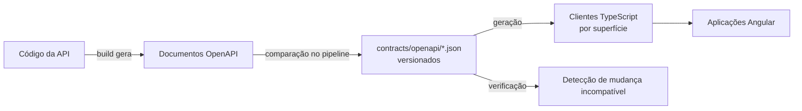
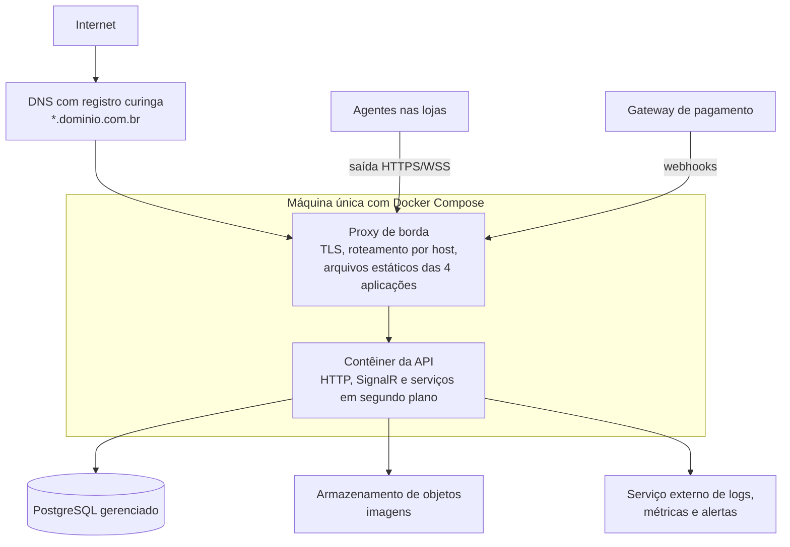
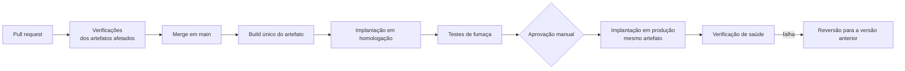

# Infraestrutura, monorepo e CI/CD

> Status: **proposta para revisão** · Última revisão: 2026-10-11
> Decisões relacionadas: [ADR-0005](../adr/0005-estrutura-do-monorepo.md), [ADR-0013](../adr/0013-contratos-openapi-por-superficie.md), [ADR-0014](../adr/0014-hospedagem-do-mvp.md)

> **Mudança de escopo em 2026-10-13.** O sistema passou a atender **uma única loja** ([ADR-0016](../adr/0016-uma-unica-loja.md)). Os trechos deste documento sobre vários estabelecimentos (`TenantId`, loja resolvida pelo endereço, isolamento entre lojas, Platform Admin, planos e assinaturas) não se aplicam mais e serão revisados. O restante continua valendo.

> **Repositórios separados desde 2026-10-13.** O front-end fica no repositório [brasa-burger-front-end](https://github.com/Ryan-pedro/brasa-burger-front-end), com o workspace Angular na raiz ([ADR-0017](../adr/0017-front-end-em-repositorio-proprio.md)). Onde este documento diz `front-end/`, leia a raiz daquele repositório. No repositório da API, o conteúdo de `back-end/` passou para a raiz: onde este documento diz `back-end/src` ou `back-end/tests`, leia `src` e `tests`.

## 1. Estado atual (fatos)

- O repositório tem um commit, na branch `main`, e um remoto no GitHub.
- Não existem: `Dockerfile`, Compose, pipelines em `.github/workflows`, configuração de ambientes, scripts de infraestrutura, `README` ou `.gitignore` na raiz.
- O frontend usa npm 10 com `legacy-peer-deps=true`, o que indica um conflito de dependências pares contornado, não resolvido.
- O frontend tem `.editorconfig` e Prettier. Não tem ESLint.
- A mensagem do único commit está em português e não segue um padrão de prefixo.

Este documento não cria nenhum arquivo executável. Estruturas e nomes de arquivos são propostas.

## 2. Estrutura do monorepo

**Decisão proposta** ([ADR-0005](../adr/0005-estrutura-do-monorepo.md)):

```
brasa-burger/
├─ .github/
│  ├─ workflows/                 # um pipeline por artefato implantável
│  ├─ CODEOWNERS
│  ├─ pull_request_template.md
│  └─ dependabot.yml
├─ docs/
│  ├─ architecture/              # estes documentos
│  └─ adr/                       # registros de decisão
├─ contracts/
│  └─ openapi/                   # store, admin, kitchen, platform, agent
├─ front-end/                    # workspace Angular (já existe)
│  ├─ projects/
│  │  ├─ storefront/  admin/  kitchen/  platform/      # aplicações
│  │  └─ ui/  app-core/  realtime/  api-clients/       # bibliotecas
│  └─ e2e/                       # testes ponta a ponta
├─ back-end/
│  ├─ Brasa.sln
│  ├─ src/
│  │  ├─ Brasa.Domain/  Brasa.Application/  Brasa.Infrastructure/
│  │  ├─ Brasa.Api/                # API e hubs
│  │  ├─ Brasa.Worker/             # processamento assíncrono
│  │  ├─ Brasa.Printing.Contracts/ # protocolo do agente
│  │  └─ Brasa.PrintAgent/         # agente local de impressão
│  ├─ tests/
│  └─ installer/                   # empacotamento do agente
├─ infra/
│  ├─ compose/                   # definições por ambiente
│  ├─ docker/                    # imagens
│  ├─ edge/                      # configuração do proxy de borda
│  └─ scripts/                   # backup, restauração, implantação
├─ .editorconfig  .gitignore  .gitattributes
└─ README.md
```

- O diretório `front-end/` é mantido com o nome atual. O backend usa `back-end/` por simetria.
- Testes unitários do frontend ficam ao lado do código (`*.spec.ts`, como já é feito). Os do backend ficam em `back-end/tests/`.
- O agente de impressão fica na mesma solução .NET para compartilhar o projeto de contratos, mas tem pipeline e versionamento próprios.

### 2.1 Dependências do frontend: npm

> **Decidido em 2026-10-11:** o projeto permanece no **npm**. A comparação abaixo fica como registro; a recomendação original era pnpm.

| Opção | Avaliação |
|---|---|
| **Manter npm** | Funciona hoje. Instalação mais lenta e permissiva com dependências não declaradas. **Adotado.** |
| **pnpm como gerenciador, um único `package.json`** | Instalação mais rápida e com cache eficiente no pipeline; resolução estrita, que impede usar pacote não declarado. Era a recomendação; não adotado. |
| pnpm workspaces com um `package.json` por aplicação | Permite versões diferentes por aplicação, o que aqui é indesejável: as quatro devem usar a mesma versão do Angular. Não recomendado. |
| Ferramenta de monorepo com grafo de dependências e cache de build | Útil com muitos projetos e builds lentos. Excessivo para quatro aplicações. Reavaliar se o tempo de pipeline incomodar. |

O workspace multi-projeto do próprio Angular já resolve o que os "workspaces" de gerenciadores de pacote resolveriam.

Pendência herdada: **investigar o conflito mascarado por `legacy-peer-deps`** em vez de carregá-lo adiante. O melhor momento é ao adicionar o ESLint, na fase de fundações.

### 2.2 Dependências do .NET

- Versões de pacotes centralizadas em um único arquivo na raiz de `back-end/`.
- Propriedades comuns (tipos anuláveis, avisos como erro, analisadores) em um arquivo compartilhado por todos os projetos.
- Versão do SDK fixada, para que máquina local e pipeline usem a mesma.
- Arquivos de bloqueio de pacotes habilitados, para builds reproduzíveis.
- Filtros de solução por artefato (API, agente), para que cada pipeline compile só o necessário.

### 2.3 Contratos OpenAPI como elo entre frontend e backend



1. Quem altera um endpoint regenera o documento da superfície e o inclui no mesmo pull request.
2. O pipeline da API falha se o documento gerado pelo código for diferente do versionado.
3. Uma mudança em `contracts/openapi/<superfície>.json` dispara o pipeline da aplicação que consome aquela superfície.
4. Os clientes TypeScript são gerados a partir do arquivo versionado durante o build. Se a mudança for incompatível, a aplicação não compila, **no mesmo pull request**.
5. Uma verificação à parte classifica a mudança como compatível ou incompatível e comenta no pull request.

A ferramenta de geração dos clientes é a pendência **DP-10**.

## 3. Ambientes

| Ambiente | Finalidade | Dados | Integrações |
|---|---|---|---|
| **Desenvolvimento local** | Programar e testar | Semeados; a loja de demonstração vem do cardápio mockado do protótipo | Gateway falso; impressora virtual; e-mails capturados localmente |
| **Homologação** | Validar antes de produção; demonstrações | Sintéticos. Nunca cópia de produção com dados pessoais | Gateway em modo de teste; agente com impressora virtual ou de teste |
| **Produção** | Lojas reais | Reais | Gateway real; agentes nas lojas |

Regras:

- Homologação e produção têm a mesma topologia; muda o tamanho.
- O mesmo artefato (imagem da API, arquivos estáticos) é promovido de homologação para produção. Não há build específico de produção.
- Bancos, armazenamento e segredos são separados por ambiente.

### 3.1 Desenvolvimento local

- **Compose** sobe as dependências: PostgreSQL, armazenamento de objetos compatível com S3 e um capturador de e-mails.
- A API e as aplicações Angular rodam direto na máquina, com recarga automática, para um ciclo de edição rápido.
- **Subdomínios locais:** navegadores resolvem qualquer nome terminado em `.localhost` para a própria máquina. Assim `brasa.localhost`, `outra-loja.localhost` e `painel.localhost` funcionam sem configuração de DNS, e a resolução de tenant por host pode ser exercitada desde o primeiro dia.
- O servidor de desenvolvimento do Angular encaminha `/api` e `/hubs` para a API local, preservando o host, reproduzindo o comportamento do proxy de borda.
- Um comando de semeadura cria duas lojas de demonstração. **Duas**, para que qualquer falha de isolamento apareça durante o desenvolvimento.
- O agente de impressão roda localmente com a impressora virtual, que grava o resultado em arquivo.

### 3.2 Topologia de homologação e produção (MVP)



## 4. Docker e Docker Compose

| Imagem | Conteúdo | Observações |
|---|---|---|
| **API** | Aplicação .NET publicada | Build em estágios; imagem final só com o runtime; execução como usuário sem privilégios; verificação de saúde. |
| **Proxy de borda** | Proxy com a configuração de rotas | Os arquivos estáticos das aplicações são montados de um volume versionado, não embutidos na imagem, para que cada aplicação seja publicada sem reconstruir o proxy. |

- Compose define os serviços de cada ambiente. Os arquivos ficam em `infra/compose/`.
- As imagens são marcadas com o identificador do commit e publicadas em um registro de contêineres.
- Nada de `latest` em produção: a versão implantada é sempre explícita.
- O banco **não** roda em contêiner em produção se houver opção gerenciada (seção 5.2).
- O agente de impressão **não** usa Docker: é um serviço instalado no computador da loja.

## 5. Hospedagem

### 5.1 Opções para a aplicação

| Opção | Vantagens | Desvantagens |
|---|---|---|
| **Uma máquina virtual com Compose e proxy de borda** | Custo mais baixo e previsível; controle total sobre WebSocket e certificado curinga; fácil de entender | Sistema operacional, atualizações e disponibilidade são responsabilidade nossa; ponto único de falha |
| **Plataforma de contêineres gerenciada** | Menos operação; TLS e reversão simplificados | Custo maior; suporte a domínio curinga e a conexões longas varia entre provedores; nem todas têm região no Brasil |
| **Serviços gerenciados de um grande provedor** | Mais robusto; região em São Paulo; banco, armazenamento e monitoramento integrados | Custo e curva de aprendizado maiores |
| **Kubernetes** | Escala e orquestração | Complexidade operacional incompatível com o estágio do produto. **Descartado para o MVP.** |

**Decisão proposta** ([ADR-0014](../adr/0014-hospedagem-do-mvp.md)): **uma máquina com Compose e proxy de borda**, com banco gerenciado se o orçamento permitir. A arquitetura não depende de nenhum provedor: tudo é contêiner, PostgreSQL e armazenamento compatível com S3.

> **Pendência DP-04.** O provedor e a região não estão definidos. Requisitos a conferir na escolha: região em São Paulo ou próxima, porque a latência afeta a operação da cozinha; suporte a WebSocket; certificado para domínio curinga; PostgreSQL gerenciado com recuperação pontual; armazenamento de objetos; custo mensal previsível. Preços devem ser levantados na data da contratação.

### 5.2 Banco de dados

| Opção | Avaliação |
|---|---|
| **PostgreSQL gerenciado** | Backups, recuperação pontual e atualizações pelo provedor. **Recomendado**: o banco é a única parte do sistema que não pode ser recriada a partir do repositório. |
| PostgreSQL em contêiner na mesma máquina | Custo zero adicional. Exige rotina própria de backup para fora da máquina e testes de restauração. Aceitável apenas enquanto não houver lojas pagantes. |

### 5.3 Proxy de borda, DNS e certificados

- Um registro DNS curinga aponta todos os subdomínios para a borda.
- O proxy termina TLS, roteia por host e por prefixo de caminho ([architecture-overview.md](architecture-overview.md#8-hosts-e-superfícies-da-api)), serve os arquivos estáticos e aplica cabeçalhos de segurança.
- Certificado curinga exige validação por DNS. Alternativa: colocar um serviço de CDN na frente, que fornece o certificado curinga e proteção contra tráfego abusivo.
- O proxy é o **único** ponto exposto. A API não é acessível diretamente.
- O proxy repassa o host original e a origem da requisição; a API aceita esses cabeçalhos apenas dele.
- Domínio próprio por loja (evolução) exigirá emissão de certificado por domínio e verificação de posse.

## 6. CI/CD no GitHub Actions

### 6.1 Pipelines

| Pipeline | Disparado por mudanças em | Etapas | Entrega |
|---|---|---|---|
| **Aplicação web** (reutilizável, uma execução por aplicação) | `front-end/projects/<app>/**`, bibliotecas, configuração raiz do workspace, `contracts/openapi/<superfície>.json` | Instalar com cache, gerar clientes, lint, testes, build | Arquivos estáticos |
| **API** | `back-end/src/**` exceto o agente, `back-end/tests/**` | Restaurar, compilar, testes unitários, testes de integração com PostgreSQL, testes de arquitetura, suíte de isolamento, comparação do OpenAPI, build da imagem | Imagem no registro |
| **Agente de impressão** | `back-end/src/Brasa.PrintAgent/**`, `Brasa.Printing.Contracts/**` | Compilar, testes, publicar executável, empacotar instalador | Instalador anexado a uma versão marcada |
| **Contratos** | `contracts/openapi/**` | Detecção de mudança incompatível | Comentário no pull request |
| **Ponta a ponta** | Pull requests que tocam frontend ou backend; execução noturna | Subir o ambiente com Compose, semear, rodar os fluxos críticos | Relatório |
| **Segurança** | Pull requests e agenda semanal | Varredura de segredos, vulnerabilidades em dependências, análise estática | Alertas |
| **Documentação** | `docs/**` | Verificação de links | — |

Para as quatro aplicações web existe **um** pipeline reutilizável, chamado com o nome da aplicação. Isso evita quatro cópias que divergem com o tempo.

### 6.2 Fluxo de entrega



- Homologação recebe todo merge em `main`, automaticamente.
- Produção exige aprovação manual, configurada como ambiente protegido no GitHub.
- A implantação da API troca a imagem e verifica a saúde; em falha, volta à imagem anterior.
- A implantação de uma aplicação web publica os arquivos em um diretório novo e troca o apontamento. Reverter é reapontar.

### 6.3 Build e deploy independentes

| Mudança | O que é construído e implantado |
|---|---|
| Só no Storefront | Só o Storefront |
| Em uma biblioteca compartilhada | As aplicações que a importam |
| Só na API, sem mudar contrato | Só a API |
| Na API, com mudança de contrato de uma superfície | A API e a aplicação daquela superfície |
| Só no agente | Só o instalador do agente |
| Só em documentação | Nada é implantado |

Condição para isso funcionar: **mudanças de contrato precisam ser compatíveis com a versão anterior do consumidor**, porque API e frontend não são trocados no mesmo instante. A ordem segura é: publicar a API com o campo ou endpoint novo; publicar o frontend que o usa; remover o antigo em uma entrega posterior.

O agente de impressão tem uma restrição mais forte: ele é atualizado nas lojas com atraso de dias ou semanas. O protocolo do agente mantém compatibilidade com a versão anterior ([backend-architecture.md](backend-architecture.md#11-versionamento-da-api)).

### 6.4 Migrations seguras

1. Migrations são geradas em desenvolvimento e revisadas no pull request, junto com o script SQL resultante.
2. A aplicação **não** aplica migrations ao iniciar. Elas são um passo próprio do pipeline, executado antes da troca da versão.
3. Esse passo usa um papel de banco diferente do papel da aplicação.
4. Toda mudança segue o padrão **expandir e contrair**:
   - *Expandir:* adicionar coluna ou tabela de forma que a versão antiga da aplicação continue funcionando.
   - *Migrar:* publicar a aplicação que usa a estrutura nova; copiar dados se necessário.
   - *Contrair:* remover a estrutura antiga em uma entrega posterior.
5. Com isso, a versão anterior da aplicação sempre funciona com o esquema novo, e reverter a aplicação não exige reverter o banco.
6. Operações que bloqueiam tabelas grandes são feitas de forma não bloqueante e fora do horário de pico.
7. Antes de qualquer migration destrutiva, um backup pontual é confirmado.
8. Toda tabela nova com dados de loja inclui, na mesma migration, a política de isolamento. Um teste falha se faltar.

## 7. Armazenamento de imagens

| Aspecto | Proposta |
|---|---|
| Onde | Armazenamento de objetos compatível com S3, fora do contêiner da API |
| Envio | Pela API, que valida, recodifica e gera variações de tamanho ([security.md](security.md#85-envio-de-imagens)) |
| Nomes | Gerados, com o identificador da loja como prefixo; nunca o nome original |
| Variações | Miniatura, cartão e detalhe, geradas no envio |
| Entrega | Por um host separado, com CDN, cache longo e sem cookies. O nome muda quando a imagem muda |
| Formato | Um formato moderno com alternativa compatível |
| Limpeza | Imagens sem referência são removidas por rotina periódica |
| Local | No desenvolvimento, um emulador compatível com S3 no Compose |

As ilustrações SVG do protótipo viram dados de demonstração.

## 8. Logs, métricas e alertas

### 8.1 Coleta

- A API e o agente emitem logs estruturados e instrumentação OpenTelemetry ([backend-architecture.md](backend-architecture.md#14-logs-e-rastreabilidade)).
- Os contêineres escrevem na saída padrão; a coleta é responsabilidade da infraestrutura.
- Erros do frontend são capturados e enviados com o identificador de rastreamento.

> **Pendência DP-12.** O destino dos dados não está definido. Recomendação: um serviço **externo** à máquina da aplicação, para que o monitoramento não caia junto com o que monitora. Critérios: custo no volume inicial, retenção, alertas por e-mail ou mensagem, suporte a OpenTelemetry.

### 8.2 Métricas a acompanhar

| Grupo | Métricas |
|---|---|
| API | Requisições, latência e taxa de erro por superfície |
| Pedidos | Pedidos criados por minuto; tempo entre criação e comanda; pedidos recusados na revalidação |
| Outbox | Mensagens pendentes; idade da mais antiga |
| Impressão | Tarefas pendentes; idade da mais antiga; taxa de falha; tarefas abandonadas |
| Agentes | Conectados; offline; versão de cada um |
| Tempo real | Conexões ativas por hub |
| Pagamentos | Webhooks recebidos, recusados e com falha de processamento |
| Banco | Conexões em uso; consultas lentas; tamanho |
| Segurança | Falhas de login; requisições barradas por limite de taxa |
| Infraestrutura | CPU, memória, disco; validade de certificados; idade do último backup |

### 8.3 Alertas iniciais

Limiares sugeridos, a calibrar com o uso real.

| Alerta | Condição |
|---|---|
| Indisponibilidade | Verificação externa de saúde falha por 2 minutos |
| Erros | Taxa de erro 5xx acima de 2% por 5 minutos |
| Outbox parado | Mensagem pendente há mais de 1 minuto |
| Impressão parada | Tarefa pendente há mais de 2 minutos com o agente conectado |
| Pagamentos | Falhas consecutivas no processamento de webhooks |
| Backup | Último backup com mais de 26 horas |
| Disco | Uso acima de 80% |
| Certificado | Vence em menos de 14 dias |
| Banco | Conexões próximas do limite |

## 9. Monitoramento do agente de impressão

O agente está fora da nossa infraestrutura, então é monitorado pelo que ele informa.

| Fonte | Conteúdo |
|---|---|
| Sinal de vida periódico | Versão, situação de cada impressora, tamanho da fila local, último erro |
| Resultado das tentativas | Sucesso, falha com motivo, resultado desconhecido |
| Ausência de sinal | Agente considerado offline após 90 segundos |

| Quem vê | Onde |
|---|---|
| Cozinha | Barra de situação do Kitchen Display: impressora conectada, offline ou com erro |
| Dono e gerente | Tela de impressão do Admin: agentes, impressoras, últimas tarefas, botão de teste |
| Operação do SaaS | Tela de saúde dos agentes no Platform Admin: todas as lojas, versões desatualizadas, agentes offline em horário de funcionamento |

Evolução: aviso ativo ao proprietário quando o agente fica offline durante o horário de funcionamento.

## 10. Backup e recuperação

**Objetivos propostos para o MVP**, a validar:

| Objetivo | Com banco gerenciado | Com banco em contêiner |
|---|---|---|
| Perda máxima de dados | Minutos | Até 24 horas |
| Tempo máximo de recuperação | Algumas horas | Algumas horas |

| O que | Como | Retenção |
|---|---|---|
| Banco de dados | Recuperação pontual do provedor, mais uma cópia lógica diária para armazenamento separado | 30 dias |
| Imagens | Versionamento ou cópia periódica do armazenamento | 30 dias |
| Chaves de proteção de dados | Junto com os segredos | Enquanto houver sessões |
| Configuração de infraestrutura | No repositório | Histórico do Git |
| Segredos | Inventário documentado e cofre | — |

Regras:

- **Backup sem teste de restauração não conta.** Restaurar em homologação pelo menos a cada trimestre, com o procedimento escrito.
- Backups cifrados, em local diferente do banco principal, com acesso restrito.
- **Limitação conhecida:** com banco compartilhado, não há restauração nativa de uma única loja. O procedimento é restaurar o backup em um banco temporário e exportar as linhas daquela loja. É um dos gatilhos para migrar lojas grandes para banco dedicado.

## 11. Escalabilidade e limites operacionais

**Ordem de grandeza.** Cem lojas, cada uma com cerca de duzentos pedidos concentrados em três horas de pico, somam poucos pedidos por segundo. As conexões em tempo real são algumas por loja (painel, admin, agente). É uma carga pequena para uma máquina modesta. A capacidade real deve ser medida em teste de carga antes da entrada em produção.

**O que precisa ser verdade desde o início, para escalar depois sem reescrever:**

- A API não guarda estado de sessão em memória. Caches têm validade curta e são reconstruíveis.
- As chaves de proteção de dados ficam fora do contêiner.
- Arquivos ficam no armazenamento de objetos, nunca no disco do contêiner.
- Os serviços em segundo plano toleram mais de uma instância.
- Toda fila tem limite de tentativas e toda consulta de lista tem paginação.

**Caminho de crescimento**, um passo de cada vez, cada um só quando houver medição que o justifique:

| Passo | Quando | O que muda |
|---|---|---|
| 1. Máquina maior | Uso de CPU ou memória sustentado | Nada na arquitetura |
| 2. Banco gerenciado, se ainda não for | Antes de lojas pagantes | Conexão |
| 3. Várias instâncias da API | Necessidade de disponibilidade ou de capacidade | Balanceador com afinidade de sessão para WebSocket, backplane do SignalR, limitador de taxa com armazenamento compartilhado |
| 4. Processamento assíncrono em processo próprio | Junto com o passo 3 | Configuração; o código já é separado |
| 5. Réplica de leitura | Relatórios pesando nas operações | Consultas de relatório apontadas para a réplica |
| 6. Particionamento por tempo das tabelas grandes | Tabelas de pedidos e auditoria com muitos milhões de linhas | Esquema |
| 7. Banco dedicado para lojas grandes | Uma loja degradar as demais ou exigir isolamento físico | Resolução de conexão por loja |

**Limites operacionais** aplicados pelo sistema: limites de taxa por origem e por loja; limites por plano (produtos, pedidos por mês, impressoras); tamanho máximo de requisição e de imagem; tempo máximo por requisição; número máximo de conexões em tempo real por loja.

## 12. Fluxo de trabalho no GitHub

### 12.1 Branches

- `main` é a única branch permanente e está sempre implantável.
- Trabalho em branches curtas, a partir de `main`: `feat/...`, `fix/...`, `docs/...`, `chore/...`.
- Sem branch de desenvolvimento de longa duração. Funcionalidade incompleta fica atrás de um sinalizador, não em uma branch aberta por semanas.

### 12.2 Commits

Padrão Conventional Commits, com o escopo indicando a área:

| Parte | Regra |
|---|---|
| Tipo | `feat`, `fix`, `docs`, `refactor`, `test`, `chore`, `ci`, `build`, `perf` |
| Escopo | `storefront`, `admin`, `kitchen`, `platform`, `ui`, `api`, `worker`, `agent`, `infra`, `adr` |
| Descrição | Em português, no imperativo, como o commit existente |
| Mudança incompatível | Marcada com `!` e explicada no corpo |

O escopo também ajuda a entender, no histórico, qual artefato foi afetado.

### 12.3 Pull requests

- Toda mudança entra em `main` por pull request, inclusive com uma pessoa só no projeto: é o que aciona as verificações e deixa o histórico legível.
- Pequenos e com um único propósito.
- Merge por squash, mantendo o histórico linear.
- Modelo de descrição com lista de conferência:
  - O que muda e por quê.
  - Há teste cobrindo a mudança?
  - Toca dados de loja? O isolamento foi considerado e testado?
  - Há migration? Segue expandir e contrair?
  - Muda contrato da API? O documento OpenAPI foi atualizado e a mudança é compatível?
  - Muda uma decisão de arquitetura? O ADR foi criado ou atualizado?

### 12.4 Proteção da branch principal

- Proibido enviar direto para `main`; proibido forçar envio e apagar a branch.
- Verificações obrigatórias antes do merge.
- Histórico linear.
- Conversas resolvidas antes do merge.

**Cuidado com pipelines filtrados por caminho:** uma verificação obrigatória que não roda (porque o caminho não foi tocado) pode bloquear o merge. A solução usual é uma verificação "portão", que sempre roda e resume o resultado das que se aplicam. Ela é a única marcada como obrigatória.

### 12.5 Revisão

- **Enquanto houver uma pessoa só:** a aprovação obrigatória por outra pessoa não é viável. A revisão é a autoconferência pelo modelo do pull request, mais as verificações automáticas. Revisão assistida por IA é um complemento útil, não um substituto dos testes.
- **Quando houver uma segunda pessoa:** exigir uma aprovação, e usar `CODEOWNERS` para os caminhos sensíveis: contexto de tenant, autenticação e autorização, migrations, pipelines e configuração de borda.

### 12.6 Versionamento

| Artefato | Estratégia |
|---|---|
| Aplicações web e API | Entrega contínua. A versão é a data e o identificador do commit, exibida no rodapé e no endpoint de saúde. |
| Contrato da API | Versão maior no caminho (`v1`). |
| Agente de impressão | Versionamento semântico, com marcação `agent-vX.Y.Z` e notas de versão. É o único artefato que clientes instalam. |
| Protocolo do agente | Número inteiro próprio, independente da versão do agente. |
| Decisões de arquitetura | ADRs numerados; um ADR nunca é apagado, é substituído por outro. |

### 12.7 Atualização de dependências

Atualizações automatizadas semanais, agrupadas por ecossistema, para npm, NuGet, imagens e ações do GitHub. Atualizações de segurança fora da janela.

## 13. MVP e fases posteriores

| Tema | Necessário no MVP | Pode esperar |
|---|---|---|
| Contêineres | Imagem da API, proxy, Compose | Orquestração |
| Ambientes | Local, homologação, produção | Ambientes temporários por pull request |
| Pipelines | API, aplicações web, agente, contratos, segurança | Ponta a ponta noturno completo; testes de carga automáticos |
| Banco | Gerenciado com recuperação pontual, ou rotina de backup testada | Réplica de leitura; particionamento |
| Imagens | Armazenamento de objetos com variações | Otimização avançada |
| Observabilidade | Logs estruturados, verificação externa de saúde, alertas essenciais | Painéis completos; rastros distribuídos detalhados |
| Agente | Instalador, sinal de vida, atualização manual | Atualização automática; aviso ativo ao proprietário |
| Escala | Uma instância | Várias instâncias, backplane, processo assíncrono separado |
| Domínios | Subdomínio curinga | Domínio próprio por loja |
