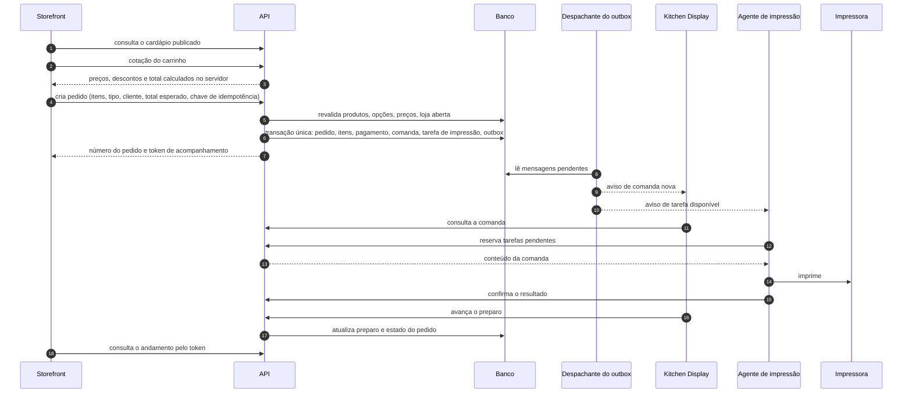
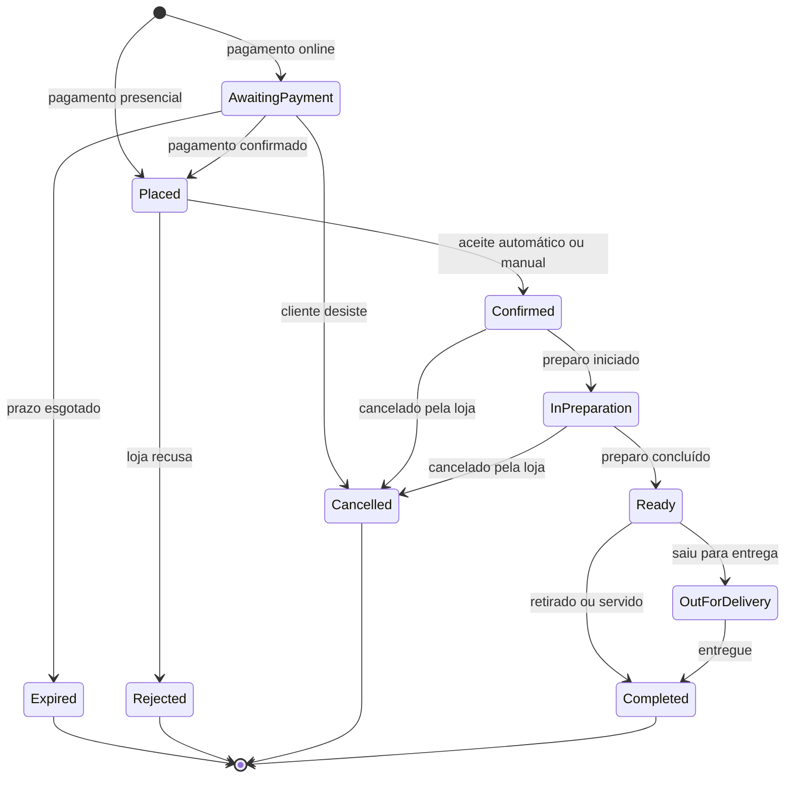
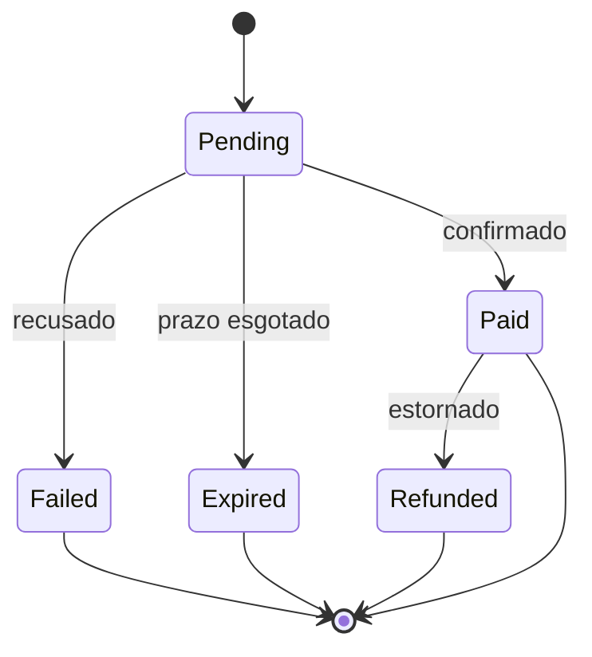
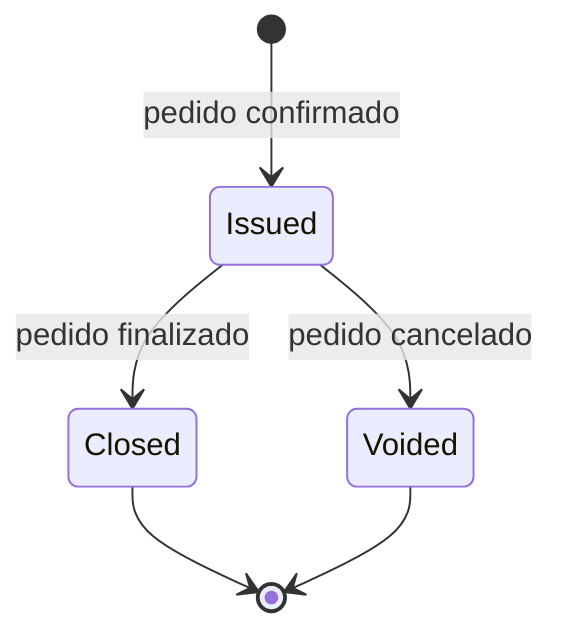
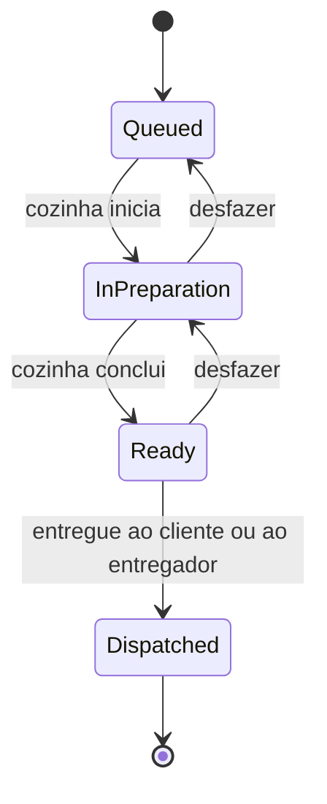
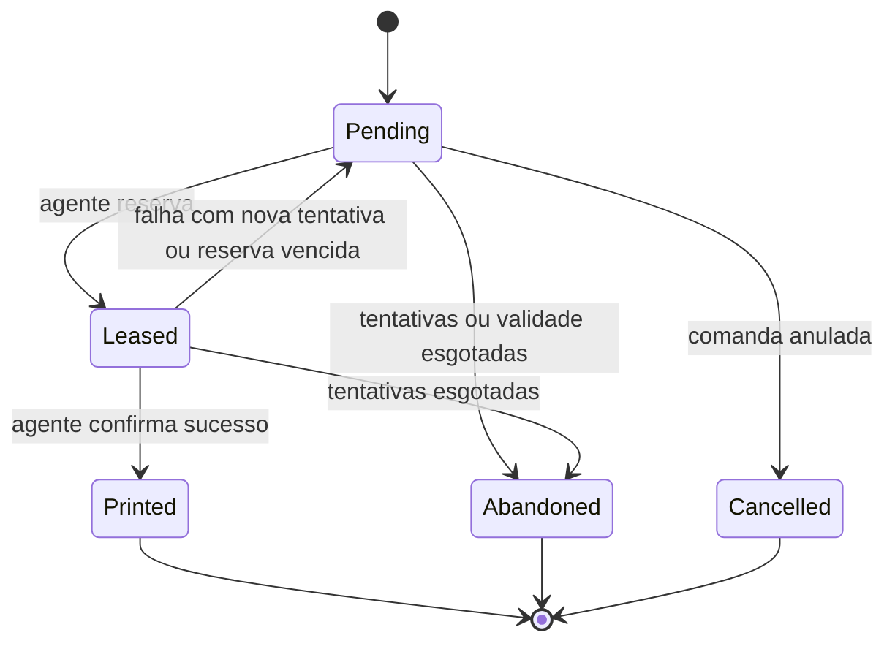
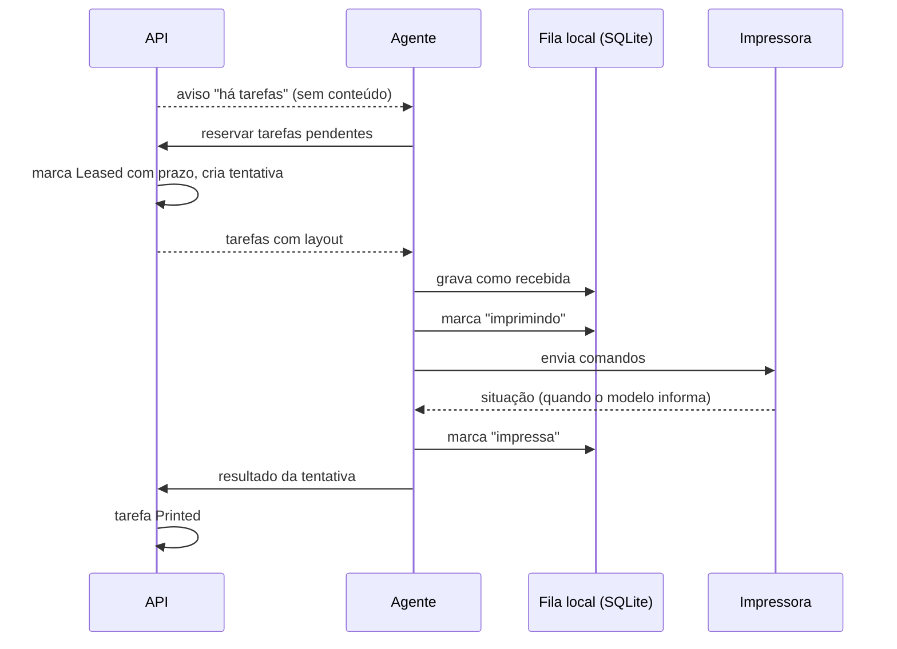
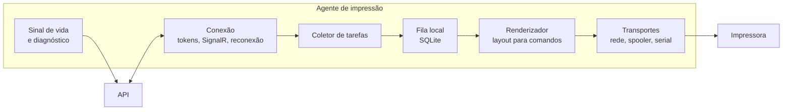

# Fluxo de pedidos, cozinha e impressão

> Status: **proposta para revisão** · Última revisão: 2026-10-11
> Decisões relacionadas: [ADR-0007](../adr/0007-consistencia-outbox-e-fila-em-tabelas.md), [ADR-0008](../adr/0008-tempo-real-com-signalr.md), [ADR-0009](../adr/0009-agente-de-impressao-local.md), [ADR-0011](../adr/0011-maquinas-de-estado-separadas.md), [ADR-0012](../adr/0012-snapshot-de-pedido-e-dinheiro.md)

> **Mudança de escopo em 2026-10-13.** O sistema passou a atender **uma única loja** ([ADR-0016](../adr/0016-uma-unica-loja.md)). Os trechos deste documento sobre vários estabelecimentos (`TenantId`, loja resolvida pelo endereço, isolamento entre lojas, Platform Admin, planos e assinaturas) não se aplicam mais e serão revisados. O restante continua valendo.

**Fato:** no protótipo, o pedido é criado no navegador, o status avança por um botão de simulação e a comanda é impressa com `window.print()`. Nada disso é reaproveitável como mecanismo; o que se aproveita é o conteúdo da comanda e os cinco passos exibidos ao cliente.

## 1. Princípios do fluxo

1. **O servidor decide preço e disponibilidade.** O cliente envia o que quer; o servidor diz quanto custa e se pode.
2. **Pedido confirmado implica comanda.** As duas coisas acontecem na mesma transação. Não existe pedido confirmado sem comanda.
3. **O painel da cozinha é a fonte de verdade; o papel é uma cópia.** Se a impressão falhar, a cozinha continua vendo o pedido na tela.
4. **Falha de impressão nunca trava um pedido.** Ela gera alerta, não bloqueio.
5. **Entrega "ao menos uma vez".** Com uma impressora física não existe "exatamente uma vez". O sistema prefere imprimir uma segunda via identificada a perder uma comanda.
6. **Avisos em tempo real são dicas; consultas são a verdade.** Nenhuma etapa depende de um aviso ter chegado.

## 2. Fluxo completo

O diagrama mostra o caso de pagamento presencial com aceite automático. Com pagamento online, a transação do passo 6 cria o pedido aguardando pagamento, e a comanda só nasce quando o pagamento é confirmado (seção 5).

## 3. As quatro máquinas de estado

**Decisão proposta** ([ADR-0011](../adr/0011-maquinas-de-estado-separadas.md)): pedido, pagamento, comanda/preparo e tarefa de impressão têm estados **separados**. Tratar tudo como um único "status" obrigaria, por exemplo, a decidir se um pedido com impressão falha está "em preparo" ou "com erro", quando as duas coisas são verdade ao mesmo tempo.

### 3.1 Pedido

Ciclo de vida comercial. É o que o consumidor vê.

| Estado | Rótulo para o consumidor (do protótipo) |
|---|---|
| `AwaitingPayment` | Aguardando pagamento (novo) |
| `Placed` | Pedido recebido |
| `Confirmed` | Pedido confirmado |
| `InPreparation` | Em preparação |
| `Ready` | Pronto |
| `OutForDelivery` | Saiu para entrega (novo, só delivery) |
| `Completed` | Finalizado |
| `Cancelled`, `Rejected`, `Expired` | Mensagens próprias (novo) |

### 3.2 Pagamento

Um pagamento presencial (dinheiro, cartão na maquininha, Pix no balcão) nasce `Pending` e **não bloqueia** a confirmação do pedido. Ele passa a `Paid` quando a loja registra o recebimento.

### 3.3 Comanda e preparo

A comanda tem **dois** campos de estado independentes.

**Documento** — se a comanda vale:

**Preparo** — em que ponto a produção está:

O preparo permite desfazer o último passo, porque toques errados em tela são comuns em cozinha. No MVP o preparo é da comanda inteira; com estações, passa a ser por estação.

### 3.4 Tarefa de impressão

Cada passagem por `Leased` gera um registro de **tentativa**, com resultado próprio: sucesso, falha (com motivo), reserva vencida ou resultado desconhecido.

### 3.5 Como as máquinas se influenciam

| Evento | Efeito |
|---|---|
| Pagamento → `Paid` | Pedido `AwaitingPayment` → `Placed` |
| Pagamento → `Failed` | Pedido continua `AwaitingPayment`; o cliente pode tentar de novo até o prazo |
| Pagamento → `Expired` | Pedido → `Expired` |
| Pedido → `Confirmed` | Comanda criada (`Issued`, preparo `Queued`) e tarefa de impressão criada (`Pending`) |
| Preparo → `InPreparation` | Pedido → `InPreparation` |
| Preparo → `Ready` | Pedido → `Ready` |
| Preparo → `Dispatched` | Pedido → `OutForDelivery` (delivery) ou `Completed` |
| Pedido → `Completed` | Comanda → `Closed` |
| Pedido → `Cancelled` | Comanda → `Voided`; tarefas pendentes → `Cancelled`; se a comanda já foi impressa, é criada uma tarefa de **aviso de cancelamento** |
| Tarefa de impressão, qualquer estado | **Nenhum efeito** em pedido ou preparo |
| Tarefa → `Abandoned` | Alerta no Kitchen Display e no Admin |

A última parte é a razão da separação: a impressão é observada, não é pré-requisito.

## 4. Criação do pedido e idempotência

### 4.1 Cotação

Antes de fechar, o Storefront envia o carrinho (identificadores de produtos e opções, quantidades, tipo de pedido) e recebe os valores calculados pelo servidor. A cotação não grava nada e pode ser chamada quantas vezes for preciso.

### 4.2 O que o cliente envia e o que o servidor ignora

| O cliente envia | O servidor **nunca** aceita do cliente |
|---|---|
| Identificadores de produtos e opções, quantidades, observações | Preços, descontos, taxas, totais |
| Tipo de pedido, dados do cliente, endereço | Identificador da loja |
| Forma de pagamento | Número ou estado do pedido |
| **Total esperado**, da última cotação | — |
| Chave de idempotência | — |

### 4.3 Passos no servidor

1. Resolver a loja pelo host. Verificar se está ativa, aberta e se aceita o tipo de pedido.
2. Consultar a chave de idempotência. Se já existe com a mesma requisição, devolver o pedido original.
3. Carregar do banco os produtos e opções citados, **da mesma loja**, ativos e disponíveis.
4. Validar as seleções contra os limites de cada grupo de opções.
5. Calcular preços a partir do banco; aplicar ofertas no fuso horário da loja; aplicar taxa de entrega; verificar o pedido mínimo.
6. Comparar o total calculado com o **total esperado**. Se forem diferentes, responder 409 `cart_changed` com a nova cotação e **não criar o pedido**.
7. Obter o próximo número de pedido da loja.
8. Em uma transação: gravar pedido, itens e opções com as cópias de nome e preço, pagamento, registro de idempotência e mensagens do outbox.
9. Se o pagamento for presencial e o aceite for automático, confirmar o pedido na mesma transação, o que cria a comanda e a tarefa de impressão.
10. Responder com número do pedido, token de acompanhamento e estado.

O passo 6 existe para que o cliente nunca pague um valor diferente do que viu. Se o preço mudou entre a cotação e o envio, ele é avisado e decide.

### 4.4 Pedido enviado mais de uma vez

- O Storefront gera uma chave de idempotência quando o cliente inicia a confirmação e a **reutiliza** em toda nova tentativa do mesmo checkout: toque duplo, repetição automática após tempo esgotado, recarregamento da página.
- O servidor guarda, por loja, a chave, um hash da requisição e o pedido resultante.
- Mesma chave e mesma requisição: devolve o pedido já criado, com o mesmo número.
- Mesma chave e requisição diferente: 422 `idempotency_key_reused`.
- Duas requisições simultâneas com a mesma chave: a restrição de unicidade deixa só uma gravar; a outra recebe o resultado da primeira.
- A chave é descartada pelo cliente apenas ao receber uma resposta definitiva.

### 4.5 Token de acompanhamento

O número do pedido é sequencial e previsível, portanto não serve como credencial. Cada pedido recebe um token aleatório longo, que é o que vai no link de acompanhamento. A consulta por token devolve **apenas** a visão do consumidor: número, estado, itens e total. Nunca a comanda.

## 5. Confirmação conforme pagamento e operação

| Cenário | Caminho |
|---|---|
| Pagamento presencial, aceite automático | Criado já como `Confirmed`. Comanda imediata. **Recomendado para o MVP.** |
| Pagamento presencial, aceite manual | Criado como `Placed`. A loja aceita ou recusa no Admin ou no Kitchen Display; sem resposta em um prazo configurado, o pedido é recusado automaticamente. |
| Pagamento online | Criado como `AwaitingPayment`. Vira `Placed` quando o gateway confirma, e segue um dos caminhos acima. |

Aceite automático ou manual é uma configuração da loja; o padrão é a pendência **DP-06**.

**Risco do pagamento presencial com aceite automático:** pedidos falsos custam ingredientes. Mitigações: limite de pedidos por origem, limite de valor para pedidos sem pagamento antecipado, aceite manual como opção da loja e, na evolução, confirmação do telefone.

### 5.1 Pagamento online

1. O pedido é criado como `AwaitingPayment`, com um pagamento `Pending` e um prazo.
2. Depois do commit, o backend cria a cobrança no gateway, usando o identificador do nosso pagamento como chave de idempotência.
3. O cliente recebe os dados para pagar (por exemplo, o código Pix).
4. O gateway notifica por webhook. O backend valida a assinatura, grava o evento na caixa de entrada, **consulta o estado real no gateway** e aplica a transição.
5. Com o pagamento confirmado, o pedido avança e a comanda é criada.

**Nenhuma comanda é criada antes de o pagamento online ser confirmado.**

## 6. Comanda e aviso à cozinha

- A comanda é criada pelo módulo Kitchen em reação ao evento de confirmação do pedido, **dentro da mesma transação**.
- Ela guarda uma cópia do que a cozinha precisa: número, tipo, identificação do cliente ou mesa, itens, opções em linguagem de cozinha ("SEM CEBOLA", "+ BACON"), observações. Esse conteúdo é imutável.
- Na mesma transação é gravada uma mensagem no outbox. Depois do commit, o despachante avisa o grupo da loja no hub `kitchen` e o Admin no hub `ops`.
- O aviso contém apenas tipo, identificador e versão. O Kitchen Display busca a comanda por HTTP.
- Se o aviso se perder, o painel ainda encontra a comanda na próxima consulta: ele reconsulta periodicamente e sempre que reconecta.

A comanda é um recurso interno. Ela só é servida pelas superfícies `kitchen` e `agent` (e `admin`, para reimpressão), todas autenticadas.

## 7. Tarefas de impressão

### 7.1 Avaliação de mecanismos

| Necessidade | Opções | Decisão proposta |
|---|---|---|
| Não perder o evento entre gravar e avisar | Avisar direto após o commit; **Outbox** | **Outbox.** Avisar direto perde o evento se o processo cair entre o commit e o envio. |
| Fila durável de impressão | Broker de mensagens; **tabela no banco** | **Tabela `PrintJob`.** Ela já precisa existir para histórico e reimpressão; usá-la como fila elimina um componente. |
| Entrega ao agente | Somente push; somente consulta periódica; **push como aviso e consulta como entrega** | **Combinação.** Push dá rapidez; a consulta garante entrega. |
| Novas tentativas | Sem limite; **limite com espera crescente e validade** | **Limite e validade.** Uma comanda impressa uma hora depois atrapalha mais do que ajuda. |

Um broker passa a fazer sentido se houver consumidores fora deste processo ou volume que o banco não acompanhe. Nenhum dos dois é esperado no horizonte do MVP.

### 7.2 Criação

- Para cada comanda emitida, é criada uma tarefa para cada impressora de destino. No MVP, a impressora padrão da loja.
- A tarefa é criada na mesma transação da comanda.
- O conteúdo da tarefa é um **documento de layout independente de impressora**: uma lista de linhas com texto e estilo (centralizado, negrito, tamanho duplo, separador, corte). Quem traduz para comandos da impressora é o agente.
- Se a loja não tiver impressora ativa, nenhuma tarefa é criada e o Kitchen Display é o único canal. Isso é um modo de operação válido.

### 7.3 Distribuição e reserva

- O agente **também** pede tarefas periodicamente (a cada poucos segundos) e sempre que reconecta. O aviso só encurta a espera.
- A reserva tem prazo. O servidor escolhe tarefas pendentes na ordem de criação, ignorando as já reservadas, e só entrega tarefas de impressoras daquele agente.
- Se o resultado não chegar antes do fim da reserva, um serviço em segundo plano devolve a tarefa a `Pending` e registra a tentativa como "reserva vencida".

### 7.4 Novas tentativas e validade

Valores sugeridos, todos configuráveis:

| Parâmetro | Sugestão |
|---|---|
| Duração da reserva | 60 segundos |
| Tentativas máximas | 5 |
| Espera entre tentativas | Crescente: 5 s, 15 s, 45 s, 2 min, 5 min |
| Validade de uma tarefa automática | 30 minutos |
| Sinal de vida do agente | A cada 30 segundos |
| Agente considerado offline | Após 90 segundos sem sinal |

Ao esgotar tentativas ou validade, a tarefa vira `Abandoned` e gera um alerta: "A comanda do pedido 1052 não foi impressa". A comanda continua no painel.

### 7.5 Reimpressão

- É sempre uma ação explícita de uma pessoa, no Kitchen Display ou no Admin, com permissão própria.
- Cria uma **nova** tarefa, com motivo "reimpressão", para a mesma comanda. O conteúdo é idêntico, com a marca **"2ª VIA"** no cabeçalho.
- É registrada na auditoria.

## 8. Agente de impressão

**Decisão proposta** ([ADR-0009](../adr/0009-agente-de-impressao-local.md)): um serviço .NET independente, instalado no computador da loja.

### 8.1 Por que um agente local

A API está na nuvem e a impressora está em uma rede privada, atrás de NAT. A API não consegue abrir conexão com a impressora. Algo dentro da rede da loja precisa buscar o trabalho.

| Alternativa | Avaliação |
|---|---|
| **Agente local em .NET** | Imprime sem ninguém clicar, mesmo com o navegador fechado; controla novas tentativas e situação da impressora. Exige instalação. **Recomendado.** |
| Impressão pelo navegador do Kitchen Display em modo quiosque | Sem instalação. Depende de a aba estar aberta, de configuração do navegador e não detecta falhas. Serve como **contingência**. |
| Acesso direto do navegador a USB ou serial | Sem instalação, mas restrito a alguns navegadores, depende de permissão manual e da aba aberta. |
| Impressoras com impressão em nuvem do fabricante | A própria impressora busca tarefas, sem agente. Exige modelos específicos, em geral mais caros. A fila `PrintJob` é compatível com esse modelo; pode ser um transporte adicional no futuro. |

### 8.2 Componentes

| Aspecto | Proposta |
|---|---|
| **Tecnologia** | .NET Worker Service, publicado como executável único e autossuficiente. |
| **Instalação** | Instalador para Windows que registra um Serviço do Windows com início automático e conta de serviço com privilégio mínimo. Linux é possível, como serviço do systemd, por ser a mesma base de código. |
| **Pareamento** | Na instalação, o agente pede o código de pareamento gerado no Admin. |
| **Autenticação** | Identificador e segredo próprios, trocados por tokens de curta duração. O segredo é guardado cifrado pelo sistema operacional. |
| **Comunicação** | Somente conexões **de saída**, HTTPS e WebSocket seguro, com validação de certificado. Nenhuma porta aberta na loja. |
| **Persistência local** | SQLite com as tarefas recebidas e seu estado. Sobrevive a reinício e queda de energia. Retenção de alguns dias, para detectar duplicatas. |
| **Logs** | Arquivos locais com rotação. Erros relevantes também seguem para o servidor junto com o sinal de vida. |
| **Diagnóstico local** | Comandos para ver situação, parear e imprimir teste. Se houver página de situação, ela escuta apenas no próprio computador. |
| **Sinal de vida** | Periódico, com versão do agente, situação de cada impressora, tamanho da fila local e último erro. |
| **Atualização** | Manual no MVP. O servidor recusa versões abaixo de um mínimo e o Admin avisa. Atualização automática com pacotes assinados é evolução. |
| **Versão de protocolo** | O agente informa a versão; o servidor mantém compatibilidade com a anterior. |

### 8.3 Protocolo de impressão: ESC/POS

- ESC/POS é o padrão de fato das térmicas, mas cada fabricante tem variações em página de código, corte, sinal sonoro e consulta de situação.
- O agente tem **perfis de impressora**: largura em colunas (80 mm ou 58 mm), página de código para acentuação, comando de corte, suporte a consulta de situação.
- Texto com acentos é o problema mais comum em português. Estratégia: usar a página de código do perfil; se o modelo não tiver uma adequada, imprimir o texto como imagem.
- Transportes previstos: rede (TCP), fila de impressão do Windows em modo bruto, e serial/USB.

> **Pendência DP-02.** O protocolo final, a página de código, a capacidade de informar falta de papel e o transporte dependem do modelo de impressora. Enquanto o equipamento não for definido, o desenvolvimento usa uma **impressora virtual** que grava o resultado em arquivo. Recomendação para o equipamento de referência: térmica de 80 mm, com guilhotina, ESC/POS e **interface de rede**, que é o transporte mais simples e o que melhor informa a situação da impressora.

### 8.4 Estados locais e duplicatas

No agente, cada tarefa passa por: recebida → imprimindo → impressa (ou falhou), mais a indicação de "resultado informado ao servidor".

| Situação ao iniciar ou receber uma tarefa | Ação |
|---|---|
| Tarefa já consta como impressa localmente | Não imprime. Informa o sucesso de novo. |
| Tarefa consta como recebida | Imprime normalmente. |
| Tarefa consta como "imprimindo" (o agente caiu no meio) | Resultado desconhecido. Informa isso ao servidor, que recoloca a tarefa na fila com a marca de **possível 2ª via**. |

O estado "imprimindo" é gravado **antes** de enviar à impressora. É isso que permite distinguir "nunca tentou" de "talvez tenha impresso".

## 9. Cenários de falha

| Cenário | Comportamento |
|---|---|
| **O pagamento demora** | O pedido fica `AwaitingPayment` até o prazo. O Storefront mostra a espera e consulta o estado. Nenhuma comanda é criada. |
| **O pagamento falha** | O pagamento vira `Failed`. O cliente pode gerar nova cobrança para o mesmo pedido até o prazo. Vencido o prazo, o pedido vira `Expired`. |
| **O pagamento chega depois de o pedido expirar** | O pagamento é registrado, o pedido **não** é reaberto, e é gerado um alerta para a loja decidir entre estornar ou atender. Estorno automático é evolução. |
| **O mesmo pedido é enviado mais de uma vez** | A chave de idempotência faz o servidor devolver o pedido original. Um só pedido, uma só comanda, uma só impressão. |
| **O webhook de pagamento chega repetido ou fora de ordem** | Repetido: reconhecido pelo identificador do evento e ignorado. Fora de ordem: o estado real é consultado no gateway, e transições inválidas são descartadas. |
| **A API está temporariamente indisponível** | *Storefront:* o envio falha com mensagem clara, o carrinho é preservado e a nova tentativa reutiliza a mesma chave. *Kitchen Display:* aviso de desconexão, último estado conhecido, reconexão automática e reconsulta. *Agente:* tenta de novo com espera crescente; as tarefas ficam guardadas no servidor. *Gateway:* reenvia webhooks conforme a sua política; o estado também é reconciliado por consulta. |
| **O agente perde a conexão** | As tarefas se acumulam como `Pending`. Sem sinal de vida por 90 segundos, o agente é marcado offline e o Kitchen Display e o Admin avisam. Ao voltar, o agente reserva o que está pendente, em ordem. Tarefas com validade vencida **não** são impressas em rajada: viram `Abandoned` e aparecem como alerta. |
| **A impressora está desligada ou sem papel** | Se o modelo informa a situação, o agente detecta antes de imprimir, informa falha com motivo, e a tarefa volta à fila com espera. O painel mostra o motivo. Se o modelo **não** informa, o envio parece bem-sucedido e a falha só é percebida pela ausência do papel: é para isso que existem a reimpressão e o painel. |
| **A impressão ocorreu, mas a confirmação se perdeu** | O agente tem a tarefa como impressa na fila local e reenvia o resultado até conseguir. Se a reserva vencer antes e a tarefa for reentregue, o agente reconhece o identificador, **não imprime de novo** e confirma. |
| **O agente cai durante a impressão** | Ao reiniciar, a tarefa está como "imprimindo". O agente informa resultado desconhecido; a tarefa é recolocada com a marca de possível 2ª via. |
| **Uma tarefa é reprocessada no servidor** | A criação é protegida por unicidade (comanda, impressora, motivo). Reprocessar o evento não cria outra tarefa. |
| **O despachante do outbox falha no meio** | A mensagem continua pendente e é entregue de novo. Os consumidores toleram repetição. |
| **A hamburgueria tem mais de uma impressora** | Cada impressora recebe a sua tarefa, com estado e tentativas independentes. A falha de uma não afeta a outra. No MVP todas as comandas vão para a impressora padrão; o roteamento por categoria (cozinha, bar, expedição) e o número de vias por impressora são evolução, e o modelo de dados já os comporta. Uma loja pode ter mais de um agente. |
| **A loja não tem impressora ou o agente não está instalado** | Nenhuma tarefa é criada. O Kitchen Display é o canal. |
| **O pedido é cancelado depois de impresso** | A comanda fica `Voided`, destacada no painel, e é impressa uma comanda de aviso de cancelamento. |

## 10. Garantias e limites conhecidos

| Garantia | Como |
|---|---|
| Um checkout gera no máximo um pedido | Chave de idempotência com unicidade no banco |
| Pedido confirmado sempre tem comanda | Mesma transação |
| Comanda sempre chega ao painel | Persistida; o painel consulta, não depende de aviso |
| Tarefa de impressão não se perde | Persistida no servidor e na fila local do agente |
| Cozinha nunca vê dados de outra loja | Isolamento por tenant em todas as camadas |
| Consumidor nunca vê comanda | Superfícies separadas; token de acompanhamento só dá a visão do consumidor |

| Limite | Consequência aceita |
|---|---|
| Impressão é "ao menos uma vez" | Em falhas raras pode sair uma segunda via, identificada como tal |
| Nem toda impressora informa falta de papel | Algumas falhas só são percebidas por pessoas; por isso o painel é a fonte de verdade |
| Avisos em tempo real podem se perder | Atraso de alguns segundos até a próxima consulta |
| Sem conexão com a internet, a loja não recebe pedidos novos | O sistema não opera offline; isso está fora do escopo |

## 11. Pendências que afetam este fluxo

| ID | Questão | Efeito |
|---|---|---|
| DP-02 | Modelo de impressora e conexão | Perfil ESC/POS, detecção de falhas, transporte |
| DP-03 | Pagamento online no MVP e gateway | Existência do estado `AwaitingPayment` na primeira versão; formato dos webhooks |
| DP-06 | Aceite automático ou manual como padrão | Estado inicial do pedido presencial |
| DP-11 | Escopo do delivery e pedido em mesa | Campos do pedido e cálculo da taxa |

Registro completo em [implementation-roadmap.md](implementation-roadmap.md#6-decisões-pendentes).
