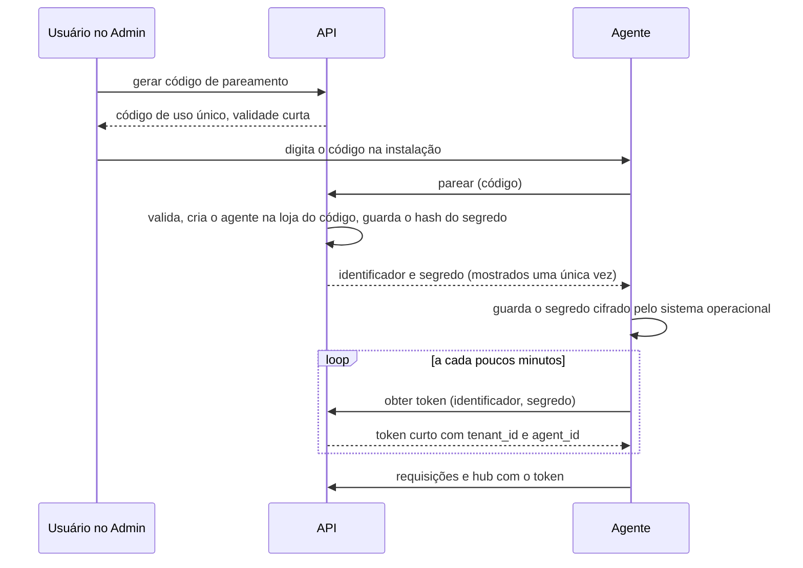

# Segurança

> Status: **proposta para revisão** · Última revisão: 2026-10-11
> Decisões relacionadas: [ADR-0003](../adr/0003-multi-tenancy-banco-compartilhado.md), [ADR-0004](../adr/0004-resolucao-de-tenant-por-host.md), [ADR-0010](../adr/0010-autenticacao-e-sessoes.md)

> **Mudança de escopo em 2026-10-13.** O sistema passou a atender **uma única loja** ([ADR-0016](../adr/0016-uma-unica-loja.md)). Os trechos deste documento sobre vários estabelecimentos (`TenantId`, loja resolvida pelo endereço, isolamento entre lojas, Platform Admin, planos e assinaturas) não se aplicam mais e serão revisados. O restante continua valendo.

**Fato:** o protótipo não tem autenticação, autorização, noção de tenant nem comunicação com servidor. Além disso, a comanda da cozinha está em uma rota pública da aplicação do consumidor. Tudo neste documento é proposta.

## 1. Princípios

1. **O servidor decide.** Ocultar um botão no frontend não é controle de acesso. Toda permissão, todo preço e todo tenant são verificados na API.
2. **Negar por padrão.** Um endpoint sem política declarada não compila nos testes de arquitetura. Uma consulta sem tenant não devolve nada.
3. **Menor privilégio.** Cada ator recebe apenas o que a sua função exige: o papel de cozinha não vê configurações; o agente só vê tarefas das suas impressoras; a aplicação conecta ao banco sem poder ignorar políticas.
4. **Defesa em profundidade.** O isolamento entre lojas tem quatro camadas independentes ([database-and-tenancy.md](database-and-tenancy.md#8-estratégia-multi-tenant)).
5. **Separação de superfícies.** Consumidor, loja, cozinha, plataforma e dispositivos usam hosts, rotas, sessões e contratos distintos.

## 2. Atores e mecanismos

| Ator | Como se identifica | O que pode | Superfície |
|---|---|---|---|
| **Consumidor** | Não se identifica no MVP. Cada pedido tem um token de acompanhamento. | Ver o cardápio, criar pedido, ver o próprio pedido pelo token. | `store` |
| **Proprietário / gerente** | E-mail e senha, sessão em cookie, segundo fator opcional. | Conforme o papel na loja ativa. | `admin` |
| **Operador de cozinha** | E-mail e senha, sessão longa em cookie. | Ver comandas, avançar preparo, reimprimir. | `kitchen` |
| **Operação da plataforma** | E-mail e senha com **segundo fator obrigatório**. | Dados globais; dados de loja só com acesso de suporte. | `platform` |
| **Agente de impressão** | Identificador e segredo do dispositivo, trocados por token curto. | Reservar e confirmar tarefas das próprias impressoras. | `agent` |
| **Gateway de pagamento** | Assinatura do webhook. | Entregar notificações. | `webhooks` |

## 3. Alternativas de autenticação

| Alternativa | Vantagens | Desvantagens | Avaliação |
|---|---|---|---|
| **ASP.NET Core Identity com cookies de sessão** | Token nunca fica acessível ao JavaScript; revogação simples; sem componente extra; integrado ao .NET. | Exige proteção contra CSRF; funciona melhor com API na mesma origem. | **Recomendada.** A API já é servida na mesma origem de cada interface. |
| JWT de acesso e de renovação guardados no navegador | Simples de consumir; sem estado no servidor. | Tokens ao alcance de qualquer script injetado; revogação difícil; renovação exige cuidado. | Não recomendada para as interfaces web. |
| Provedor de identidade externo (serviço gerenciado) | Segundo fator, login social e recuperação de conta prontos. | Custo por usuário, dependência externa, mais uma integração; o modelo de vínculo usuário–loja continua sendo nosso. | Desnecessária no MVP. Reavaliar se login social ou SSO virarem requisito. |
| Servidor OIDC próprio | Padrão aberto; serve a aplicações de terceiros. | Complexidade alta para quatro aplicações próprias. | Não se justifica. |

**Decisão proposta** ([ADR-0010](../adr/0010-autenticacao-e-sessoes.md)): Identity com cookies para pessoas; credencial de dispositivo com token de curta duração para agentes.

## 4. Sessões de pessoas

### 4.1 Cookies

| Atributo | Valor | Motivo |
|---|---|---|
| Prefixo do nome | `__Host-` | O navegador só aceita o cookie se for seguro, sem domínio e com caminho raiz. Um subdomínio de loja não consegue criar nem sobrescrever o cookie do painel. |
| `HttpOnly` | Sim | Inacessível ao JavaScript. |
| `Secure` | Sim | Só trafega em HTTPS. |
| `SameSite` | `Lax` | Não é enviado em requisições de outros sites que alteram estado. |
| Domínio | Não definido | Fica preso ao host exato. |

Cada superfície (painel, cozinha, plataforma) tem o seu host e, portanto, o seu cookie. Sair do painel não afeta a cozinha, e uma sessão de cozinha não vale no painel.

### 4.2 Duração

Valores sugeridos, a confirmar:

| Superfície | Inatividade | Duração máxima | Observação |
|---|---|---|---|
| Admin | 12 horas | 14 dias | Ações sensíveis pedem a senha de novo. |
| Kitchen | 30 dias | 90 dias | Dispositivo fixo, permissões restritas. |
| Platform | 1 hora | 8 horas | Segundo fator em todo login. |

### 4.3 Credenciais e recuperação

- Senhas armazenadas com o algoritmo de derivação do Identity. Requisito de comprimento mínimo, sem regras de composição arbitrárias; recusa de senhas sabidamente vazadas é evolução.
- Bloqueio progressivo após falhas de login, por conta e por origem.
- Mensagens de login e de recuperação não revelam se o e-mail existe.
- Recuperação de senha e convites usam tokens de uso único com validade curta.
- Trocar a senha, alterar o segundo fator ou revogar um vínculo invalida as sessões existentes.
- Segundo fator por aplicativo autenticador (TOTP): obrigatório na plataforma, opcional e recomendado para proprietários.

### 4.4 Loja ativa

- A sessão carrega a loja ativa. Ela é escolhida no login (se houver mais de uma) e trocada por uma chamada que **valida o vínculo no servidor** e reemite a sessão.
- A cada requisição, o servidor confirma que o vínculo ainda existe e que a loja está ativa, com cache curto.
- Nenhum endpoint das superfícies `admin` e `kitchen` aceita identificador de loja como entrada.

## 5. Dispositivos: agente de impressão

- O código de pareamento é curto, de uso único e expira em minutos. As tentativas de pareamento têm limite de taxa.
- O servidor guarda apenas o hash do segredo.
- O token dura pouco (sugestão: 15 minutos) e carrega a loja e o agente. É dele que o servidor tira o tenant; o agente não informa a loja.
- O escopo do token é restrito à superfície `agent`. Ele não serve em nenhuma outra.
- Revogar o agente no Admin invalida o segredo, encerra a conexão em tempo real e impede novos tokens. O acesso residual é, no máximo, a duração de um token.
- Um agente comprometido expõe as comandas **daquela loja** que passarem por ele, e nada mais. É o limite do dano.

## 6. Acesso de suporte da plataforma

Operadores da plataforma não têm acesso permanente a dados de lojas.

1. O operador abre um acesso informando a loja e o motivo.
2. O acesso tem prazo curto e é **somente leitura** por padrão. Acesso com escrita exige um papel de plataforma mais restrito.
3. Durante o acesso, as requisições rodam com o contexto daquela loja, pelos mesmos filtros de um usuário comum.
4. Cada ação é auditada com o operador real e a referência ao acesso.
5. O proprietário da loja consegue ver, no Admin, os acessos de suporte feitos à sua loja.

## 7. Autorização

### 7.1 Papéis e permissões

Os papéis são fixos e o mapa de papel para permissões fica no código.

| Papel na loja | Permissões |
|---|---|
| **Proprietário** | Tudo do gerente, mais equipe, assinatura e exclusão de dados. |
| **Gerente** | Catálogo, ofertas, pedidos, configurações da loja, impressoras. |
| **Cozinha** | Ver comandas, avançar preparo, reimprimir. Nada administrativo. |

| Papel na plataforma | Permissões |
|---|---|
| **Administrador** | Lojas, planos, assinaturas, usuários da plataforma, configurações globais, acesso de suporte com escrita. |
| **Suporte** | Leitura de dados globais; acesso de suporte somente leitura. |

Regras:

- **Papéis não se herdam entre superfícies.** Gerente não recebe automaticamente as permissões de cozinha, nem o contrário. Quem precisa das duas coisas tem os dois papéis.
- Papéis de plataforma e papéis de loja são tabelas diferentes. Não há caminho de um para o outro.
- Ninguém altera o próprio papel. Só um proprietário altera papéis, e a loja não pode ficar sem proprietário.

### 7.2 Como é aplicada

1. **Por rota no proxy.** Cada host só encaminha os prefixos da sua superfície. É uma camada de redução de exposição, não o controle principal.
2. **Por política no endpoint.** Todo endpoint declara a permissão exigida ou declara, explicitamente, que é anônimo.
3. **Por recurso.** Todo recurso solicitado por identificador é carregado dentro do tenant corrente. Se for de outra loja, a resposta é 404.
4. **Por estado.** Transições inválidas são recusadas mesmo para quem tem permissão.

## 8. Proteções da camada web

### 8.1 CORS

Como cada interface chama a API na própria origem, **nenhuma origem externa é liberada**. Não há política de CORS permissiva em nenhuma superfície. O host de webhooks não é usado por navegadores.

### 8.2 CSRF

Sessões em cookie exigem proteção contra requisições forjadas. `SameSite=Lax` não basta sozinho aqui, porque os subdomínios das lojas pertencem ao mesmo site que o painel.

Medidas combinadas, em toda requisição que altera estado nas superfícies com sessão:

- Token antifalsificação enviado em um cabeçalho próprio, que uma página de outra origem não consegue definir sem uma liberação de CORS que não existe.
- Verificação do cabeçalho `Origin` contra o host da própria superfície.
- Operações que alteram estado nunca usam `GET`.

A superfície `store` não tem sessão, portanto não há o que forjar. A criação de pedidos é protegida por limite de taxa e pela chave de idempotência.

### 8.3 Cabeçalhos

| Cabeçalho | Política |
|---|---|
| `Strict-Transport-Security` | Ativo em todos os hosts, com subdomínios. |
| `Content-Security-Policy` | Restritiva: scripts apenas da própria origem, sem código embutido; imagens da própria origem e do host de imagens; conexões apenas à própria origem. |
| `X-Content-Type-Options` | `nosniff`. |
| `Referrer-Policy` | Restrita, para o token de acompanhamento não vazar em links externos. |
| `frame-ancestors` (na CSP) | Nenhum, para impedir que as interfaces sejam embutidas em outras páginas. |

### 8.4 Limitação de taxa

| Alvo | Chave do limite | Objetivo |
|---|---|---|
| Criação de pedido | Origem e loja | Conter pedidos falsos e automação. |
| Cotação de carrinho | Origem e loja | Conter raspagem e abuso. |
| Consulta por token de acompanhamento | Origem | Conter tentativa de adivinhação. |
| Login | Conta e origem | Conter força bruta e reutilização de senhas vazadas. |
| Recuperação de senha e convites | Conta e origem | Conter enumeração e envio abusivo de e-mails. |
| Pareamento de agente | Origem e loja | Conter adivinhação do código. |
| Cota por loja | Loja | Impedir que uma loja degrade as outras. |

A origem da requisição é obtida do cabeçalho encaminhado pelo proxy de borda, aceito **apenas** quando vem do proxy confiável. Sem isso, o limite por origem seria contornável.

### 8.5 Envio de imagens

- Só imagens de produto e logotipo, por usuários com permissão.
- Tipo verificado pelo conteúdo, não pela extensão. Tamanho e dimensões limitados.
- A imagem é **recodificada** no servidor, o que descarta metadados e conteúdo embutido.
- **SVG não é aceito** em envios, por poder conter scripts.
- Armazenada com nome gerado e prefixo da loja; nunca com o nome original.
- Servida de um host separado, sem cookies.

**Fato relacionado:** as ilustrações atuais do protótipo são SVGs versionados em `public/img/produtos/`. Elas são arquivos do próprio projeto, não envios de usuários, e podem continuar como dados de demonstração.

## 9. Auditoria

Registro apenas de inclusão, separado dos logs técnicos, consultável pelo proprietário (para a própria loja) e pela plataforma.

| Evento auditado | Dados registrados |
|---|---|
| Login, falha de login, saída, troca de senha, mudança de segundo fator | Usuário, origem, resultado |
| Convite, mudança de papel, revogação de vínculo | Quem fez, quem foi afetado, antes e depois |
| Alteração de preço, de disponibilidade e de ofertas | Quem, item, antes e depois |
| Alteração de configurações da loja | Quem, campos alterados |
| Aceite, recusa, cancelamento e alteração manual de estado de pedido | Quem, pedido, de e para, motivo |
| Registro de recebimento e estorno de pagamento | Quem, pedido, valor |
| Reimpressão | Quem, comanda |
| Pareamento e revogação de agente | Quem, agente |
| Abertura, uso e encerramento de acesso de suporte | Operador, loja, motivo, ações |
| Criação, suspensão e reativação de loja; mudança de plano | Operador, loja, antes e depois |

Cada registro tem data e hora, ator (usuário, agente ou sistema), loja, origem e o identificador de rastreamento da requisição.

## 10. Gestão de segredos

- **Nenhum segredo no repositório**, em nenhum formato. O pipeline inclui varredura de segredos.
- Em desenvolvimento: mecanismo de segredos de usuário do .NET e arquivo de ambiente local ignorado pelo Git.
- Em homologação e produção: variáveis de ambiente injetadas pela plataforma de hospedagem ou por um cofre de segredos; segredos do pipeline no GitHub, por ambiente.
- Segredos distintos por ambiente. Credenciais do gateway de pagamento em modo de teste em homologação.
- Chaves de proteção de dados do ASP.NET Core (que cifram cookies e tokens) persistidas fora do contêiner, para que sessões sobrevivam a novas implantações.
- Rotação documentada para: senha do banco, credenciais do gateway, segredo de webhook, chaves de armazenamento.
- Se cada loja usar a própria conta no gateway de pagamento (DP-03), as credenciais dela ficam no banco **cifradas**, com a chave de cifragem guardada fora do banco. Elas nunca são devolvidas por nenhum endpoint depois de gravadas.
- No frontend não há segredos. Tudo que é entregue ao navegador é público.

## 11. Integrações externas: webhooks de pagamento

1. **Validar a assinatura** com o segredo do provedor antes de qualquer processamento. Assinatura inválida: 401, sem detalhes.
2. **Verificar a data** do evento, quando o provedor a assina, para recusar repetições antigas.
3. **Gravar o evento** na caixa de entrada com unicidade por provedor e identificador. Evento repetido: 200, sem reprocessar.
4. **Responder rápido** e processar depois.
5. **Não confiar no conteúdo.** O estado e o valor são consultados na API do gateway antes de alterar o pagamento.
6. **Conferir valor e moeda** contra o nosso pagamento. Divergência gera alerta, não confirmação.
7. **Descobrir a loja** pela referência do nosso pagamento, nunca por um campo do corpo do webhook. Se cada loja tiver a própria conta no gateway (DP-03), a URL do webhook traz um identificador opaco da integração, que seleciona o segredo usado para validar a assinatura; a referência do pagamento precisa pertencer à mesma loja.
8. **Aplicar a transição** de forma condicional ao estado atual.

O host de webhooks só expõe esses endpoints.

## 12. Privacidade e LGPD

O sistema trata dados pessoais de consumidores (nome, telefone, endereço) e de funcionários das lojas (e-mail).

- **Minimização.** O pedido coleta só o que o tipo de pedido exige: mesa para consumo local; nome para balcão; nome, telefone e endereço para delivery. O protótipo já segue essa lógica.
- **Finalidade.** Os dados do consumidor servem para atender o pedido. Qualquer uso para marketing exigirá consentimento próprio.
- **Retenção.** Dados pessoais de pedidos são anonimizados depois de um prazo; os valores do pedido permanecem para histórico.
- **Logs.** Dados pessoais não são gravados em logs.
- **Comanda.** Traz apenas o necessário para preparar e entregar.
- **Direitos do titular.** Deve existir um procedimento, ainda que manual no início, para atender pedidos de acesso e exclusão.
- **Backups.** Cifrados e com acesso restrito.

> **Pendência DP-09.** Papéis das partes (em princípio, a loja é controladora dos dados dos seus clientes e o SaaS é operador), prazos de retenção, termos de uso e política de privacidade precisam de validação jurídica antes da entrada em produção.

## 13. Modelo de ameaças

| Ameaça | Como apareceria aqui | Mitigação | Verificação |
|---|---|---|---|
| **Acesso a objeto de outro usuário (IDOR/BOLA)** | Trocar o identificador de um pedido, produto ou comanda na URL. | Todo recurso carregado dentro do tenant; 404 para o que é de outra loja; pedidos do consumidor só por token aleatório. | Varredura automática de endpoints com identificadores de outra loja. |
| **Acesso cruzado entre tenants** | Consulta sem filtro; chave de cache sem loja; grupo de tempo real errado. | Quatro camadas de isolamento; tenant nas chaves de cache, grupos e caminhos de arquivo. | Suíte de isolamento. |
| **Elevação de privilégio** | Cozinha chamando rota administrativa; usuário enviando `role` no corpo; convite para si mesmo como proprietário. | Política por endpoint; requisições com tipos explícitos; regras de alteração de papel; superfícies separadas por host. | Testes por papel em cada endpoint; teste de arquitetura de política obrigatória. |
| **Adulteração de preço** | Cliente altera valores no envio do pedido. | O servidor ignora valores do cliente e recalcula tudo. | Teste de integração enviando valores falsos. |
| **Webhook forjado ou repetido** | Alguém envia "pagamento confirmado"; o provedor reenvia o mesmo evento. | Assinatura, unicidade do evento, consulta do estado real, conferência de valor. | Testes com assinatura inválida, evento repetido e fora de ordem. |
| **Requisição forjada entre sites (CSRF)** | Página maliciosa aciona uma ação no painel de um gerente logado. | Token antifalsificação em cabeçalho, verificação de origem, `SameSite`. | Teste sem token e com origem diferente. |
| **Injeção de script (XSS)** | Nome de produto ou observação com HTML. | Conteúdo tratado como texto; nenhuma inserção de HTML bruto; CSP restritiva; SVG recusado em envios. | Revisão de código; teste com conteúdo malicioso. |
| **Interferência de sessão por subdomínio** | Uma loja tenta plantar ou sobrescrever o cookie do painel. | Cookies com prefixo `__Host-`; slugs reservados. | Teste manual na homologação. |
| **Injeção de comandos na impressora** | Observação com caracteres de controle que alteram a impressão. | Remoção de caracteres de controle na entrada; o agente escapa o texto ao renderizar. | Teste do renderizador com entradas maliciosas. |
| **Enumeração de pedidos** | Percorrer números sequenciais. | Consulta pública só por token aleatório longo; limite de taxa. | Teste de consulta por número na superfície pública. |
| **Pedidos falsos** | Pedidos em massa com pagamento na entrega. | Limite de taxa, limite de valor sem pagamento antecipado, aceite manual opcional; confirmação de telefone na evolução. | Teste de carga dos limites. |
| **Tomada de conta** | Senhas reutilizadas ou fracas. | Bloqueio progressivo, segundo fator, invalidação de sessões, mensagens que não revelam contas. | Teste de bloqueio. |
| **Roubo da credencial do agente** | Cópia do segredo do computador da loja. | Segredo cifrado pelo sistema operacional; escopo restrito a uma loja e à superfície do agente; revogação imediata. | Teste de revogação. |
| **Adivinhação do código de pareamento** | Tentativas repetidas. | Uso único, validade curta, limite de taxa. | Teste de limite. |
| **Exposição de informação interna** | Rastro de erro na resposta; comanda acessível ao consumidor; documentação administrativa pública. | Erros sem detalhe interno; comanda só nas superfícies internas; documentação restrita fora de produção. | Teste de respostas de erro; revisão das rotas publicadas. |
| **Envio de arquivo malicioso** | Arquivo executável ou imagem com script. | Verificação por conteúdo, recodificação, recusa de SVG, host separado sem cookies. | Teste com arquivos disfarçados. |
| **Falsificação do host** | Cabeçalho de host adulterado para se passar por outra loja. | O host original só é aceito do proxy confiável; a API não fica exposta diretamente. | Teste chamando a API sem passar pelo proxy. |
| **Slug enganoso** | Loja registrada como `painel-login` ou parecida com nomes do sistema. | Lista de slugs reservados; criação de loja é feita pela plataforma. | Revisão da lista. |
| **Injeção de SQL** | Entrada concatenada em consulta. | Consultas parametrizadas pelo ORM; SQL manual só por um ponto único revisado. | Análise estática; revisão. |
| **Vizinho barulhento** | Uma loja com tráfego anormal derruba as outras. | Cota por loja; limites de plano; tempo máximo por requisição. | Teste de carga. |
| **Abuso de acesso interno** | Operador consultando dados de lojas sem motivo. | Acesso de suporte com motivo, prazo e auditoria visível ao proprietário. | Revisão periódica da auditoria. |
| **Vazamento de segredo** | Credencial enviada ao repositório. | Varredura de segredos no pipeline; segredos fora do código; rotação. | Pipeline. |
| **Cadeia de dependências** | Pacote comprometido ou vulnerável. | Arquivos de bloqueio de versão; atualização automatizada; verificação de vulnerabilidades no pipeline. | Pipeline. |
| **Exposição de backup** | Cópia do banco acessível. | Backups cifrados, com acesso restrito e em local separado. | Revisão de permissões. |

## 14. Verificações de segurança antes de produção

- [ ] Suíte de isolamento entre lojas passando, incluindo as políticas do banco.
- [ ] Todo endpoint com política declarada; nenhum endpoint anônimo fora da lista esperada.
- [ ] Testes por papel cobrindo proprietário, gerente e cozinha em todas as rotas.
- [ ] Preço adulterado pelo cliente recusado ou ignorado.
- [ ] Webhook com assinatura inválida recusado; evento repetido sem efeito.
- [ ] Cookies com `__Host-`, `HttpOnly`, `Secure` e `SameSite` conferidos em homologação.
- [ ] Requisição que altera estado sem token antifalsificação recusada.
- [ ] Cabeçalhos de segurança presentes em todos os hosts.
- [ ] Limites de taxa ativos e testados.
- [ ] API inacessível sem passar pelo proxy de borda.
- [ ] Nenhum segredo no repositório nem no histórico.
- [ ] Documentação interativa da API desativada em produção.
- [ ] Restauração de backup testada.
- [ ] Pendência DP-09 resolvida.
